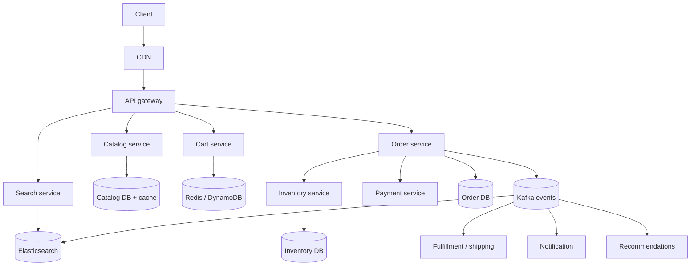
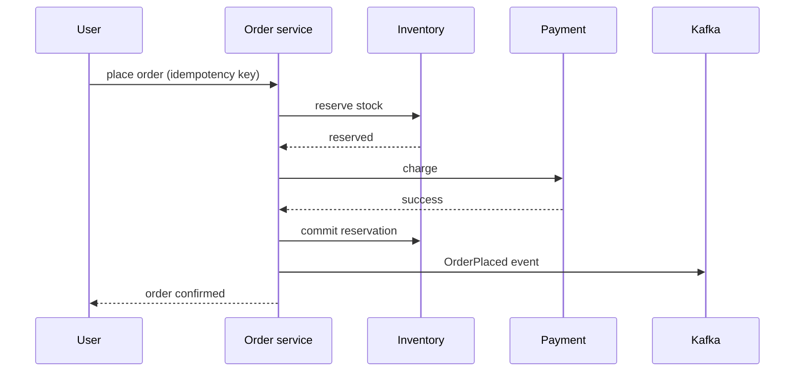

# Amazon (E-commerce Platform)

> [!info] Added
> The source doc only had the title "Design Amazon". This note is written from scratch and covers the **HLD** (services, data, consistency). Class-level design lives in the LLD problem "Online Shopping System", which is out of scope here.

## Requirements

**Functional**

- Browse and search the catalog; view product details.
- Cart: add/remove/update items.
- Checkout: address, payment, place order.
- Order tracking, cancellation, returns.
- Seller side: list products, manage inventory and prices.

**Non-functional**

- Highly available for browse/search (availability over consistency).
- **Strong consistency** for inventory decrement and payment (no overselling, no double charge).
- Low latency (product page under ~200 ms); scalable for sale events (10-50x traffic spikes).

### Estimates (example)

- 100M DAU, 10 page views per user: about 1B reads/day, about 12K reads/s average and about 100K/s at peak.
- 1M orders/day: about 12 orders/s average, with sale-day peaks 50-100x that.
- Reads vastly outnumber writes, so cache and read replicas on the browse path, and careful transactional writes on the order path.

## High-level design

## Catalog service

- Product (title, description, attributes, images, price, seller) in a document store or relational DB; images in object storage behind a CDN.
- Heavy read caching (Redis + CDN for static content). Product pages are mostly static and cache well.
- Price and availability change often; fetch these from the pricing/inventory services at render time or with short TTLs.

## Search

- Index products in **Elasticsearch/OpenSearch** via change events (CDC/Kafka) from the catalog DB.
- Features: full-text, filters/facets (brand, price, rating), sorting, autocomplete, typo tolerance, ranking by relevance + sales + rating.
- Search is eventually consistent with the catalog (a few seconds of lag is fine).

## Cart

- Per-user (or per-guest session) cart in Redis/DynamoDB with a TTL; low latency and high write rate.
- Cart stores `(product_id, qty)` only. **Price and availability are re-validated at checkout**, not trusted from the cart.
- Merge the guest cart into the user cart on login.

## Inventory

The hardest consistency problem: **don't oversell**.

- Inventory per `(sku, warehouse)` in a relational DB (or strongly consistent store).
- **Reserve** stock when the order is placed: `UPDATE inventory SET available = available - :q WHERE sku = :s AND available >= :q`. If 0 rows are updated, the item is out of stock.
- Reservation has a TTL (e.g. 10-15 min). If payment doesn't complete, release it. On payment success, convert the reservation into a committed decrement.
- **Hot SKU on sale day:** one row becomes a hotspot. Mitigate by splitting stock into N buckets (sharded counters; see [Sharded Counters](sharded-counters.md)), or by queueing requests for that SKU and processing them serially.

## Checkout and orders

- This is a **saga**: reserve inventory, charge payment, confirm. On failure, run compensating actions (release stock, refund). See [Payment System](payment-system.md) for idempotency and reconciliation.
- **Idempotency key** on place-order so retries/double-clicks don't create two orders.
- **Order DB:** relational, sharded by `user_id` (so "my orders" is a single-shard query). Order status: `CREATED → PAID → PACKED → SHIPPED → DELIVERED`, plus `CANCELLED`, `RETURNED`.
- An **outbox pattern** publishes the event atomically with the DB write, so no events are lost.

## Fulfillment

- Order events feed the warehouse management system: pick the warehouse (closest with stock), pick/pack, hand off to a courier.
- Shipment tracking updates flow back as events and update the order status; notifications are sent on each milestone.
- Delivery promise (ETA) is computed at checkout from warehouse, stock, and pincode serviceability.

## Recommendations (brief)

- Event stream (views, clicks, purchases) feeds offline jobs (collaborative filtering, "frequently bought together") and online ranking. Results are cached per user/product.

## Data stores summary

| Data | Store | Why |
|---|---|---|
| Catalog | Document DB / MySQL + cache + CDN | read-heavy, flexible schema |
| Search index | Elasticsearch | full-text, facets |
| Cart | Redis / DynamoDB | low latency, TTL |
| Inventory | Relational (ACID) | no overselling |
| Orders | Relational, sharded by user | transactions, history |
| Events | Kafka | decoupling, replay |
| Media | Object store + CDN | cheap, scalable |

## Scaling and failure handling

- **Sale events:** pre-warm caches and scale out ahead of time; rate-limit and queue checkout (a waiting room); degrade non-critical features (recommendations) first.
- **Graceful degradation:** if search is down, fall back to category browse; if the recommendation service is slow, skip it.
- **Payment timeouts:** the order stays `PENDING_PAYMENT`; a reconciliation job resolves it using the PSP's status.
- **Multi-region:** serve the catalog/search from the nearest region; keep inventory and orders in a home region per marketplace to preserve consistency.

> [!tip] Interview tips
> Split the system into a **read path** (catalog, search, cache; AP) and a **write path** (inventory, orders, payment; CP). Most of the interesting discussion is overselling, the checkout saga, and hot-SKU handling.
