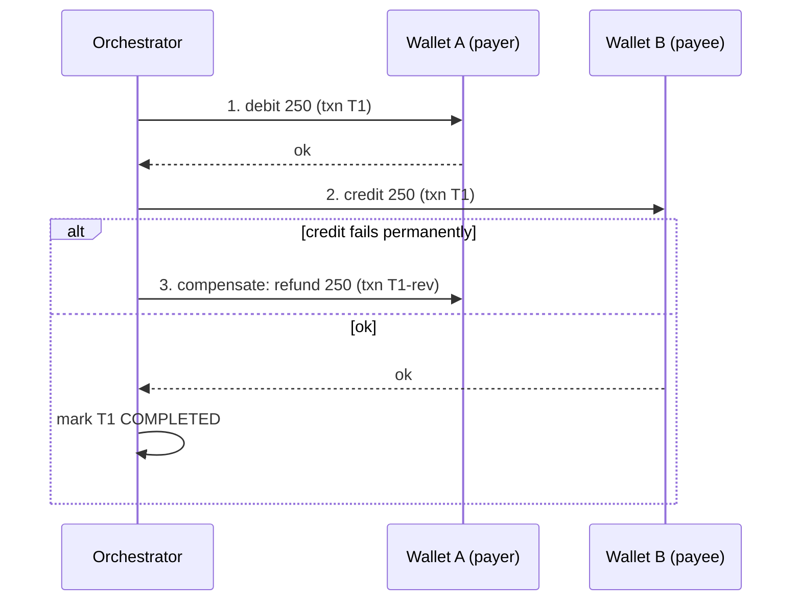
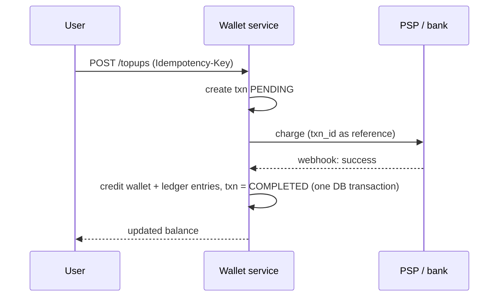

# Digital Wallet

> [!info] Added
> The original doc only had this pointer under "Consistency & correctness": *2 phase commit / 3 phase commit / saga pattern / event sourcing.* The rest of this note is written from general knowledge and expands those four ideas. For external card/bank payment flows see [Payment System](payment-system.md).

A digital wallet stores a user's balance and lets them **top up**, **pay merchants** and **transfer** money to other users. The core challenge is **correctness**: money must never be created, lost or double-spent, even with retries, crashes and concurrent requests.

## Requirements

**Functional**

- Create a wallet per user (single currency to start).
- Top up from a bank/card (via a PSP, see [Payment System](payment-system.md)).
- Transfer between wallets; pay a merchant.
- Withdraw to a bank account.
- Balance check and transaction history.

**Non-functional**

- **Strong consistency** for balances (no negative balance, no double spend).
- Exactly-once *effect* (at-least-once delivery + idempotency).
- High availability and durability; full audit trail.
- Reconciliation with external systems.

## Estimates (example)

- 10M active users, ~5 transactions per user per day => 50M tx/day => **~600 TPS average, ~3k TPS peak**.
- 1 transfer = 2 ledger entries (debit + credit), ~200 B each => ~20 GB/day of ledger data.
- Moderate TPS, but every operation must be correct, so favor correctness over raw throughput.

## Data model

Use a **double-entry ledger**: every movement is at least two immutable entries that sum to zero.

```text
wallet(wallet_id, user_id, currency, status, version)
transaction(txn_id, type, status, idempotency_key, created_at)
ledger_entry(entry_id, txn_id, wallet_id, direction[DEBIT|CREDIT], amount_minor, created_at)
balance(wallet_id, balance_minor, version)      // derived/cached view, not the source of truth
```

- Store money as **integer minor units** (paise/cents) or `DECIMAL`, never floating point.
- The ledger is **append-only**. Corrections are new entries (reversals), never updates or deletes.
- `balance` is a materialized view of the ledger, kept up to date in the same DB transaction, and can always be rebuilt by summing entries.

## API

```http
POST /v1/wallets/{id}/topups      { "amount": 500000, "source": "card_tok_123" }
POST /v1/transfers                { "from": "w1", "to": "w2", "amount": 25000 }
GET  /v1/wallets/{id}/balance
GET  /v1/wallets/{id}/transactions?cursor=...
```

All mutating calls require an `Idempotency-Key` header.

## Idempotency

Clients and internal services retry. Without protection, a retry would move money twice.

- Client sends a unique `Idempotency-Key` (UUID) per logical operation.
- Server stores `(key -> request hash, result)` with a **unique constraint** on the key, inside the same transaction as the ledger write.
- A repeated key returns the stored result; the same key with a different payload is rejected.
- Internal calls (saga steps, consumers) use the `txn_id` as their idempotency key.

## Balance consistency within one database

If wallets live in the same DB (or the same shard), use a **local ACID transaction**:

```sql
BEGIN;
-- lock rows in a consistent order (by wallet_id) to avoid deadlocks
SELECT balance FROM balance WHERE wallet_id IN ('w1','w2') ORDER BY wallet_id FOR UPDATE;
-- check sufficient funds
UPDATE balance SET balance_minor = balance_minor - 25000, version = version + 1 WHERE wallet_id = 'w1';
UPDATE balance SET balance_minor = balance_minor + 25000, version = version + 1 WHERE wallet_id = 'w2';
INSERT INTO ledger_entry ...;  -- debit and credit
INSERT INTO transaction ... ;  -- with idempotency_key (unique)
COMMIT;
```

- Alternative to row locks: **optimistic concurrency** with the `version` column (`UPDATE ... WHERE version = ?`) and retry on conflict.
- Add a `CHECK (balance_minor >= 0)` constraint as a safety net.
- Hot wallets (e.g. a big merchant) become a bottleneck. Mitigate by splitting into sub-accounts and batching credits (see [sharded counters](sharded-counters.md)).

## Distributed transactions (the original four options)

When the debit and credit live on **different shards/services**, a local transaction is not enough.

### Two-phase commit (2PC)

- A coordinator asks all participants to **prepare** (lock + vote), then **commit** or **abort**.
- Pros: atomic, strong consistency.
- Cons: blocking if the coordinator crashes while participants hold locks; lower availability and throughput; poor fit across services you don't own (e.g. a bank).

### Three-phase commit (3PC)

- Adds a **pre-commit** phase and timeouts to reduce blocking.
- Cons: more round trips, still not safe under network partitions, rarely used in practice.

### Saga pattern

- A sequence of **local transactions**, each with a **compensating action** if a later step fails.
- Orchestrated (a central coordinator drives steps) or choreographed (services react to events).
- Example transfer saga:



- Each step must be **idempotent** and retryable; compensations must be able to succeed (no "cannot refund" states).
- Prefer "debit first, then credit": a failure after the debit is fixed by a refund, and the money is never available twice.
- The intermediate state is visible (money is in-flight), so model it explicitly with a `PENDING` status or a transit/holding account.

### Event sourcing

- Instead of storing the current balance, store the **sequence of events** (`WalletCredited`, `WalletDebited`, ...) as the source of truth. The balance is a projection (fold of events).
- Pros: perfect audit trail, easy replay/rebuild, natural fit for the immutable ledger and for sagas, great for reconciliation and debugging.
- Cons: more complex reads (need projections/snapshots), event schema evolution, eventual consistency of read models.
- Use **optimistic concurrency per wallet stream** (expected version) to serialize writes, and snapshots every N events.

### Which to choose

| Approach | Use when |
|---|---|
| Local ACID transaction | Both wallets in one DB/shard (design for this as the fast path: shard so most transfers are same-shard). |
| 2PC | Few participants, all under your control, low contention. |
| Saga + idempotency | Cross-shard/cross-service or external parties (the usual answer). |
| Event sourcing (with CQRS) | Strong audit/replay needs; pairs well with sagas. |

## Flows

### Top-up (external -> wallet)



- Never credit before the PSP confirms. Treat the webhook as **at-least-once** and dedupe it (by PSP reference + txn_id).
- If the PSP call times out, the status is unknown. Query the PSP or wait for the webhook/reconciliation. Don't blindly retry the charge without an idempotency key.

### Wallet-to-wallet transfer

- Same shard: single ACID transaction above.
- Cross-shard: saga (debit -> credit -> complete/refund).

### Withdrawal

- Debit the wallet and move money to a **holding account** first, call the bank payout, then either finalize or reverse on failure.

## Reconciliation

- Periodically (e.g. daily) compare internal ledger against PSP/bank statements and between internal systems; classify mismatches (missing, duplicate, amount differs) and auto-fix or send for manual review via adjusting entries.
- Invariant checks: sum of all ledger entries = 0 (per currency), each wallet's `balance` equals the sum of its entries, no negative balances.
- Detect stuck `PENDING` transactions by age and resolve them (retry, query PSP, or reverse).

## Scaling

- Shard by `wallet_id` (consistent hash). Keep payer and payee on the same shard where possible; otherwise use the saga.
- Read replicas / cache for balance and history reads; the write path stays on the primary.
- Partition ledger tables by time and archive old entries to cheap storage; keep recent ones hot.
- Use Kafka for outbox events (notifications, analytics, fraud) via the **transactional outbox** pattern so events are never lost or duplicated relative to the DB commit.

## Security and compliance

- Strong auth + step-up (OTP/PIN) for transfers and withdrawals; rate limits and velocity checks.
- Fraud/risk scoring, KYC limits, AML monitoring, and wallet freeze capability.
- Encrypt data at rest/in transit; never store raw card data (use PSP tokens).
- Full audit logging; ledger is immutable.

## Trade-offs

| Decision | Pro | Con |
|---|---|---|
| Balance table + ledger together | Fast reads, always auditable | Must update both atomically |
| Pure event sourcing | Best audit/replay | More complexity |
| Saga over 2PC | Available, no long locks | Intermediate states and compensations to design |
| Sync debit/credit in one DB | Simplest and strongest | Limits sharding flexibility and creates hot-account contention |

## Interview tips

- Lead with correctness: integer money, double-entry ledger, idempotency keys, no negative balance.
- Show the progression: single-DB ACID -> cross-shard saga -> reconciliation as the safety net.
- Know why 2PC is usually avoided (blocking, availability) and where event sourcing and the outbox pattern help.
