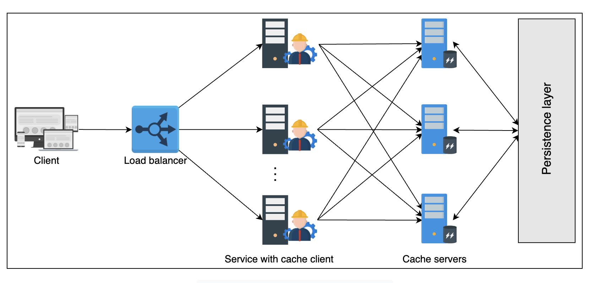
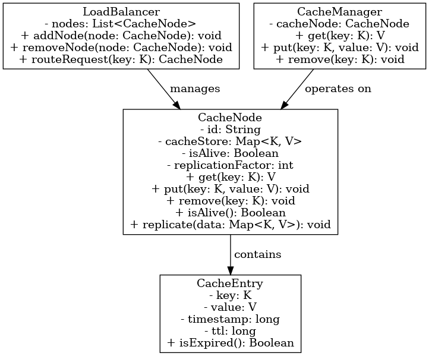

# Distributed Cache

## Problem statement

- A client requests the service.
- The service has a list of servers that can serve the requests.
- It has a database used by the service/servers.

Under normal circumstances this works fine, but as the number of users grows, database queries slow down.

RAM is generally used as cache storage because of the balance it gives between cost, performance and availability.

## What is a distributed cache?

A single server isn't enough for storage, so multiple servers coordinate to store frequently accessed data.

A cache relies on the **locality of reference** principle: a program accesses a particular set of data over a short period of time.

**Benefits**

- Minimizes client latency by storing frequently accessed data and precalculating results.
- Pre-generates expensive database queries.
- Stores user sessions temporarily.
- Serves data from temporary storage even when the database is down.
- Reduces network cost by serving data from local resources.

## Caching at different layers

| System layer | Technology in use | Usage |
|---|---|---|
| Web | HTTP cache headers, web accelerators, key-value store, CDNs | Accelerate retrieval of static web content, manage sessions |
| Application | Local cache and key-value data store | Accelerate application-level computations and data retrieval |
| Database | Database cache, buffers, key-value data store | Reduce data retrieval latency and I/O load on the database |

DNS-side caching is also done.

## Topics to cover

| Topic | Motivation |
|---|---|
| Writing policies | Data is written to both cache and database. The order has performance implications, so pick a policy suited to the cache. |
| Eviction policies | The cache lives on limited storage (RAM), so keep the most frequently accessed data and replace the rest. |
| Cache invalidation | Cached data can go stale; remove outdated entries. |
| Storage mechanism | A distributed cache has many servers: which entry goes on which server, and which data structure to use. |
| Cache client | A cache server stores entries, while a cache client calls the server to request data. |

## Writing policies

Where do we store data first, database or cache? Trade-offs:

- **Write-through:** writes to the cache and the database concurrently or one after another. Increases write latency but keeps cache and database consistent.
- **Write-back (write-behind):** writes to the cache first, then to the database asynchronously. Write latency is small, but inconsistency is inevitable when a client reads stale data from the database.
- **Write-around:** writes to the database only. The entry is written to the cache later, on a cache miss at read time. Not suitable for reading recently updated data.

## Eviction policies

A cache is fast partly because it's small, and a small cache has limited storage, so we need to evict less frequently accessed data. Well-known strategies:

- Least recently used (LRU)
- Most recently used (MRU)
- Least frequently used (LFU)
- Most frequently used (MFU)

## Cache invalidation

- **Active expiration:** a daemon process or thread actively checks the TTL of cache entries.
- **Passive expiration:** the TTL of an entry is checked when it is accessed.

## Storage mechanism

Storing data in a distributed cache isn't trivial since there are many servers. Two questions:

1. Which data (range of keys) is stored on which cache server?
2. Which data structure stores the data inside each cache server?

**1. Key placement:** use **consistent hashing** rather than simple hashing, since servers can be added or removed.

**2. Data structure inside a server:** a hash function only locates the entry; it says nothing about managing the cache. For LRU, use a **doubly linked list** together with a **HashMap**. Adding/removing is O(1): we evict from the tail or move an entry to the head, so no iteration is needed.

> [!note] Bloom filters
> Bloom filters are an interesting choice for quickly checking whether an entry is *definitely not* in the cache servers. A "present" answer is probabilistic. They're quite useful in large caching or database systems.

## Cache techniques

**Dedicated cache servers**

- Flexibility in hardware choices for each function.
- Independently scalable.

**Co-located cache**

- Lower latency.
- Scaling one service automatically scales the other.
- Lower cost.

## Cache client

A cache client is code residing in the hosting servers that does the (hash) computations to store and retrieve data on the cache servers. It may also coordinate with other components such as monitoring and configuration services.

- Each cache client knows about all the cache servers.
- Clients use well-known transport protocols such as TCP or UDP to talk to cache servers.

## Design

### Requirements

**Functional**

- Insert data (key, value).
- Retrieve data using the key.

**Non-functional**

- **Availability:** should be available, to reduce load on the database.
- **Scalability:** easy to scale.
- **Consistency:** consistent when clients use primary and secondary servers.
- High performance.
- Affordability.

### API design

```text
insert(key, value)
retrieve(key)
```

The API looks exactly like a key-value store. Differences between a key-value store and a distributed cache:

- A key-value store must durably store data (persistence). A cache is used in addition to persistent storage to increase read performance.
- A cache serves data from RAM. A key-value store writes data to non-volatile storage.
- Key-value stores are robust and should survive failures. Caches can crash and be repopulated from scratch after recovery.



### Detailed design

**Problem 1: how will clients know about the addition and removal of servers?**

1. A configuration file on the client side keeps the metadata and health of the servers. It can be updated manually through a devops tool.
2. Store the configuration files in a centralized place that clients can access. They still need to be updated manually.
3. Automatic: a **configuration service** continuously monitors the health of cache servers, and cache clients get notified when a new cache server joins the cluster (something like Redis Sentinel).

The configuration service has the highest operational cost and is the most complex, but it's the most robust.

**Problem 2: a single cache server for a set of entries is a SPOF. How to solve it?**

Add one primary and two backup nodes per cache shard. With replicas there's always a possibility of inconsistency. If replicas are in close proximity, writes to replicas are performed synchronously to avoid inconsistency between shard replicas.

Advantages:

- Improved availability in case of failures.
- Hot shards can have multiple nodes (primary-secondary) serving reads.

This improves both availability and performance.

**Problem 3: which data structures?**

- **Hash map:** the cache server uses a hash map to store and locate entries in RAM.
- **Doubly linked list:** to evict data, we need a list that orders entries by access recency/frequency.
- **Eviction policy:** depends on the application requirements.

### Summary

- Client requests reach the service hosts through the load balancers, where the cache clients reside.
- Each cache client uses consistent hashing to identify the cache server, then forwards the request to the server holding that shard.
- Each cache server has primary and replica servers. Internally every server uses the same mechanisms to store and evict entries.
- The configuration service ensures all clients see an updated, consistent view of the cache servers.
- Monitoring services can additionally log and report metrics of the caching service.

Design choices that contribute to good performance:

- Consistent hashing: finding a key takes O(log N), where N is the number of cache shards.
- Inside a cache server, keys are located with hash tables, constant time on average.
- LRU eviction uses constant time to access and update entries in a doubly linked list.
- Client-server communication over TCP/UDP is very fast.
- More replicas reduce the performance penalty of high request load on a single machine.
- Adding, retrieving and serving data from RAM gives very low latency.

## Memcached vs Redis

| Feature | Memcached | Redis |
|---|---|---|
| Low latency | Yes | Yes |
| Persistence | Possible via third-party tools | Multiple options |
| Multi-language support | Yes | Yes |
| Data sharding | Possible via third-party tools | Built-in solution |
| Ease of use | Yes | Yes |
| Multithreading | Yes | No |
| Data structures | Objects | Multiple data structures |
| Transactions | No | Yes |
| Eviction policy | LRU | Multiple algorithms |
| Lua scripting | No | Yes |
| Geospatial support | No | Yes |
| Automatic discovery | Yes | Yes (through Redis Sentinel) |

Memcached is preferred for smaller, simpler, read-heavy systems. Redis is useful for complex systems that are both read- and write-heavy.

> [!info] Added
> The doc's "Automatic discovery" row had the values swapped ("Yes (through Redis Sentinel)" under Memcached, "No" under Redis). Sentinel is a Redis feature, so the row above is corrected. Memcached discovery is client-side (e.g. AWS ElastiCache auto-discovery). Redis is also effectively single-threaded for command execution (I/O threads exist since 6.0).

## LLD



Classes (from the diagram):

- **LoadBalancer:** `nodes: List<CacheNode>`; `addNode`, `removeNode`, `routeRequest(key): CacheNode`. Manages the nodes.
- **CacheManager:** `cacheNode`; `get(key)`, `put(key, value)`, `remove(key)`. Operates on a node.
- **CacheNode:** `id`, `cacheStore: Map<K, V>`, `isAlive`, `replicationFactor`; `get`, `put`, `remove`, `isAlive()`, `replicate(data)`.
- **CacheEntry:** `key`, `value`, `timestamp`, `ttl`; `isExpired()`.

```java
class CacheEntry<K, V> {
    private K key;
    private V value;
    private long timestamp;
    private long ttl;

    boolean isExpired() {
        return System.currentTimeMillis() - timestamp > ttl;
    }
}
```

## Added: deep dives and interview points

> [!info] Added
> Everything below is supplementary and not from the original doc.

### Back-of-envelope estimation (example)

- 100M daily active users, 10 cache reads per user per day: ~1B reads/day, ~12K reads/s average, ~50K/s peak.
- Average entry 1 KB with 100M hot entries: ~100 GB, which fits across ~10 nodes of 16 GB (with replicas ×3, ~30 nodes).
- One Redis node handles roughly 50-100K ops/s, so throughput is rarely the bottleneck; memory is.

### Consistent hashing details

- Hash both servers and keys onto a ring. A key belongs to the first server clockwise from its hash.
- Use **virtual nodes** (e.g. 100-200 per server) to spread load evenly and make rebalancing smooth when a server is added or removed.
- Only about K/N keys move when a node joins or leaves (K keys, N nodes), unlike modulo hashing, which remaps almost everything.

### Cache read/write patterns

- **Cache-aside (lazy loading):** the app checks the cache, on a miss reads the DB and populates the cache. The most common choice; the cache holds only what is requested.
- **Read-through:** the cache itself loads from the DB on a miss.
- Pair write policies with read patterns: cache-aside + write-around/invalidate-on-write is the common default.

### Common failure modes

| Problem | What happens | Mitigation |
|---|---|---|
| Cache stampede / thundering herd | A hot key expires and many requests hit the DB at once | Request coalescing / per-key lock, jittered TTLs, refresh-ahead |
| Cache penetration | Requests for keys that never exist bypass the cache | Cache negative results with short TTL, Bloom filter |
| Cache avalanche | Many keys expire together or the cache goes down | Randomized TTLs, replicas, circuit breakers on the DB |
| Hot key | One key overloads a single shard | Local in-process cache, key replication (`key#1..n`), read replicas |
| Stale data | Cache and DB diverge | TTLs, invalidate on write, versioning, CDC-based invalidation |

### Replication and consistency

- Primary-replica with async replication gives low latency but replicas can serve stale reads. Sync replication gives stronger consistency at higher write latency.
- If the primary fails, a replica is promoted (Sentinel/Raft-style election). Writes acknowledged only on the primary can be lost in failover.
- For a cache, availability usually beats strict consistency: on a miss or failure, fall back to the DB.

### Trade-offs to state

- Dedicated vs co-located cache (cost and latency vs independent scaling).
- Write-through (consistent, slower writes) vs write-back (fast, risk of data loss) vs write-around (cache pollution avoided, cold reads).
- TTL length: short is fresher but has a lower hit rate; long has a higher hit rate but more staleness.
- Key metric to track: **hit ratio**, plus eviction rate, memory use and p99 latency.
