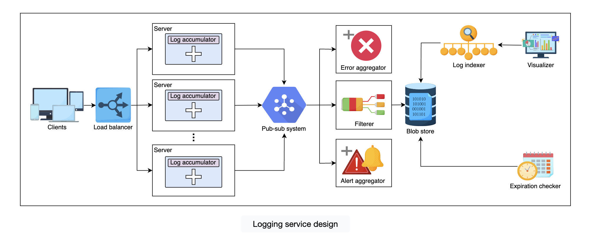
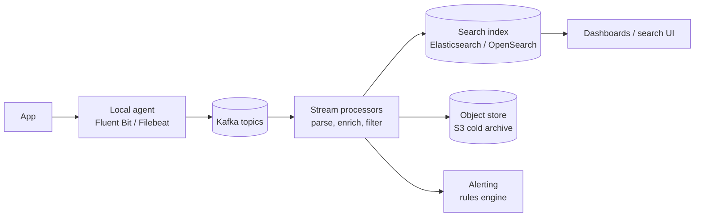

# Distributed Logging

> [!info] Added
> The original doc only contains the architecture diagram for this problem (no text). Everything except the diagram description below was added.

## Architecture (from the doc)

Flow in the diagram:

1. **Clients** send requests through a **load balancer** to a fleet of **servers**.
2. Each server runs a **log accumulator** that collects its logs and ships them to the **pub-sub system**.
3. Consumers of the pub-sub topic:
    - **Error aggregator:** picks out errors.
    - **Filterer:** filters/cleans logs and writes them to the **blob store**.
    - **Alert aggregator:** raises alerts on patterns.
4. The **log indexer** reads from the blob store and builds an index. The **visualizer** queries it to search and chart logs.
5. An **expiration checker** removes logs from the blob store once they pass their retention period.

## Requirements

**Functional**

- Collect logs from many services and hosts.
- Search logs by service, time range, level, request/trace id and free text.
- Alert on errors or patterns.
- Retain logs for a configurable period, then expire.

**Non-functional**

- **Low overhead** on the application: logging must never block or crash a service.
- **Scalable** to a very high write throughput; reads are far less frequent.
- **Reliable:** best-effort durability. Losing a few debug logs is acceptable, losing audit logs isn't.
- **Near real-time:** logs searchable within seconds.
- **Cost efficient:** log volume is large, so use tiered storage.

## Back-of-the-envelope

Assume 10,000 servers, each emitting 1 KB/s average (about 10 MB/s total, roughly 860 GB/day raw).

- Peak 5x gives ~50 MB/s ingest.
- 30 days of hot retention is ~26 TB, compressed ~5 TB (logs compress 5-10x).

## Pipeline design

### 1. Collection (agent)

- Log to **stdout/file**, never directly over the network, so the app isn't coupled to the logging backend.
- A lightweight **agent** per host (DaemonSet on Kubernetes) tails files, adds metadata (host, service, pod), batches and ships logs. It buffers on local disk when the backend is down.
- Use **structured logs** (JSON) with `timestamp`, `level`, `service`, `trace_id`, `message`.

### 2. Transport (message queue)

- Kafka decouples producers from consumers, absorbs spikes and lets multiple consumers read independently (see [Pub-Sub](pub-sub.md)).
- Partition by `service` or `host` so ordering is kept per source. Retain a few days for replay.

### 3. Processing

- Stream processors (Flink, Logstash, Vector) parse, enrich, redact PII, drop noise and sample.
- The **error aggregator** and **alert aggregator** in the diagram are consumers that count/aggregate errors in sliding windows and trigger alerts (e.g. error rate above X% in 5 minutes).

### 4. Storage (tiered)

| Tier | Store | Retention | Use |
|---|---|---|---|
| Hot | Elasticsearch/OpenSearch | 3-14 days | Interactive search |
| Warm | Cheaper nodes / compressed indices | 30-90 days | Occasional search |
| Cold | Object store (S3/GCS), Parquet | Months to years | Compliance, rare queries |

- Index by time (daily indices) so the **expiration checker** just drops whole indices or objects (cheap) instead of deleting documents.
- Use lifecycle policies (ILM) to move data between tiers automatically.

### 5. Query and visualization

- Search UI (Kibana/Grafana) queries the index by time range, service, level, `trace_id`.
- Searching by `trace_id` links logs across services for one request.

## Deep dives

### Backpressure and reliability

- The agent buffers locally and retries with backoff. If the buffer fills, drop the lowest-priority logs (debug) first. Never block the application thread.
- Use **at-least-once** delivery and de-duplicate with a log id if needed.
- Critical audit logs can go through a separate, durable path.

### Sampling and volume control

- Log levels per environment (`DEBUG` off in production).
- **Sampling** for high-volume, low-value logs (e.g. keep 1% of success access logs, 100% of errors).
- Rate-limit noisy services at the agent.

### Ordering and clocks

- Servers' clocks drift, so global ordering by timestamp is approximate. Order within a source by sequence number; across services rely on `trace_id` and span ids.

### Logs vs metrics vs traces

| Signal | Answers | Cost | Example |
|---|---|---|---|
| Logs | What happened (details) | High | Stack trace |
| Metrics | How much/how often (aggregates) | Low | Error rate, p99 latency |
| Traces | Where time went across services | Medium | One request through 8 services |

Alert on **metrics** (cheap, fast), and use **logs** and **traces** to debug.

### Security and compliance

- Redact PII and secrets before storage.
- Access control per service/team; audit who queries logs.
- Encrypt in transit and at rest; honor retention and deletion requirements.

### Trade-offs

- **Elasticsearch vs object store + query engine (Loki, Athena):** full-text index gives fast search but costs more; label-only indexing is cheaper but slower for free-text queries.
- **Push (agents) vs pull:** push is the standard for logs; pull works better for metrics (Prometheus).
- **Real-time vs batch:** streaming costs more but gives low-latency alerts.
