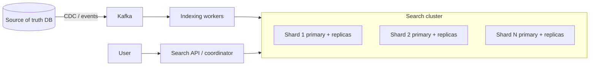
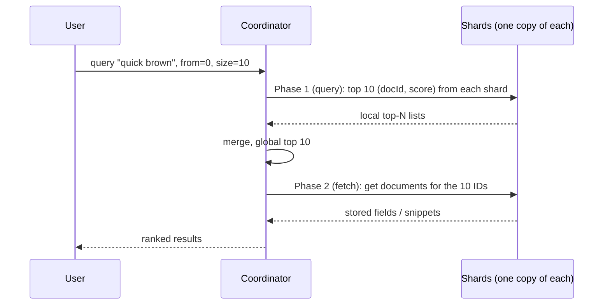

# Distributed Search

> [!info] Added
> The original doc had only the title for this problem. This note is written from general knowledge (Lucene/Elasticsearch-style design).

Design a search system that indexes a large corpus (documents, products, logs) and returns ranked results for free-text queries with low latency.

## Requirements

**Functional**

- Index documents (create, update, delete).
- Full-text search with ranking; filters and facets; pagination.
- Optional: autocomplete, highlighting, fuzzy matching (see [TypeAhead](typeahead-service.md) and [E-commerce search](ecommerce-search.md)).

**Non-functional**

- Low query latency (p99 ~100-200 ms).
- High availability; no single point of failure.
- Horizontally scalable for both data size and query rate.
- Near-real-time indexing (new docs searchable in ~1 s) is acceptable; strict read-after-write is not required.
- Eventual consistency between the source of truth and the index.

## Estimates (example)

- 1B documents x 5 KB = ~5 TB raw. Index ~ 1-2x raw size with compression => ~5-10 TB.
- A shard should stay around 10-50 GB (keeps recovery and merges manageable) => 200-500+ primary shards.
- 10k QPS peak. Each query fans out to all shards, so per-shard QPS = cluster QPS. Replicas add read capacity.

## Core concept: inverted index

Map each term to the list of documents containing it (a **postings list**).

```text
doc1: "the quick brown fox"
doc2: "quick brown dogs"

quick -> [doc1, doc2]
brown -> [doc1, doc2]
fox   -> [doc1]
dogs  -> [doc2]
```

- **Text analysis** before indexing and querying: tokenize, lowercase, remove stop words, stem/lemmatize, synonyms.
- A postings entry also stores term frequency, positions (for phrase queries) and offsets (for highlighting).
- AND queries intersect postings lists (sorted by doc ID, using skip lists); OR queries merge them.
- Lucene stores the index as immutable **segments**. New documents go into a new segment; deletes are marked in a bitmap; background **merges** combine segments and drop deleted docs.

## High-level design



- The **source of truth** is a database; the search index is a derived, rebuildable view.
- Changes flow through CDC/Kafka to **indexing workers**, which analyze documents and write to the right shard.
- A **coordinating node** receives queries and fans them out.

## Sharding

- Documents are split into **shards** by `shard = hash(doc_id) % num_shards` (Elasticsearch uses a routing hash). Shards are independent Lucene indexes.
- Fix the shard count up front (changing it needs a **reindex** or split/shrink API), so over-provision somewhat. Use consistent hashing or a shard-allocation table if you want smoother rebalancing.
- **Document partitioning (what ES does):** each shard holds a subset of docs and a complete index over them. Queries hit all shards. Simple, good write distribution.
- **Term partitioning:** each shard holds some terms for all docs. Queries touch only shards owning the query terms, but multi-term queries need cross-shard joins and hot terms create hot shards. Rarely used.
- Time-based data (logs) uses **time-based indices** (one per day/week) so old data can be dropped or moved to cheaper storage.

## Replication

- Each shard has 1 primary and N replicas on different nodes/racks/zones.
- Writes go to the primary, which forwards to replicas (in-sync set). Reads can hit any copy, which improves throughput and availability.
- A **transaction log** (translog/WAL) makes writes durable before the segment is flushed.
- On primary failure, a replica is promoted and the cluster manager re-allocates missing copies.

## Query flow (scatter-gather)



1. The coordinator picks one copy (primary or replica) of every shard (load balancing, adaptive replica selection).
2. **Query phase:** each shard returns only `(docId, score)` for its local top `from + size`.
3. Coordinator merges into a global top-N.
4. **Fetch phase:** retrieves the full documents for just those IDs.

Deep pagination is expensive (each shard must return `from + size` entries). Use `search_after` / cursors instead of large offsets.

## Ranking

- **TF-IDF / BM25:** term frequency (saturating), inverse document frequency, and field-length normalization. BM25 is the Lucene default.
- IDF is computed per shard by default, which can skew scores on small or uneven shards. A "distributed frequency" pre-phase can fix this but costs an extra round trip.
- Add signals: field boosts (title > body), freshness, popularity/CTR, personalization.
- Two-stage ranking: cheap retrieval (BM25) -> re-rank top ~100-1000 with a learning-to-rank model.

## Near-real-time indexing

- Writes go into an in-memory buffer + translog. A periodic **refresh** (default ~1 s) creates a new searchable segment. A **flush** persists segments and truncates the translog.
- Trade-off: a shorter refresh interval gives fresher search but produces more small segments and more merge work.
- For bulk loads, raise the refresh interval or disable replicas, then restore.

## Caching

- **Query/filter cache** for frequent filters (bitsets), **request cache** for whole shard-level results, and OS page cache for segments (keep enough RAM free for it).
- Coordinator-level result cache for popular queries (short TTL).

## Failure handling

| Failure | Handling |
|---|---|
| Node down | Replicas serve reads; the cluster promotes a replica and re-creates missing copies. |
| Slow shard | Timeouts and partial results (flag `partial=true`); hedged requests to another replica. |
| Cluster manager down | Elect a new one (quorum of master-eligible nodes, avoids split-brain). |
| Bad deploy/mapping change | Build a new index, then flip an **alias** atomically (zero-downtime reindex). |
| Index corruption/loss | Rebuild from the source of truth (it is the system of record). |

## Trade-offs

| Choice | Pro | Con |
|---|---|---|
| Document partitioning | Even writes, simple | Every query hits all shards |
| More shards | More parallelism | More overhead per query; harder merges |
| More replicas | More read capacity and HA | More storage and write cost |
| Short refresh interval | Fresh results | More segments/merge IO |
| Search as a derived index | Rebuildable, decoupled | Eventual consistency with the source DB |

## Interview tips

- Start from the inverted index, then explain sharding (document partitioning), replication and the two-phase scatter-gather query.
- Mention that search is a **secondary, derived store** fed by CDC, and use index aliases for zero-downtime reindexing.
- Call out deep pagination, shard sizing, and the NRT refresh trade-off.
