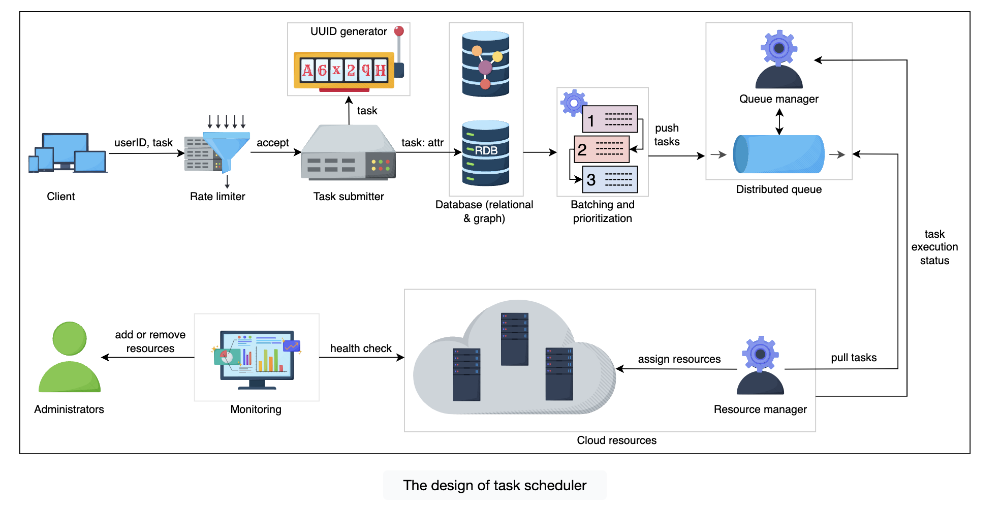

# Distributed Task Scheduler

## Requirements

**Functional**

- Submit a task
- Cancel a task
- Prioritization of tasks
- Efficient resource utilization: don't assign large resources to small tasks
- Release resources after a task is removed
- Fetch task status
- Notification on completion of a task

**Non-functional**

- Scalable and available
- Tasks should be durable so they don't get lost
- Fault tolerant
- Bounded waiting time: notify if the time is breached

> [!info] Added
> **Delivery semantics:** at-least-once execution, so tasks should be **idempotent** (or carry an idempotency key). Exactly-once execution isn't achievable across arbitrary workers.
>
> **Estimates (example):** 100M tasks/day is about 1.2K tasks/s average, with peaks 5-10x. At ~1 KB metadata per task that's about 100 GB/day of metadata, so archive or TTL completed tasks.

## Use cases of a task scheduler

A critical component for getting work done efficiently. Used in multiple places:

- **Local OS task scheduler:** many processes and tasks contend for a node's limited compute resources, so the OS scheduler assigns them efficiently.
- **Cloud computing services:** many distributed resources and tasks from multiple tenants. A scheduler is needed to use cloud resources efficiently and meet tenants' demands.
- **Large distributed systems** (Facebook, Amazon): behind a single request there are multiple tasks. It doesn't make sense to block the user, so these tasks run asynchronously via a scheduler.

## Why a queue for incoming tasks?

- We might not have enough resources right now.
- There is a task dependency: some tasks must wait for others.
- We need to decouple the client from task execution, so clients hand off their work and the system queues it for execution.

## Design



When a task comes in it should carry information about the resources it needs.

- **Resource requirements:** the task can specify the number of cores, memory and disk. Since it's hard for clients to specify these exactly, a **tiering** approach (small/medium/large) can be used.
- **Dependency:**
    - Dependent tasks: sequential execution.
    - Independent tasks: parallel execution.

### Components

- **Clients:** individuals or organizations, from small to large businesses, who want to execute their tasks.
- **Rate limiter:** the resources available to a client depend on what they pay. It's important to limit the number of tasks for the reliability of the service, e.g. N tasks per hour are allowed to enter the system. Others get a "Limit exceeded" message instead of the task being accepted and answered late. The limit is based on the client's subscription. See [Rate Limiter](rate-limiter.md).
- **Task submitter:** admits the task if it passes the rate limiter. There isn't a single submitter; a cluster of nodes admits the growing number of tasks.
- **Unique ID generator:** assigns unique IDs to newly admitted tasks.
- **Database:** all tasks taken by the submitter are stored in a distributed database. For each task we have some attributes, and all except one are stored in the relational database.
    - **Relational database (RDB):** stores task ID, user ID, required resources, execution cap, total attempts made by the client, delay tolerance, etc.
    - **Graph database (GDB):** a non-relational database using a graph structure. Used to build and store a **DAG of dependent tasks**, topologically sorted by the task submitter, so tasks can be scheduled according to the DAG.
- **Batching and prioritization:** after tasks are stored in the RDB they are grouped into batches. Prioritization is based on task attributes such as delay tolerance or a short execution cap. The top K priority tasks are pushed into the distributed queue.
- **Distributed queue:** a queue plus a queue manager.
    - The queue manager adds, updates or deletes tasks in the queue and tracks the types of queues in use.
    - It keeps a task in the queue until it executes successfully. If execution fails, the task is made visible in the queue again.
    - It knows which queue to run in peak vs off-peak time.
    - It deletes a task from the queue on success, makes it visible on failure, and retries up to the allowed number of attempts.
- **Resource manager:** knows which resources are free. It pulls tasks from the distributed queue and assigns them resources. It tracks the execution of each task and sends statuses back to the queue manager. If a task goes beyond its promised/required resource use, it is terminated, and the status goes back to the task submitter, which notifies the client with an error message.
- **Monitoring service:** checks the health of the resource manager and the resources. If a resource fails, it alerts admins to repair it or add new ones. If resources are unused, it alerts admins to remove or power them off.

### Task schema

| Field | Notes |
|---|---|
| `taskId` | |
| `userId` | |
| `schedulingType` | Daily / Monthly / Weekly / Adhoc |
| `totalAttempts` | |
| `resourceRequirements` | small / medium / large tier |
| `delayedTolerance` | how much delay we can sustain before starting the task |
| `executionCap` | maximum time allowed for execution |
| `TaskStatus` | |
| `scriptPath` | |

### Queueing

Different queues for different kinds of tasks under the queue manager. For example:

- Tasks that can't be delayed
- Tasks that can be delayed
- Tasks that need to be executed periodically
- Tasks which can run during off-peak hours

## API design

> [!info] Added
> ```text
> POST   /v1/tasks                 body: {script_path, resources_tier, schedule, priority, depends_on[], idempotency_key}
>                                  -> 202 {task_id}
> GET    /v1/tasks/{task_id}       -> {status, attempts, started_at, finished_at, error}
> DELETE /v1/tasks/{task_id}       -> cancel (best effort if already running)
> ```
> Use `Idempotency-Key` on submit so client retries don't create duplicate tasks.

## Task state machine

> [!info] Added
> ```mermaid
> stateDiagram-v2
>     [*] --> SUBMITTED
>     SUBMITTED --> QUEUED: batched/prioritized
>     QUEUED --> RUNNING: resource assigned
>     RUNNING --> SUCCEEDED
>     RUNNING --> FAILED: error / cap exceeded
>     FAILED --> QUEUED: attempts left (backoff)
>     FAILED --> DEAD: attempts exhausted
>     QUEUED --> CANCELLED
>     RUNNING --> CANCELLED
> ```

## Deep dives

> [!info] Added
> - **Scheduled/periodic tasks:** keep a time-indexed store (e.g. next_run_at with an index, or a time-wheel/delay queue). A scheduler tick selects `next_run_at <= now` and enqueues them; recompute `next_run_at` from the cron on completion.
> - **Avoiding double execution:** workers take a **lease** (visibility timeout) on a task and must heartbeat. If the lease expires the task is re-queued. Pair with idempotent tasks or a fencing token.
> - **Priority starvation:** age tasks (increase priority with wait time), and enforce per-tenant quotas so one tenant can't starve others (fair share).
> - **Bounded waiting time:** track `enqueue_time`; if wait exceeds `delayedTolerance`, escalate priority and notify the client.
> - **Failure handling:** retry with exponential backoff and jitter, then a dead letter queue. Persist state before acking so a crashed scheduler can recover.
> - **Scheduler HA:** run multiple schedulers; shard the task space (by task ID hash) or use leader election (ZooKeeper/etcd) for the periodic tick.
> - **DAG execution:** a task becomes runnable when all parents are SUCCEEDED; on failure, mark downstream tasks as blocked/cancelled per policy.
> - **Real systems for reference:** Airflow, Kubernetes Jobs/CronJobs, Quartz, Temporal.
