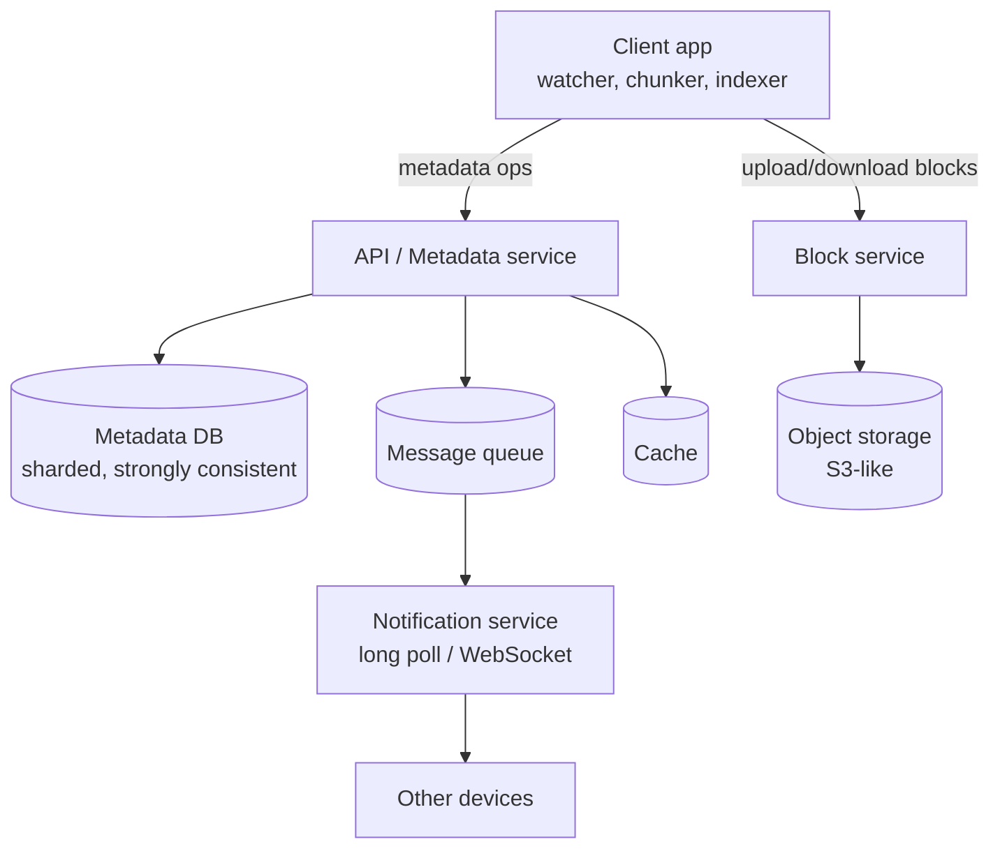
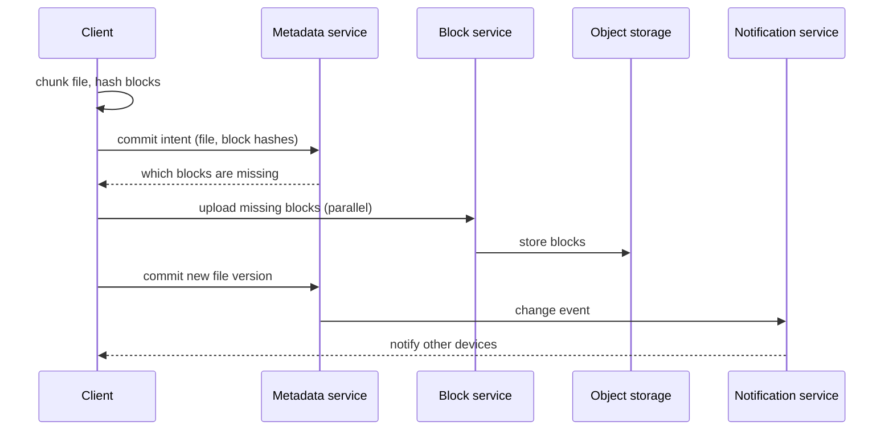

# Dropbox / Google Drive

> [!info] Added
> The doc only has the title for this problem. The whole note below was written from general system design knowledge.

A cloud file storage and sync service: users upload files, access them from multiple devices, and share them. For the LLD view see the file storage and sharing problem in the LLD section.

## Requirements

**Functional**

- Upload and download files from any device.
- Automatic **sync** across a user's devices.
- Share files/folders with other users (view/edit permissions).
- File **versioning** and history/restore.
- Offline edits that sync when back online.
- Notifications of changes on other devices.

**Non-functional**

- **Reliability and durability:** never lose a file (11 nines durability via replication/erasure coding).
- **Consistency:** a user must see a consistent view of their files; strong consistency for metadata.
- **Low bandwidth usage:** sync only what changed.
- **Fast sync** (seconds), **scalable** to hundreds of millions of users.
- Large files (GBs) supported.

## Back-of-the-envelope

- 500M users, 100M DAU, each with 10 GB stored on average. That's 5 EB of raw capacity before replication, so storage cost dominates.
- Assume 2 file changes per user per day: `100M * 2 / 86400` ~= 2.3k sync QPS (average) and ~10k peak.
- Average file ~1 MB, split into 4 MB blocks, so most files fit in one block and large files are many blocks.

## High-level design

### Components

- **Client:** watches the local folder, splits files into blocks, hashes them, compresses/encrypts, and syncs. Keeps a local metadata DB.
- **Block service (upload/download):** receives blocks, stores them in object storage, de-duplicates by hash.
- **Metadata service + DB:** file tree, file/version/block mapping, permissions, devices. Strongly consistent (SQL, sharded by `user_id`/`namespace_id`).
- **Object storage:** blocks stored immutably, addressed by hash (content-addressable).
- **Notification service:** tells other devices that something changed (long polling or WebSocket).
- **Sync/queue:** change events fan out to the user's devices and to people the file is shared with.

## Core ideas

### Chunking

- Split each file into fixed-size blocks (e.g. 4 MB), or use **content-defined chunking** (rolling hash) so an insert in the middle of a file doesn't shift every later block.
- Each block is identified by its **SHA-256 hash**.
- On edit, only **changed blocks** are uploaded (delta sync). A 1 GB file with one edit uploads about 4 MB.
- Block upload is parallel and resumable.

### Deduplication

- Before uploading, the client sends block hashes; the server replies with the ones it **doesn't already have**. Only those are uploaded.
- Dedup works within a user, and across users (global dedup saves a lot of space, but has privacy implications: it can reveal that someone else has the same file, so many services dedup per-user or use convergent encryption carefully).

### Metadata model

| Table | Key fields |
|---|---|
| `users` | `user_id`, quota |
| `devices` | `device_id`, `user_id`, `last_sync_cursor` |
| `files` / `namespace` | `file_id`, `parent_id`, `name`, `latest_version`, `is_deleted` |
| `file_versions` | `file_id`, `version`, `block_list[hashes]`, `size`, `modified_at` |
| `blocks` | `hash`, `storage_location`, `ref_count` |
| `shares` / `acl` | `file_id`, `principal`, `permission` |

### Upload flow

### Sync flow

1. Another device is told (via long poll/WebSocket) that there are changes since its cursor.
2. It fetches the metadata diff since its `last_sync_cursor`.
3. It downloads only the blocks it doesn't already have, then reassembles the file locally.

### Conflict resolution

- Two devices edit the same file offline. The first commit wins and becomes the next version; the second commit is rejected because its base version is stale.
- The losing client keeps both: it saves its copy as a **conflicted copy** (`report (John's conflicted copy).docx`) and lets the user merge manually. Dropbox does this. (Google Docs-style real-time merge needs [OT/CRDT](google-docs.md).)
- Use optimistic concurrency with a version number or ETag on every commit.

### Versioning

- Every commit creates a new version row pointing to a list of blocks. Old blocks stay while any version references them (`ref_count`).
- Retain N versions or N days; a garbage collector deletes blocks with `ref_count = 0`.

### Sharing and permissions

- ACLs on files/folders with inheritance. Shared folders appear in each member's namespace.
- Share links: random unguessable token, optional expiry and password.

### Storage layer

- Replicate blocks across zones, or use **erasure coding** (e.g. 10+4) for cold data to cut storage overhead from 3x to ~1.4x.
- Tier by access: hot (SSD/standard) for recent files, cold/archive for files not touched in months.
- Encrypt blocks at rest; client-side encryption is optional.

### Notifications

- Long polling is simple and firewall-friendly (client holds a request open until there is a change), and WebSockets are more efficient at scale.
- Only send a "something changed" signal; the client then pulls the diff. This keeps notifications cheap and reliable.

## Deep dives and failure handling

- **Partial upload failure:** blocks are immutable and content-addressed, so re-uploading is safe/idempotent. The file version is only committed after all blocks exist.
- **Metadata DB scale:** shard by `namespace_id`; keep a cache for hot directory listings. Use strongly consistent reads for the sync cursor.
- **Large files:** multipart upload, with the client able to resume from the last confirmed block.
- **Bandwidth:** compress blocks and throttle the client; LAN sync between devices on the same network can skip the cloud.
- **Deletes:** soft delete (trash) first, with a retention window, then GC.
- **Security:** auth tokens per device, revoke a lost device, virus scanning on shared files.

## Trade-offs

| Decision | Trade-off |
|---|---|
| Fixed vs content-defined chunking | Fixed is simple and fast; content-defined dedups better after inserts but is costlier to compute |
| Global dedup | Big savings but privacy/side-channel risk |
| Strong consistency for metadata | Simpler correctness; harder to scale than eventual consistency |
| Block size | Small blocks mean better dedup but more metadata; large blocks mean less overhead but more re-upload per edit |

## Interview tips

Lead with: chunking + hashing, dedup, a separate metadata service vs block storage, sync cursor + notification, conflict handling, versioning with ref-counted blocks.
