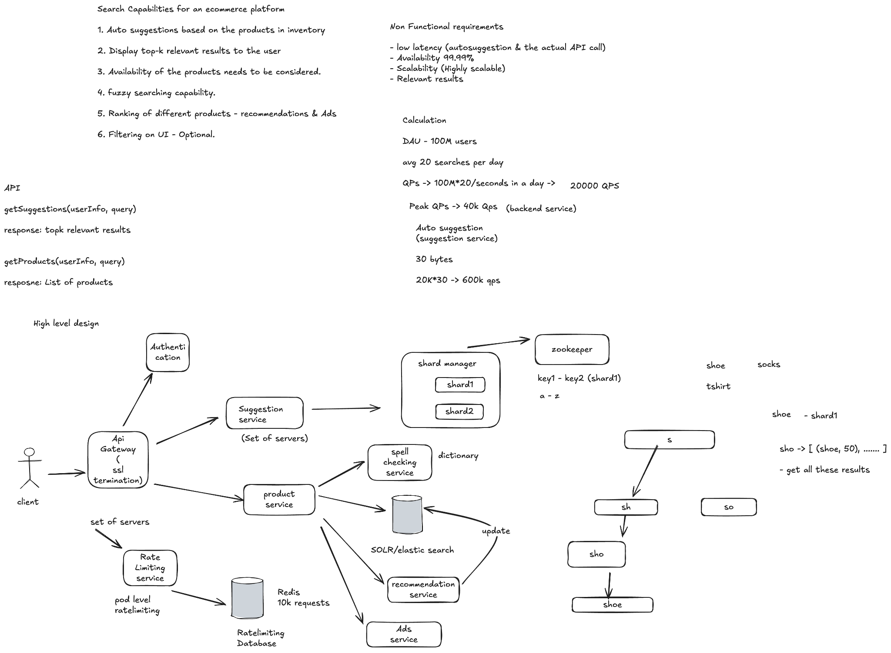
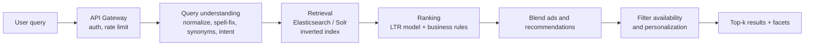
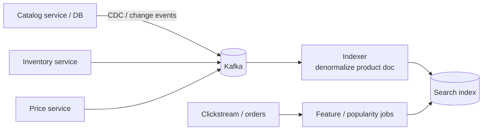

# Search Capabilities for an Ecommerce Platform

> [!info] Added
> The original doc only has the whiteboard diagram below. Its contents are transcribed in the first sections; the deep dives after that were added.

Related: [Typeahead service](typeahead-service.md) (autocomplete internals) and [Distributed search](distributed-search.md) (inverted index and sharding internals).



## Functional requirements (from the diagram)

1. Auto-suggestions based on the products in inventory.
2. Display top-k relevant results to the user.
3. Product availability needs to be considered.
4. Fuzzy searching capability.
5. Ranking of different products: recommendations and ads.
6. Filtering on the UI (optional).

## Non-functional requirements

- Low latency (auto-suggestion and the actual API call).
- Availability 99.99%.
- Highly scalable.
- Relevant results.

## Calculation

- DAU: 100M users, average 20 searches per day.
- QPS: `100M * 20 / 86400` ~= **20,000 QPS**.
- Peak QPS: **~40k QPS** (backend service).
- Auto-suggestion (suggestion service): ~30 bytes per response, so `20K * 30 B` ~= **600 KB/s**. Note that suggestions fire on every keystroke, so the real request rate is a multiple of the search QPS.

## API

```
getSuggestions(userInfo, query)   -> top-k relevant suggestions
getProducts(userInfo, query)      -> list of products
```

## High-level design (from the diagram)

- **Client** goes through the **API gateway** (SSL termination), which calls **authentication** and the **rate-limiting service** (a set of servers doing pod-level rate limiting, backed by a Redis rate-limiting database, e.g. 10k requests).
- **Suggestion service** (a set of servers): backed by a **shard manager** that owns shards (e.g. `a-z` split into key ranges, `key1-key2 -> shard1`), with the mapping kept in **ZooKeeper**. Suggestions are served from a **trie**:
    - `s -> sh -> sho -> shoe`, and the node `sho` stores precomputed top results such as `[(shoe, 50), ...]`.
    - The prefix lookup returns the stored top-k directly, without walking the subtree.
- **Product service** calls:
    - **Spell-checking service** (dictionary) for fuzzy/typo correction.
    - **Solr/Elasticsearch** for retrieval.
    - **Recommendation service**, which updates the search index (e.g. personalization/popularity signals).
    - **Ads service** for sponsored results.

## Added: deep dives

### End-to-end query flow



### Indexing pipeline



- Build a denormalized **product document**: title, brand, category, attributes, description, price, rating, popularity, availability, seller.
- Feed it by change-data-capture from the catalog DB through Kafka, so the index stays near-real-time and the catalog DB is never queried at search time.
- **Availability and price change much faster** than the rest of the catalog, so update them as **partial updates** (or in a separate fast-changing store) instead of re-indexing the whole document. Filter out-of-stock items at query time or demote them in ranking.
- Do full re-indexing into a new index and **swap an alias** for zero-downtime schema changes.

### Query understanding

- **Normalization:** lowercase, strip punctuation, stemming/lemmatization.
- **Spell correction:** edit distance (Levenshtein) against a dictionary of catalog terms and popular queries; or use a "did you mean" model. This is the **fuzzy search** requirement.
- **Synonyms:** `tee` = `t-shirt`, `sneakers` = `shoes`. Maintain a synonym list (manually plus mined from click data).
- **Intent/category classification:** detect that "iphone 15 case" means accessories, not phones.
- **Entity extraction:** brand, color, size, price ("red nike shoes under 3000") become filters.

### Retrieval and ranking

1. **Retrieve** candidates using the inverted index (BM25 on title, brand, category fields with field boosts), a few hundred to a thousand docs.
2. **Rank** with a learning-to-rank (LTR) model using features: text relevance, popularity (sales/CTR), rating, price competitiveness, availability, freshness, personalization (user history).
3. **Blend** sponsored (ads) and recommended results into fixed slots, and mark ads clearly.
4. **Re-rank/diversify:** avoid ten near-identical products from one seller.

### Facets and filtering

- Facets (brand, price range, rating, size) come from aggregations on indexed fields, computed over the full result set, not just the top-k page.
- Keep facet fields as `keyword`/numeric doc-values fields; cache frequent facet queries.

### Autocomplete

See [Typeahead service](typeahead-service.md) for the full design. Key points specific to ecommerce:

- Suggestions come from **popular queries and catalog terms**, not just prefix matches on product titles.
- Precompute the **top-k per prefix** in a trie and store it at the node (as in the diagram), rebuilt periodically from query logs.
- Only suggest queries that return results and with in-stock products.
- Debounce on the client (e.g. 100-200 ms) and cache by prefix at the edge.

### Sharding and scale

- Shard the index by `product_id` (hash) so queries fan out to all shards and results are merged (scatter-gather); add replicas for read throughput and availability. See [Distributed search](distributed-search.md).
- The suggestion service shards by **prefix range**, as in the diagram, with the shard manager and ZooKeeper tracking the key range to shard mapping. Hot prefixes (`s`, `a`) can be split further or replicated.
- Cache popular query results (Redis/edge) with a short TTL, since a small set of queries makes up most of the traffic.

### Relevance feedback loop

- Log impressions, clicks, add-to-carts and purchases per `(query, product)`.
- Use them to compute popularity/CTR features and to train the LTR model.
- Run A/B tests on ranking changes and watch metrics: CTR, conversion, zero-result rate, latency (p99).

### Failure handling and degradation

- If personalization or the recommendation service is slow, fall back to non-personalized ranking.
- If the ads service times out, return organic results.
- If the spell-check service is down, skip correction.
- Set tight timeouts per downstream call and return a partial result rather than an error.

### Trade-offs

- **Index freshness vs cost:** near-real-time indexing is costly for price/stock; batch the slow-changing fields.
- **Relevance vs latency:** heavier ranking models give better results but add milliseconds, so use a cheap first-pass ranker and an expensive re-ranker on the top ~100 only.
- **Personalization vs cacheability:** personalized results can't be cached across users, so personalize only the re-ranking stage.
