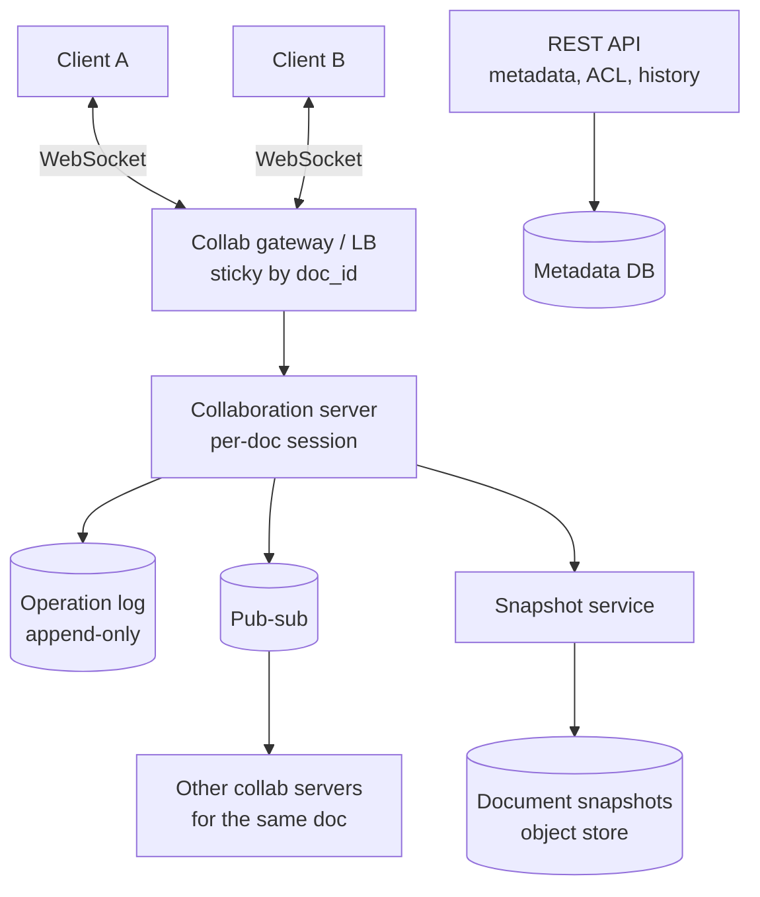
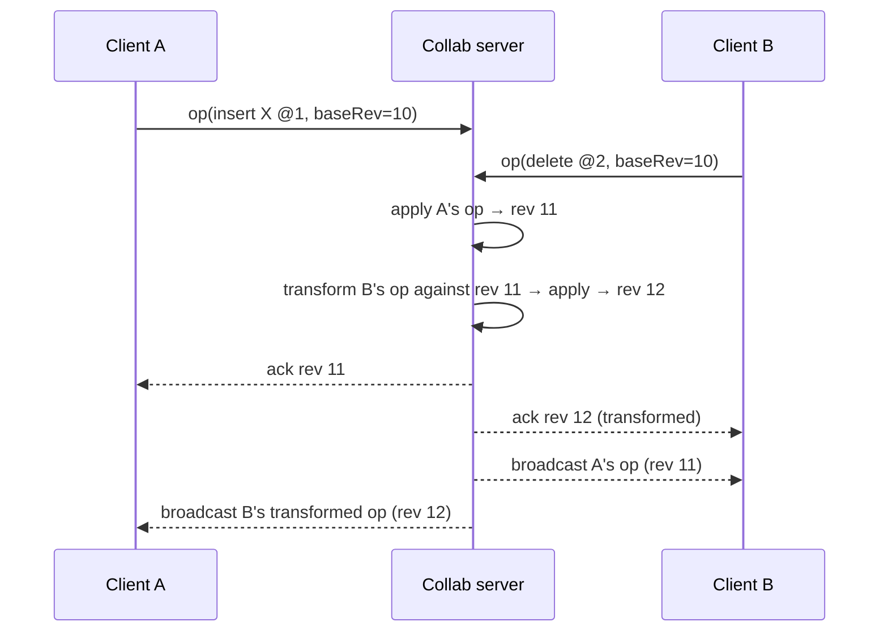

# Google Docs / Sheets

> [!info] Added
> The doc only has the title for this problem. The whole note below was written from general system design knowledge.

Real-time collaborative document editing: multiple users edit the same document concurrently and all see a consistent result within a fraction of a second.

See also [Dropbox / Google Drive](dropbox-google-drive.md) for file storage and sync (a different concurrency model: whole-file conflicts vs character-level merge).

## Requirements

**Functional**

- Create, open, edit and save documents.
- **Real-time collaboration:** many users edit at once and see each other's changes live.
- Show **presence**: who's viewing, cursors and selections.
- **Version history** and restore.
- Comments and suggestions; sharing with permissions (view/comment/edit).
- Offline editing that merges on reconnect.

**Non-functional**

- **Low latency** for edits (< 100-200 ms to appear on others' screens).
- **Convergence:** all clients end up with the identical document regardless of operation order or timing.
- **Durability:** never lose an acknowledged edit.
- **Availability** and scale: millions of documents; typically few concurrent editors per doc (tens), but some docs are very hot.

## High-level design

- **WebSocket gateway:** keeps a persistent connection per client and routes by `doc_id`. All editors of a doc should land on the **same collaboration server** (consistent hashing/sticky routing), so one process can order operations.
- **Collaboration server:** holds the in-memory state of active documents, transforms/merges operations, assigns an order, persists them and broadcasts.
- **Operation log:** every edit is stored as an operation (insert/delete/format) with a revision number.
- **Snapshots:** periodic full snapshots of the document so loading doesn't need to replay the whole log.
- **Metadata DB:** documents, owners, ACLs, comments, version labels.

## The core problem: concurrent edits

Two users edit the same text at the same time:

> Document: `ABC`. User 1 inserts `X` at position 1 → `AXBC`. User 2 deletes the char at position 2 (`C`) concurrently.

If each applies the other's operation naively (position-based), the result diverges between clients. Two main solutions:

### Operational Transformation (OT)

- A central server totally orders operations. When an operation arrives that was based on an older revision, the server **transforms** it against all operations applied since, so its intent is preserved (e.g. the delete position shifts by one because of the earlier insert).
- Clients keep a queue of unacknowledged local operations and transform incoming server operations against them.
- Used by Google Docs. **Pros:** compact operations, proven at scale, easy history. **Cons:** the transformation functions are hard to get correct, and it needs a central server.

### CRDT (Conflict-free Replicated Data Types)

- Each character gets a **unique, ordered identifier** (e.g. Logoot/LSEQ/RGA/Yjs). Inserts and deletes commute, so operations can be applied in any order and replicas converge **without a central transform**.
- **Pros:** works peer-to-peer and offline, and is simple to reason about for convergence. **Cons:** metadata overhead per character (tombstones for deletes), needs garbage collection.
- Used by libraries such as Yjs and Automerge.

| | OT | CRDT |
|---|---|---|
| Central server required | Yes | No (but usually still used for persistence) |
| Offline/p2p | Harder | Natural |
| Overhead | Low | Higher (IDs, tombstones) |
| Complexity | Transform functions are tricky | Data structure is tricky |

> [!tip] Interview answer
> Say you'd pick OT with a central server (simple model, since there's already a server per document) or Yjs-style CRDT if offline-first is a hard requirement. Explain *why* convergence is needed, then describe one approach clearly.

## Edit flow (OT, server-ordered)

- Clients apply their own edits **optimistically** (instantly) and reconcile when the server's ack/transformed ops arrive.

## Presence and cursors

- Broadcast cursor/selection and "who's here" over the same WebSocket, but treat them as **ephemeral**: don't persist, no ordering guarantees, throttle (e.g. 10-20 updates/s).
- Keep it in memory/Redis with a TTL. Drop on disconnect (heartbeat).

## Storage and versioning

- **Operation log** is the source of truth (append-only, ordered by revision). Persist before acking.
- **Snapshots** every N operations (or time), so loading = latest snapshot + replay of the newer ops.
- **Version history:** named versions point to a revision; "restore" creates a new revision with the old content (never rewrites history). Old operations can be compacted into coarser history after some time.
- **Sheets:** same model, but operations are cell-level (set value/formula, insert row/column). Conflict resolution is simpler for different cells, with last-writer-wins on the same cell. Formula dependencies are recalculated per client or server-side.

## Scaling and reliability

- **Shard by `doc_id`:** each document is owned by one collaboration server at a time (lease via ZooKeeper/etcd). On failure another server takes over, loads the latest snapshot and replays the log.
- **Hot documents** (thousands of viewers): most are read-only, so serve them through pub-sub fan-out to read-only connections; keep the editors count small.
- **Reconnects:** the client sends its last known revision; the server replays missed ops or sends a fresh snapshot if too far behind.
- **Offline:** queue local ops, and on reconnect rebase them (OT) or merge (CRDT).
- **Durability:** write the op to the replicated log before ack; snapshots to object storage.
- **Autosave:** nothing to click; persistence is continuous via the op log.

## Security

- Check the ACL on connect and on every operation (permissions can change while a session is open).
- Per-document tokens for WebSockets; rate limit operations per client (see [Rate Limiter](rate-limiter.md)).
- Encrypt in transit and at rest.

## Trade-offs

| Decision | Trade-off |
|---|---|
| Single collab server per doc | Simple ordering, but needs failover and limits one doc's throughput |
| OT vs CRDT | See table above |
| Snapshot frequency | Frequent means faster load, more storage/write cost |
| Last-writer-wins for cells (Sheets) | Simple, but can silently overwrite a concurrent edit |
