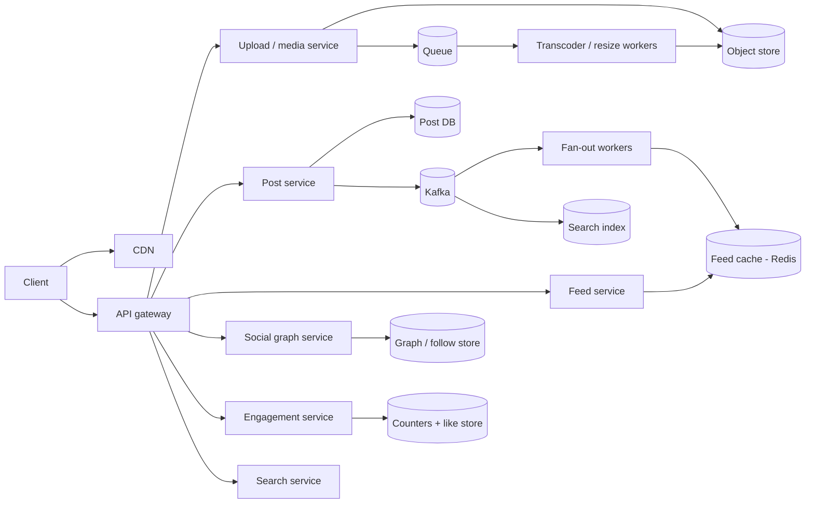

# Instagram

> [!info] Added
> The source doc only had the title "Design Instagram". This note is written from scratch.

## Requirements

**Functional**

- Upload photos/videos with a caption.
- Follow/unfollow users.
- Home feed of posts from followed users.
- Like and comment on posts.
- Stories (24-hour ephemeral content).
- Search users/hashtags and an explore page.

**Non-functional**

- High availability; feed reads are far more frequent than writes (eventual consistency is fine).
- Low latency feed and media load (media served via CDN).
- Durable media: never lose an uploaded photo.

### Estimates (example)

- 500M DAU; 100M photo uploads/day (about 1.2K uploads/s); average 2 MB per original, so about 200 TB/day of raw media before compression and multiple renditions. Plan for several renditions (about 3-5x metadata + thumbnails).
- Feed reads: each user opens the feed about 10 times/day, so 5B feed reads/day, about 58K/s average.

## API design

```text
POST /v1/media/upload-url              -> {upload_url, media_id}      (pre-signed URL)
POST /v1/posts          {media_id, caption}                           -> {post_id}
GET  /v1/feed?cursor=                  -> {posts[], next_cursor}
POST /v1/users/{id}/follow | DELETE
POST /v1/posts/{id}/like | DELETE
POST /v1/posts/{id}/comments  {text}
GET  /v1/stories/tray                  -> stories from followed users
GET  /v1/search?q=
```

## High-level design



## Media upload and delivery

- Client asks the media service for a **pre-signed URL** and uploads straight to the **object store** (S3), not through app servers.
- An upload-complete event triggers async workers: virus/NSFW checks, resize into multiple renditions (thumbnail, feed, full), video transcoding (HLS/DASH for adaptive bitrate), and metadata extraction.
- Serve through a **CDN**; media URLs are immutable and content-addressed so they cache forever.
- Post is made visible only after processing finishes.

## Data model

- **Post:** `post_id` (time-sortable, Snowflake), `user_id`, `media_ids[]`, `caption`, `created_at`, `location`.
- **Follow edge:** `(follower_id, followee_id, created_at)`; two indexes: followers-of-X and following-of-X. Store in a sharded DB (MySQL/Cassandra) or a graph-capable store.
- **Like:** `(post_id, user_id)` (unique) plus a **counter** per post (sharded counters; see [Sharded Counters](sharded-counters.md)).
- **Comment:** `(post_id, comment_id, user_id, text, created_at)`, partitioned by `post_id`.
- Post metadata in a sharded relational DB or Cassandra (partition by `user_id`, cluster by time desc). Media only by reference.

## Feed generation

The core design choice: **fan-out on write (push) vs fan-out on read (pull)**.

| | Push (fan-out on write) | Pull (fan-out on read) |
|---|---|---|
| On post | write post ID into every follower's feed cache | store post only |
| On read | read the precomputed list (fast) | merge posts of all followees (slow) |
| Cost | heavy writes for users with many followers | heavy reads |

**Hybrid (what to propose):**

- Push for normal users: the fan-out worker prepends the `post_id` into each follower's feed list in Redis (capped at a few hundred entries).
- **Celebrities** (millions of followers): don't push. At read time, merge the precomputed feed with recent posts from followed celebrities.
- Feed read = fetch the list of post IDs, hydrate post/user/like-count data (batched, cached), then **rank** (recency + relevance/ML model) and return a page via a cursor.
- Inactive users: skip pushing to their feed; build it on demand when they return.

## Likes and comments

- Like writes are idempotent (`(post_id, user_id)` unique). Counter updates are async via sharded counters; the displayed count is eventually consistent.
- Comments are stored per post with cursor pagination; the first few comments are cached with the post.
- Both emit events to Kafka for notifications and ranking signals.

## Stories

- Ephemeral: store with a **24 h TTL** (object store lifecycle + DB TTL).
- Keep a per-user list of active story IDs; the **story tray** = followed users with active stories, ordered by recency/affinity.
- Track viewers per story (set of user IDs) for "seen by" and to mark rings as seen.
- Prefer fan-out on read for the tray (the number of followees with stories is small and TTL data is cheap to merge).

## Search and explore

- **Search:** index usernames, hashtags and captions in Elasticsearch, updated via Kafka. Autocomplete uses a prefix index (same idea as the Typeahead service problem).
- **Explore:** offline pipeline builds candidate posts (engagement, topics, similar-user behavior), then an online ranker personalizes. Results cached per user.
- Hashtag pages: inverted index `hashtag → post IDs` ordered by time/popularity.

## Scaling and failure handling

- **Shard** posts and feeds by `user_id`; replicate across regions; read from the nearest.
- **Hot users:** cache their profile and recent posts aggressively; use the pull path for them.
- **Fan-out backlog:** use Kafka partitions + autoscaled workers; a delayed feed is acceptable, a lost post is not (the post DB is the source of truth, and the feed cache can be rebuilt).
- **Media durability:** object store with cross-region replication; keep the original and regenerate renditions if needed.
- **Degradation:** if ranking is slow, fall back to reverse-chronological order.

## Trade-offs

- Push vs pull: write amplification vs read latency (resolved by the hybrid).
- Precomputed feed caches use memory but make reads O(1); cap list length and evict inactive users.
- Eventual consistency for counts and feed vs strong consistency for the follow graph and posts.

> [!tip] Interview tips
> Spend the most time on **feed generation (hybrid fan-out)** and **media pipeline**. Mention celebrities explicitly. Treat stories, search and explore as extensions at the end.
