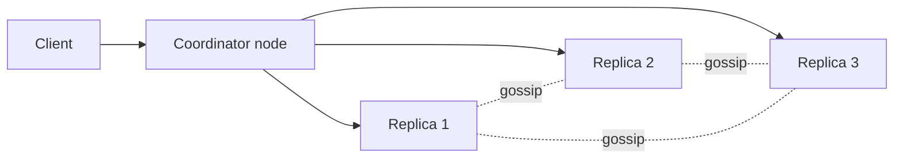
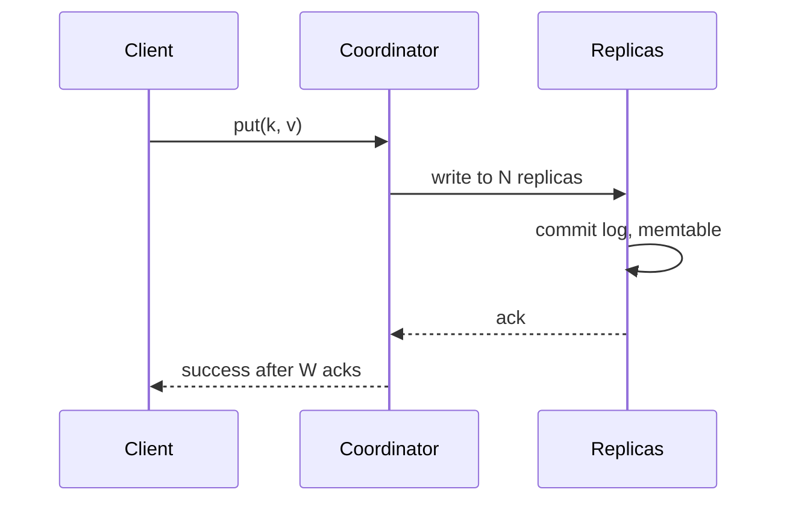

# Key-Value Store

> [!info] Added
> The source doc only has a title stub for this problem. This note is written from general knowledge (Dynamo / Cassandra-style design), not from the doc.

A distributed key-value store supports `put(key, value)` and `get(key)` at large scale with high availability and tunable consistency.

## Requirements

**Functional**

- `put(key, value)`
- `get(key)`
- `delete(key)` (optional)

**Non-functional**

- High availability: always writable, even during failures (AP system by default).
- Horizontal scalability: add nodes to grow capacity and throughput.
- Low latency: single-digit ms reads and writes.
- Tunable consistency (eventual by default, stronger on request).
- Durability: data survives node failures.
- Small values (typically < 1 MB).

## Back-of-envelope (example)

- 1B keys, 1 KB average value: ~1 TB raw. With replication factor 3: ~3 TB.
- At 500 GB per node usable: ~6-8 nodes for storage; add more for throughput and headroom.
- 100K ops/s peak spread across nodes.

## CAP and consistency

A partitioned system has to choose between consistency and availability. Dynamo-style stores choose **availability** with **eventual consistency**, and let the client trade off per request via quorum settings.

## High-level design



Any node can act as a **coordinator** for a request. Nodes are peers (no single master) and share membership via gossip.

## Data partitioning

- Use **consistent hashing**: hash keys and nodes onto a ring; a key belongs to the first node clockwise from its hash.
- Use **virtual nodes** so each physical node owns many small ranges. This balances load and lets bigger machines own more vnodes.
- Adding or removing a node moves only about 1/N of the keys.

## Replication

- Each key is stored on the next **N** distinct physical nodes clockwise on the ring (the *preference list*). N is typically 3.
- Spread replicas across racks / availability zones.

## Quorum consistency

With N replicas, write quorum W and read quorum R:

- **R + W > N** gives strong-ish consistency (every read set overlaps the latest write set).
- **W = 1** gives fast writes; **R = 1** gives fast reads.
- Typical: N=3, W=2, R=2.

| Config | Behavior |
|---|---|
| W=1, R=N | Fast writes, slow reads, strong reads |
| W=N, R=1 | Slow writes, fast reads |
| W=1, R=1 | Fastest, eventual consistency |
| W=2, R=2 (N=3) | Balanced, consistent |

## Handling conflicts: versioning

With concurrent writes to different replicas, versions can diverge.

- **Vector clocks:** each value carries `[(node, counter), ...]`. If one clock descends from another, the older version is discarded. If neither does, the versions are concurrent (a conflict), and the client or app reconciles them.
- **Last-write-wins (LWW):** use a timestamp. Simple but can silently drop writes and depends on clock sync. Cassandra uses this.
- Vector clocks can grow; prune old entries by threshold.

## Failure detection: gossip

- Each node periodically sends its membership/heartbeat table to a few random peers.
- If a node's heartbeat counter hasn't increased for a period, it's marked suspect/down.
- This avoids all-to-all heartbeats and scales to large clusters.

## Handling failures

**Temporary failures: sloppy quorum + hinted handoff**

- If a replica is down, a write goes to the next healthy node on the ring.
- That node stores a **hint** and hands the data back when the original replica recovers.
- Keeps the store writable.

**Permanent failures: anti-entropy with Merkle trees**

- Each replica builds a Merkle tree (hash tree) over its key ranges.
- Replicas compare root hashes; if they differ, they walk down the tree to find the differing ranges and sync only those.
- Minimizes data transferred when repairing replicas.

**Read repair:** during a read, if the coordinator sees stale replicas, it writes the latest version back to them.

**Data center outage:** replicate across multiple data centers.

## Write path



On each node (LSM-tree storage engine):

1. Append to the **commit log** (sequential disk write) for durability.
2. Write to the in-memory **memtable**.
3. When the memtable is full, flush it to disk as an immutable sorted **SSTable**.
4. **Compaction** merges SSTables in the background, drops overwritten values and tombstones.

## Read path

1. Coordinator sends the read to R replicas (or one plus digest requests).
2. On each node: check the memtable, then use a **Bloom filter** per SSTable to skip files that don't contain the key, then read from the SSTables (via index).
3. Merge results, pick the latest version (vector clock / timestamp), return it.
4. Trigger read repair if replicas disagree.

## Deletes

Deletes write a **tombstone** marker, since SSTables are immutable. Tombstones are removed during compaction after a grace period, long enough for replicas to sync.

## API design

```text
put(key, value, context?)   // context carries the version (vector clock)
get(key) -> (value(s), context)
delete(key)
```

## Components summary

| Concern | Technique |
|---|---|
| Partitioning | Consistent hashing with virtual nodes |
| Replication | N replicas on successive nodes, across racks/DCs |
| Consistency | Tunable quorum (R, W, N) |
| Conflicts | Vector clocks or LWW |
| Failure detection | Gossip protocol |
| Temporary failure | Sloppy quorum + hinted handoff |
| Permanent failure | Merkle-tree anti-entropy, read repair |
| Storage | LSM tree: commit log, memtable, SSTables, compaction, Bloom filters |

## Trade-offs and interview tips

- Say upfront whether you choose AP (Dynamo/Cassandra) or CP (etcd/ZooKeeper-style with Raft/Paxos). Explain what it means for availability during partitions.
- Compare to a **distributed cache**: a cache is RAM-based and disposable; a KV store must persist durably. See [Distributed Cache](distributed-cache.md).
- LSM trees favor writes (sequential I/O) at the cost of read amplification, mitigated by Bloom filters and compaction. B-trees favor reads.
- Mention hot keys, large values, and cross-key transactions as limitations.
- Real systems to name: DynamoDB, Cassandra, Riak, Redis (single-node primarily), etcd.
