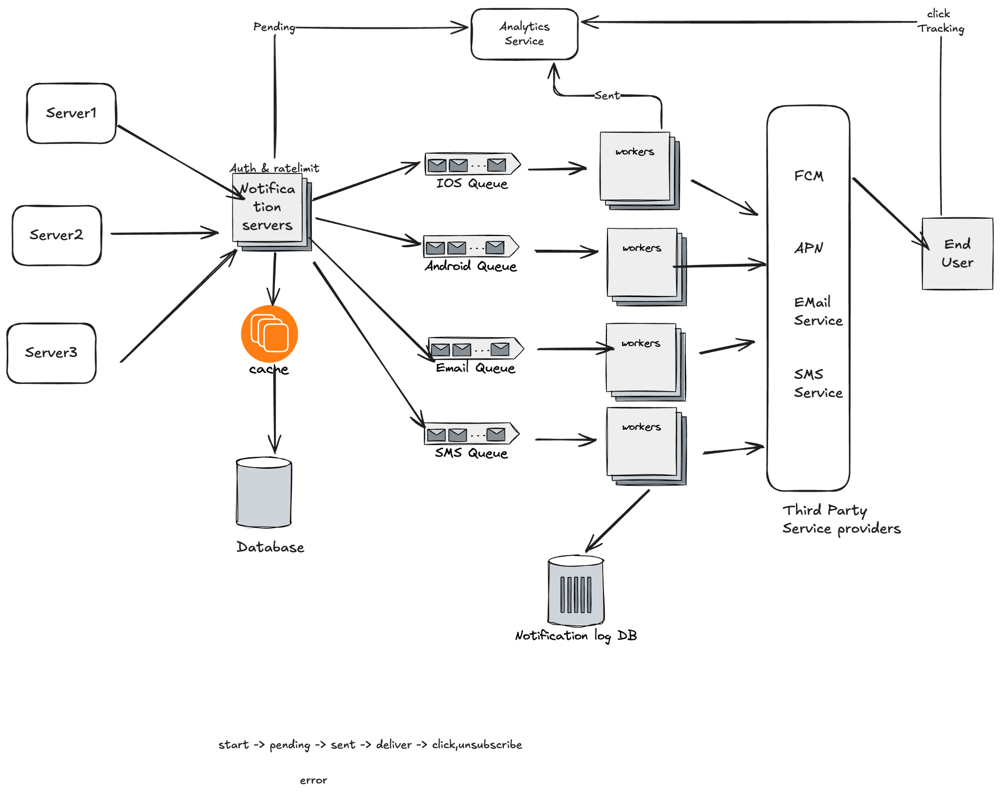
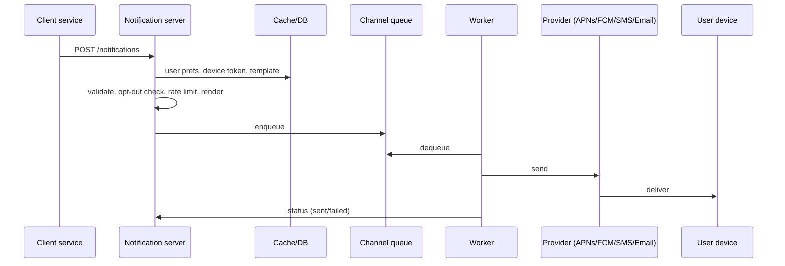
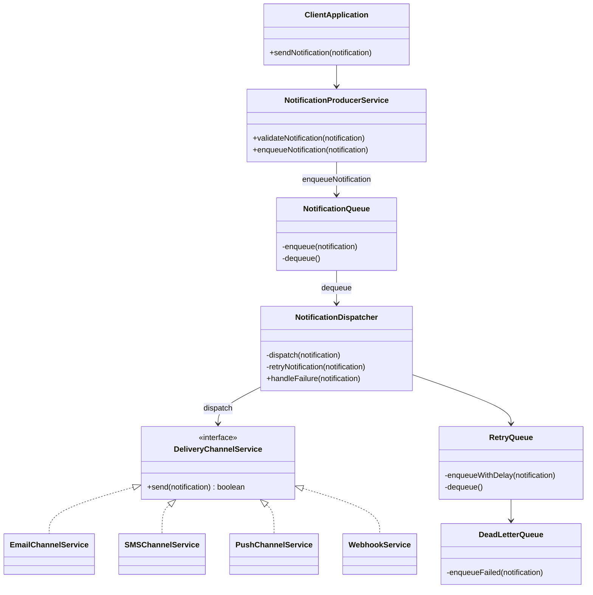

# Notification Service

> [!info] Added
> Sections marked **Added** (estimates detail, delivery guarantees, failure handling, scaling, trade-offs, interview tips) are supplemental and not from the original doc.

## Requirements

**Functional**

- Clients should be able to send notifications to users.
- Notification medium can be push (Android/iOS), email or SMS.
- Users should be able to opt out of certain kinds of notifications from clients.

**Non-functional**

- **Reliability:** if a user goes offline, notifications must not be lost. As soon as they come online, deliver them.

> [!info] Added: more non-functional requirements
> - **Soft real-time:** a few seconds of delay is fine for most notifications (OTP and alerts are the exception, so give them a high-priority path).
> - **Scalable and available:** absorb spikes (sales, flash events) without dropping messages.
> - **Delivery semantics:** at-least-once delivery, with deduplication to approximate exactly-once.
> - **Pluggable:** easy to add a new channel or third-party provider.

## Estimates

- 10M users, 100 notifications sent per user per day.
- Total: 10M × 100 = 1B notifications/day, ~1 TB of data per day (at ~1 KB each).

> [!info] Added: throughput
> 1B / 86,400 s ≈ **~12K notifications/s** on average. Plan for peaks of 5-10× (~60-120K/s), so queues and workers need to scale horizontally.

## Types of notifications

- **iOS push:** Provider → APNs (Apple Push Notification service) → iOS device
- **Android push:** Provider → FCM (Firebase Cloud Messaging) → Android device
- **SMS:** Provider → SMS service (e.g. Twilio, Nexmo) → phone
- **Email:** Provider → email service (e.g. SendGrid, Mailchimp) → inbox

## Contact info gathering flow

When a user installs the app or signs up, the API servers collect contact info and store it in the database.

**User**

- userId
- emailId
- country_code
- phoneNumber
- created_at

**Device**

- deviceId
- userId
- device_token
- user_logged_in_at

> [!info] Added
> A user can have multiple devices, so `Device` is one-to-many on `userId`. Refresh `device_token` on every login/app start, and delete tokens that APNs/FCM report as invalid.

## Naive design: a single notification server

Problems:

- **SPOF.**
- **Performance:** one server has to render each complete notification and get the list of userIds subscribed to the topic, then send them all.

## Improved design



**Notification servers**

- Basic validation of client and user attributes.
- Render the notification using a notification template.
- Rate limit, so users aren't overwhelmed with notifications.
- Put notification data on message queues for parallel processing.
- Provide the opt-out functionality.
- Auth: an app key/secret ensures only verified clients can send.

**Cache:** user info, device info and notification templates are cached.

**DB:** stores data about users, notifications, notification settings, etc.

**Message queues**

- Remove dependencies between components.
- Act as buffers when high volumes of data need to be sent out.
- Each notification type gets a distinct queue, so an outage at one third party doesn't affect the other notification types.

**Workers:** pull notification events from the queues and send them to third-party services.

**Notification log DB:** workers record status for each notification.

**Analytics service:** receives events (pending, sent, delivered, click) for tracking.

### Flow

1. A service calls the notification service APIs to send a certain kind of notification to a user.
2. The notification service queries the cache and DB. If the user hasn't opted out, it renders the notification using the template, then publishes it to the appropriate message queue.
3. Workers pull notification events from the queues.
4. Workers send the notification to third-party services.
5. Third-party services deliver the notification to user devices.



Notification lifecycle (from the diagram): `start → pending → sent → delivered → click / unsubscribe`, with `error` as the failure branch.

## Delivery guarantees

**What if the user is offline? How do we prevent data loss?**

Notifications can be delayed or re-ordered, so we need persistence in the database plus a retry mechanism.

**How do we ensure a message is delivered exactly once?**

The distributed nature can result in duplicate notifications. Attach an `eventId` to each message and check a Bloom filter to see whether this notification has already been sent.

> [!info] Added
> - A Bloom filter has false positives, so a legitimate notification can occasionally be dropped as a "duplicate". For critical notifications (OTP, payments) use an exact dedup instead: a Redis `SET key NX EX ttl` on `eventId` or a unique constraint in the DB.
> - True exactly-once isn't achievable over unreliable third parties. Aim for **at-least-once + idempotent dedup by `eventId`**.

## Additional components and considerations

**Notification template:** introduced to avoid building notifications from scratch.

**Notification settings**

- userId
- channel
- clientId
- optIn

**Rate limiting:** to avoid overwhelming users. See [Rate Limiter](rate-limiter.md).

**Retry mechanism:** when a third party fails to send a notification, the notification is added to a retry queue. If the problem persists, send out an alert.

**Monitor queued notifications and add workers:** if the queue keeps growing, add workers.

**Events tracking:** metrics such as open rate, click rate and engagement are important for understanding customer behavior. An analytics service handles the interaction between the notification service and the user.

## Simple LLD



### Classes

| Class | Responsibility |
|---|---|
| `User` | Recipient of notifications. Fields: userId, email, phoneNumber, deviceToken, isSubscribed, createdAt. Methods: createUser, updateUser, getUserPreferences, updateUserPreferences. |
| `NotificationPreferences` | User-specific settings. Fields: userId, preferredChannels, dailyLimit, frequency, quietHours. Methods: updatePreferences, getPreferences. |
| `Notification` | A specific notification. Fields: notificationId, userId, templateId, status, priority, createdAt, sentAt. Methods: sendNotification, getNotificationStatus, retryNotification, cancelNotification. |
| `NotificationTemplate` | Templates with CRUD. Fields: templateId, type, templateBody, placeholders. |
| `MessageQueue` | Queue of notifications. Fields: queueId, pendingMessages, processingMessages, failedMessages. Methods: enqueue, dequeue, getQueueStatus, retryFailedMessages. |
| `NotificationStatus` | Tracks status. Fields: notificationId, status, errorMessage, createdAt. Methods: updateStatus, getStatus. |
| `DeliveryProvider` | External delivery services. Fields: providerId, name, type, rateLimit, status. Methods: add/update/delete provider, getProviderStatus. |
| `RetryPolicy` | Retry rules. Fields: policyId, maxRetries, delayBetweenRetries, backoffStrategy. Methods: applyPolicy, getRetryPolicy. |
| `Batch` | Groups of notifications. Fields: batchId, notifications, createdAt. Methods: addNotification, processBatch, getBatchStatus. |
| `Placeholder` | Dynamic fields in templates. Fields: name, value. Methods: create/update/delete. |

## Database design

```sql
-- Users
CREATE TABLE Users (
    userId        UUID PRIMARY KEY,
    email         VARCHAR(255) UNIQUE NOT NULL,
    phoneNumber   VARCHAR(15),
    deviceToken   VARCHAR(255),
    isSubscribed  BOOLEAN DEFAULT TRUE,
    createdAt     TIMESTAMP DEFAULT CURRENT_TIMESTAMP
);

-- NotificationPreferences
CREATE TABLE NotificationPreferences (
    preferenceId       UUID PRIMARY KEY,
    userId             UUID REFERENCES Users(userId),
    preferredChannels  TEXT[],          -- e.g. email, sms
    dailyLimit         INTEGER DEFAULT 10,
    frequency          VARCHAR(50),     -- "immediately", "daily", "weekly"
    quietHours         JSONB,           -- {"start": "22:00", "end": "07:00"}
    updatedAt          TIMESTAMP DEFAULT CURRENT_TIMESTAMP
);

-- NotificationTemplates
CREATE TABLE NotificationTemplates (
    templateId    UUID PRIMARY KEY,
    type          VARCHAR(50),          -- "email", "sms", "push"
    templateBody  TEXT NOT NULL,
    placeholders  TEXT[],               -- ["{userName}", "{orderNumber}"]
    createdAt     TIMESTAMP DEFAULT CURRENT_TIMESTAMP,
    updatedAt     TIMESTAMP DEFAULT CURRENT_TIMESTAMP
);

-- Notifications
CREATE TABLE Notifications (
    notificationId  UUID PRIMARY KEY,
    userId          UUID REFERENCES Users(userId),
    templateId      UUID REFERENCES NotificationTemplates(templateId),
    finalText       TEXT,               -- rendered text
    status          VARCHAR(50),        -- "pending", "sent", "failed"
    priority        VARCHAR(50),        -- "high", "normal"
    createdAt       TIMESTAMP DEFAULT CURRENT_TIMESTAMP,
    sentAt          TIMESTAMP
);

-- MessageQueue
CREATE TABLE MessageQueue (
    queueId         UUID PRIMARY KEY,
    notificationId  UUID REFERENCES Notifications(notificationId),
    status          VARCHAR(50),        -- "pending", "processing", "failed"
    createdAt       TIMESTAMP DEFAULT CURRENT_TIMESTAMP
);

-- NotificationStatus
CREATE TABLE NotificationStatus (
    statusId        UUID PRIMARY KEY,
    notificationId  UUID REFERENCES Notifications(notificationId),
    status          VARCHAR(50),        -- "sent", "failed", "delivered"
    errorMessage    TEXT,
    createdAt       TIMESTAMP DEFAULT CURRENT_TIMESTAMP
);

-- DeliveryProviders
CREATE TABLE DeliveryProviders (
    providerId  UUID PRIMARY KEY,
    name        VARCHAR(100) NOT NULL,
    type        VARCHAR(50),            -- "email", "sms", "push"
    rateLimit   INTEGER,
    status      VARCHAR(50),            -- "active", "inactive"
    createdAt   TIMESTAMP DEFAULT CURRENT_TIMESTAMP
);

-- RetryPolicies
CREATE TABLE RetryPolicies (
    policyId             UUID PRIMARY KEY,
    maxRetries           INTEGER DEFAULT 3,
    delayBetweenRetries  INTEGER,       -- seconds
    backoffStrategy      VARCHAR(50)    -- "linear", "exponential"
);

-- Batches
CREATE TABLE Batches (
    batchId    UUID PRIMARY KEY,
    createdAt  TIMESTAMP DEFAULT CURRENT_TIMESTAMP
);

-- BatchNotifications
CREATE TABLE BatchNotifications (
    batchId         UUID REFERENCES Batches(batchId),
    notificationId  UUID REFERENCES Notifications(notificationId),
    PRIMARY KEY (batchId, notificationId)
);
```

> [!info] Added: storage at this scale
> At ~1B notifications/day, `Notifications` and `NotificationStatus` shouldn't live in a single relational table. Keep users, preferences and templates in SQL (small, relational, cache-friendly). Put the notification log in a write-optimized store (Cassandra/DynamoDB, partitioned by `userId`, or time-partitioned tables), with a TTL/archival policy (e.g. 30-90 days hot, then cold storage).

## API design

| Category | API | Endpoint | Method | Description |
|---|---|---|---|---|
| User management | Create user | `/users` | POST | Create a new user in the system. |
| | Get user preferences | `/users/{userId}/preferences` | GET | Retrieve a user's notification preferences. |
| | Update user preferences | `/users/{userId}/preferences` | PUT | Update a user's notification preferences. |
| Notifications | Send notification | `/notifications` | POST | Send a notification to a user. |
| | Get notification status | `/notifications/{notificationId}/status` | GET | Retrieve the status of a notification. |
| | Resend notification | `/notifications/{notificationId}/resend` | POST | Retry sending a failed/pending notification. |
| | Bulk notifications | `/notifications/bulk` | POST | Send bulk notifications to multiple users. |
| Templates | Create template | `/templates` | POST | Create a new notification template. |
| | Get template | `/templates/{templateId}` | GET | Retrieve details of a specific template. |
| | Update template | `/templates/{templateId}` | PUT | Update an existing template. |
| | Delete template | `/templates/{templateId}` | DELETE | Delete a template. |
| Message queue | Get queue status | `/queue/status` | GET | Retrieve the status of the message queue. |
| | Retry failed messages | `/queue/retry` | POST | Retry all failed messages in the queue. |
| Providers | Add provider | `/providers` | POST | Add a new delivery provider. |
| | Update provider | `/providers/{providerId}` | PUT | Update settings of an existing provider. |
| | Get providers | `/providers` | GET | List all available delivery providers. |
| Logs & monitoring | Get notification logs | `/logs` | GET | Retrieve logs for all notifications. |

> [!info] Added: send request example
> ```http
> POST /notifications
> Idempotency-Key: 7f3c...       # eventId, used for dedup
> Authorization: Bearer <app-key-token>
>
> {
>   "userId": "u123",
>   "templateId": "order_shipped",
>   "channel": "push",
>   "priority": "normal",
>   "params": { "orderNumber": "OD123" }
> }
> ```
> Response: `202 Accepted` with `notificationId`. The send is asynchronous, so use the status API or webhooks for the result.

## Deep dives (Added)

### Retry, backoff and dead-letter queue

- Retry transient failures (timeouts, 5xx, throttling) with **exponential backoff + jitter** via a delayed retry queue.
- After `maxRetries`, move the message to a **dead-letter queue** and alert. Don't retry permanent failures (invalid token, unsubscribed number); instead mark the device token invalid.
- Provider failover: if one SMS/email provider is down, route to a secondary provider.

### Priority

- Separate queues (or priority lanes) for **high priority** (OTP, security alerts) and **bulk/marketing**, with dedicated worker pools. This stops a marketing blast from delaying an OTP.

### Fan-out for large campaigns

- For "send to 10M users", don't expand on the API path. Store the campaign, and have a fan-out job read user segments in pages and enqueue per-user messages in batches. Rate limit the campaign against provider limits.

### Scheduling and quiet hours

- Honor `quietHours` and the user's timezone. Messages that fall in quiet hours go to a delayed/scheduled queue instead of being dropped.

### Security and compliance

- App key/secret authentication per client, and TLS everywhere.
- Never log PII (phone, email) in plain text; mask it.
- Honor unsubscribe, with a one-click link in emails. Respect regulations (CAN-SPAM, GDPR, TRAI DND for SMS in India).

## Failure handling (Added)

| Failure | Mitigation |
|---|---|
| Notification server down | Stateless, behind a load balancer, multiple instances |
| Queue/broker down | Replicated brokers (e.g. Kafka with replication, multi-AZ) |
| Worker crashes mid-send | Ack only after the send succeeds, so the message is redelivered. Dedup by `eventId` avoids double send |
| Third-party outage | Per-channel queues isolate it. Retry with backoff, then fail over to a secondary provider |
| User offline | APNs/FCM store-and-forward with TTL. Also persist in the DB so the app can fetch missed notifications on launch |
| Cache down | Fall back to DB (with rate limiting to protect it) |

## Scaling (Added)

- Notification servers: stateless, scale horizontally.
- Queues: partition by `userId` (keeps per-user ordering) and add partitions for throughput.
- Workers: autoscale on queue depth/lag (the "monitor queued notifications and add workers" point above).
- Cache user info/device info/templates (Redis), shard by `userId`.
- DB: shard the notification log by `userId`. Read replicas for the preferences DB.

## Trade-offs (Added)

| Decision | Option A | Option B |
|---|---|---|
| Queue | Kafka: high throughput, replay, ordering per partition | SQS/RabbitMQ: simpler, per-message ack and delay built in |
| Delivery | At-least-once + dedup (chosen) | At-most-once: risk of silent loss |
| Dedup | Bloom filter: tiny, but false positives | Redis `SET NX`/DB unique key: exact, more memory |
| Templating | Render at send time: always fresh | Pre-render: faster workers, stale on template change |

## Wrap-up

- **Reliability:** minimize the failure rate.
- **Security:** app key/secret ensures only verified clients can send.
- **Tracking & monitoring:** implemented at different stages.
- **Respect user settings.**
- **Rate limiting.**

## Interview tips (Added)

- Start by clarifying channels, scale, soft-real-time vs real-time, and whether marketing/bulk is in scope.
- Draw the HLD (servers → per-channel queues → workers → providers) first, then go deep on reliability (retry, DLQ, dedup) and opt-out/rate-limiting.
- Call out that you can't get true exactly-once over third parties, and explain at-least-once + idempotency.
