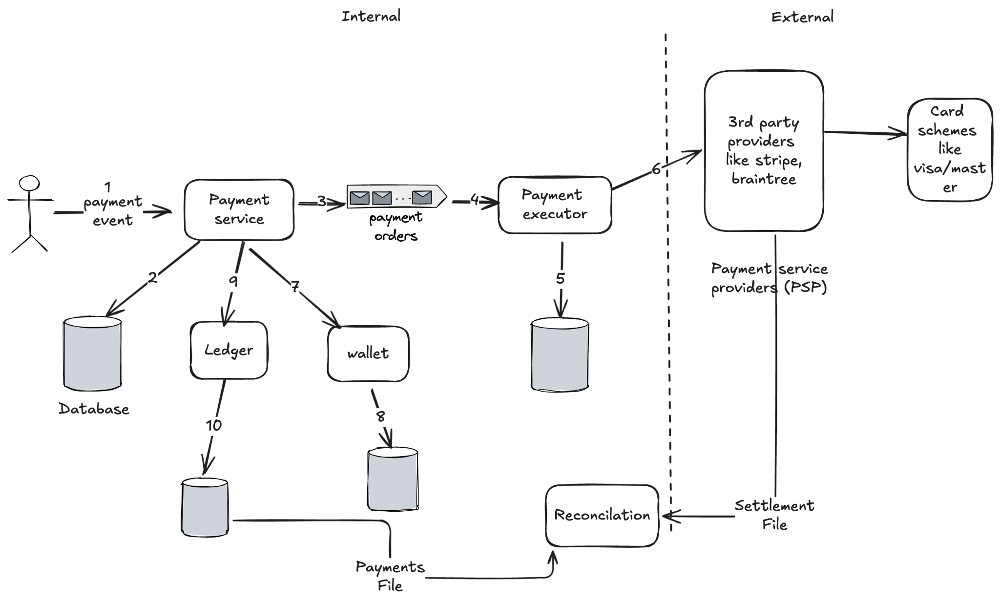
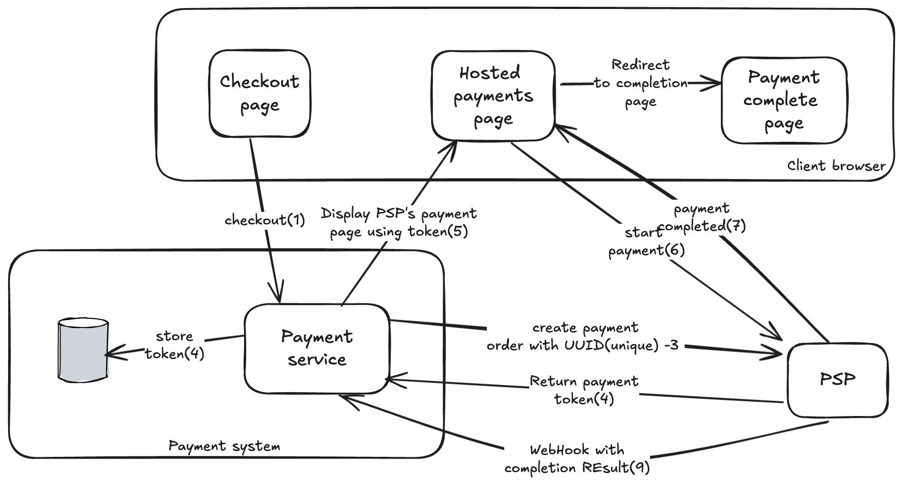

# Payment System

A payment system settles financial transactions through the transfer of monetary value. This includes institutions, instruments, people, rules, procedures, standards and technologies that make it possible.

Assume we are building the payment backend for an e-commerce application like Flipkart. When a customer places an order, the payment system handles everything related to money movement.

## Scope and requirements

- Ideally the system supports all payment methods, but assume only **credit cards**.
- We use third-party systems (Stripe, Braintree) to process the payment. **We don't store card details** in our system, since that needs compliance. The third-party processor handles sensitive data.
- The application is global, but only one currency is used.
- The payment system interacts with many internal services (accounting, analytics) and external services (third-party providers). If a service fails it may produce inconsistencies, so we need a **reconciliation** mechanism.
- Scale: 1 million transactions per day.

### Back-of-envelope

1M transactions / 10^5 seconds in a day ≈ **10 TPS**. That is not huge, so the focus is on handling transactions **correctly**, not on throughput.

**Functional**

- **Pay-in flow:** a user can pay for an order. The payment system receives money from the customer on behalf of sellers.
- **Pay-out flow:** the payment system sends money to sellers around the world.

**Non-functional**

- **Reliability:** failed payments need to be handled carefully.
- **Reconciliation** between services: an asynchronous process that verifies systems are in a consistent state.

## High-level design

The amount is transferred to the e-commerce company's bank account after the order is delivered. A seller can then request a payout.

### Pay-in flow

- **Payment service:** coordinates the payment process. It's also responsible for risk checks and detecting criminal activity (generally via a third-party provider). It breaks a payment **event** into one or more payment **orders** (e.g. if products belong to different sellers).
- **Payment executor:** executes a single payment order and interacts with the PSP.
- **Card schemes:** organizations that process credit card payments (Visa, Mastercard).
- **Ledger:** keeps the financial record of payment transactions. Very important for post-payment analysis, such as validating consistency, calculating total revenue, or forecasting revenue.
- **Wallet:** keeps track of each seller's account balance. May also record how much a given user has paid in total.

**Flow**

1. User clicks "Place order"; a payment event is generated.
2. The payment service stores the payment event in the database.
3. A single payment event can contain multiple payment orders; the payment service breaks it down and puts them in the queue.
4. The payment executor stores the payment order data in the database.
5. The payment executor calls the third-party PSP to process the credit card payment.
6. After the payment executes successfully, the payment service updates the wallet with how much money the seller has.
7. After the wallet, the payment service calls the ledger to update it.
8. The payment is marked successful.

### Payout flow

- Similar to pay-in. The key difference is that we don't use a PSP to move the money.
- Generally a third-party service is used for settlement.

## Storage schema

**Payment**

- `payment_id` / `cart_id` (generally cart ID; should be unique)
- buyer account details
- `payment_status`: marked successful when all payment orders are executed
- credit card info

**Payment order**

- `payment_order_id`: unique; used as the idempotency key when talking to the PSP
- `buyer_account`
- `seller_info`
- `amount`
- `cart_id` (foreign key)
- `payment_order_status`: `NOT_STARTED`, `EXECUTING`, `SUCCESS`, `FAILED`
- `wallet_updated`
- `ledger_updated`

We don't need seller bank account information, since the money is transferred to the e-commerce company's bank account first.

> [!warning] Amount type
> The original notes used `Double` for amount "to avoid errors or round-off". Floating point is the wrong choice for money: store the amount as an integer in the smallest currency unit (e.g. paise/cents) or as a `DECIMAL`, along with the `currency`. Currencies vary a lot in scale.

**Choosing the database**, focus on:

- Proven stability: some financial firms have used it for 5-6 years.
- Maturity of tools.
- Community support.

> [!info] Added
> Use a relational DB with ACID transactions (e.g. MySQL/PostgreSQL). At 10 TPS a single primary with replicas is enough. Shard by `user_id`/`cart_id` only if needed.

## API design

**`POST /v1/payment/orders`**

Request:

- `buyer_info`
- `cart_id`
- `credit_card_details` (in the hosted-page flow these never touch our servers; see below)
- `payment_orders: List<PaymentOrder>`

`PaymentOrder`:

- `seller_id`
- `amount`
- `currency`
- `payment_order_id` (globally unique)

**`GET /v1/payments/{payment_order_id}`**

Returns the execution status for the payment order ID.

## Double-entry ledger system

- Fundamental to any payment system; key for accurate bookkeeping.
- Records every payment transaction in **two** separate ledger accounts with the same amount (buyer debit $10, seller credit $10).
- The sum of all transactions must be **zero**.

## Hosted payment page

- Companies don't want to store credit card data because of security standards, so they use hosted credit-card pages provided by PSPs.
- For websites it's a widget in an iframe; for mobile apps it may be a prebuilt page.

## Deep dives

### PSP integration

Two ways:

1. If a company can safely store sensitive credit card information and chooses to, integration can be done via **APIs**. The company builds the web pages; the PSP is only responsible for connecting to banks or card schemes.
2. If the company chooses not to store card data, the PSP provides a **hosted payment page** to collect card details and stores them securely at the PSP. Most companies take this approach.

Flow in the diagram:

1. Client checks out on the checkout page.
2. The payment service creates a payment order at the PSP with a unique **UUID**.
3. The PSP returns a **token**.
4. The payment service stores the token.
5. The payment service tells the browser to display the PSP's hosted page using the token.
6. The user starts the payment on the hosted page (card details go straight to the PSP).
7. The PSP completes the payment and the browser is redirected to the payment-complete page.
8. The PSP sends a **webhook** with the completion result to the payment service.

### Reconciliation

When systems communicate asynchronously there is no guarantee a message is delivered or a response received. External systems such as PSPs and card schemes prefer asynchronous communication, so how do we ensure correctness?

**Reconciliation.** Every night the PSP sends the client a **settlement file** containing the bank account balance and the transactions. The reconciliation system parses the settlement file and compares it with the ledger.

> [!info] Added
> Mismatches fall in classes: (1) classifiable and auto-fixable (e.g. missing webhook; update our state from the PSP), (2) classifiable but needs manual fix, (3) unknown; escalate to finance ops. Alert on any non-zero unmatched amount.

### Handling payment processing delays from the PSP

What if the PSP deems a request high risk and needs a human to review it? The PSP returns a **pending** status. We provide a web page where the client can check the payment status, and the PSP notifies us when the status changes.

### Communication among services

Asynchronous communication is preferred.

### Handling failed payments

Track payment status, put failed ones in a **retry queue**, then a **dead letter queue**.

### Exactly-once delivery

Exactly-once = **at-least-once** + **at-most-once**.

- **At-least-once:** retry queues + DLQ with exponential backoff.
- **At-most-once:** idempotency.
    - The cart ID is the idempotency key at the payment system level. The token generated by the PSP is the idempotency key at the PSP side.

**What if a customer clicks the pay button twice quickly?**
The second request is treated as a retry, since the system has already seen the idempotency key. When a previously used idempotency key is included, the payment system returns the latest status of the previous request.

**What if the PSP processes the payment successfully, but the response never reaches us, and the user clicks pay again?**
We also send the PSP a unique UUID and the PSP returns a corresponding token. The UUID uniquely represents a payment order and maps to exactly one token, so the token uniquely maps to the payment order. When the user clicks pay again the payment order is the same, so the token sent to the PSP is the same. Because the token is the idempotency key at the PSP, it identifies the double payment and returns the status of the previous execution.

### Consistency

- Between internal services: exactly-once processing is very important.
- Between internal and external services: rely on reconciliation and idempotency.
- If data is replicated, replication lag can cause inconsistency between the primary and replicas. Two options:
    - Serve both reads and writes from the primary. Easy to set up but poor scalability; replicas only provide reliability and serve no traffic, which wastes resources.
    - Ensure all replicas are in sync, using a consensus algorithm (Paxos, Raft) or a consensus-based distributed database like CockroachDB or Cloud Spanner.

### Payment security

- Use HTTPS.
- Rate-limit to avoid DDoS.
- Enforce encryption.
- Card tokenization, etc.

> [!info] Added
> PCI-DSS scope is minimized by never touching raw card data (hosted page + tokens). Also: verify webhook signatures, use mTLS between services, keep audit logs, and store secrets in a vault.

## Wrap-up (other aspects to consider)

- Monitoring
- Alerting
- Debugging tools
- Currency exchange
- Geography
- Cash payment
- Google Pay / Apple Pay integration

> [!info] Added
> **Interview tips:** lead with correctness, not throughput (10 TPS). Make idempotency, the ledger/double-entry, and reconciliation the three headline ideas. Mention that a payment is a **state machine**: `NOT_STARTED → EXECUTING → SUCCESS | FAILED (→ retry → DLQ)`, and that every transition is persisted before the next side effect.
