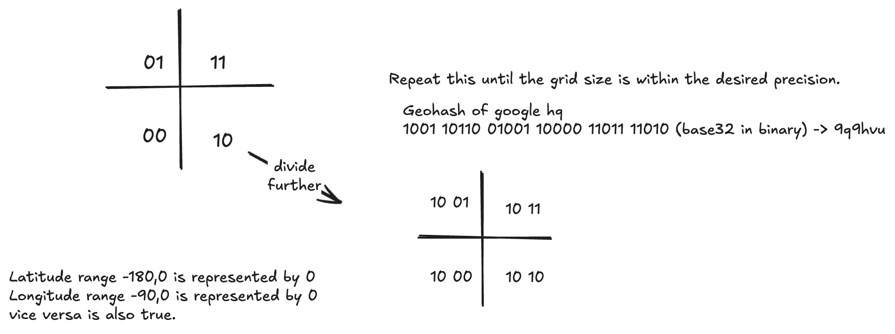
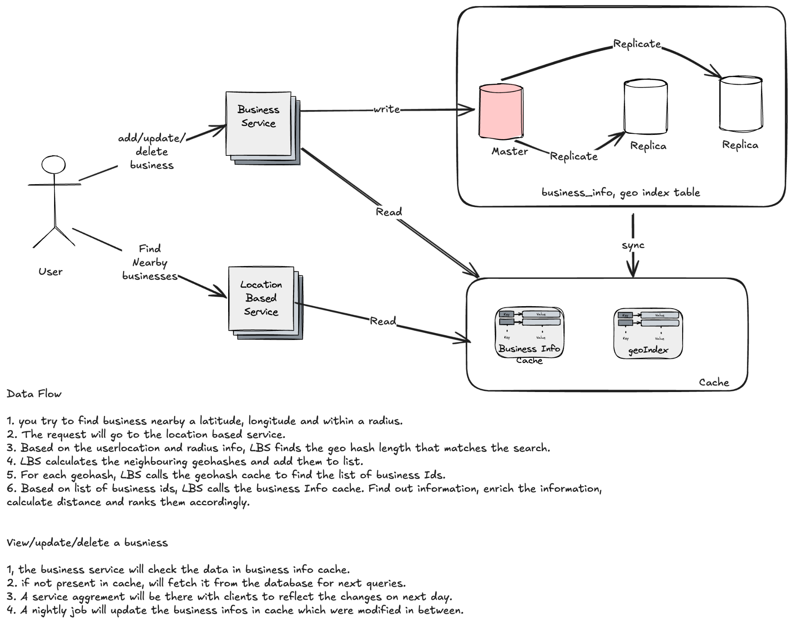

# Proximity Service

A proximity service discovers nearby places such as restaurants, hotels, theaters and museums. Think Yelp for restaurants, or finding the k nearest gas stations on Google Maps.

> [!info] Added
> Sections marked **(Added)** are supplementary: geohash precision mapping, distance calculation, an S2 summary, failure handling, and interview tips.

## Understanding the requirements

- We want the top-k businesses within a radius of the user. What if there aren't enough businesses; should we expand the search?
    - For now, only return businesses within the radius. Expanding the search can be discussed later if time permits.
- Businesses are added, updated and deleted. Do these changes need to be reflected in searches in real time?
    - We can have a contract with the business that changes are reflected the next day.
- Can a user change the radius in the UI?
    - Yes. Say 1 km, 2 km, 5 km and 20 km options are available.

**Functional requirements**

- A user can get the list of businesses within a specified radius of their location (latitude and longitude).
- Business owners can add, delete and update businesses. This doesn't need to be reflected in real time.
- Users can see detailed information about a business.

**Non-functional requirements**

- Low latency
- High availability and scalability
- Data privacy: location data is sensitive, so privacy must always be taken into consideration.

## Back-of-the-envelope calculation

- 200 million businesses.
- 100M DAU.
- Each user does 5 queries per day.
- **QPS** = 100M * 5 / 10^5 = **~5000 QPS**.

## API design

**Business APIs**

- `POST /v1/businesses/`
- `GET /v1/businesses/{id}`
- `PUT /v1/businesses/{id}`
- `DELETE /v1/businesses/{id}`

**Search nearby API**

- `GET /v1/search/nearby?latitude=<>&longitude=<>&radius=<>`

> [!tip] (Added)
> Response is a paginated list of `{business_id, name, distance, ...}`. Business detail comes from `GET /v1/businesses/{id}`.

## Database design

**Business table**

- business_id
- Latitude
- Longitude
- Name
- City
- State
- Address

**Geo index table:** maps the 2D index to a 1D index (see below).

## Algorithm to fetch nearby businesses

Given the user's latitude and longitude and a radius, fetch the nearby businesses efficiently.

### Option 1: two-dimensional search

```sql
SELECT business_id, latitude, longitude
FROM businesses
WHERE latitude BETWEEN (my_lat - radius) AND (my_lat + radius)
  AND longitude BETWEEN (my_long - radius) AND (my_long + radius);
```

This isn't efficient, because it scans the whole table to filter on longitude and latitude.

What if we index longitude and latitude?

- It's still not efficient.
- With two-dimensional data, each 1D index returns a huge set, and you need to intersect the two result sets to get the final result.

**Can we map 2D data to 1D?** Yes, there are multiple ways. All of them divide the world map into smaller areas and build indexes for faster search.

- **Hash-based:** even grid, geohash, Cartesian tiers.
- **Tree-based:** quadtree, S2, R-tree.

### Option 2: evenly divided grid

Divide the world into smaller grids. One grid can have multiple businesses, but one business maps to a single grid.

The problem: grids aren't dynamic with respect to the number of businesses in them. Some grids can have too many businesses and others very few.

### Option 3: geohash

Reduces two-dimensional longitude and latitude data into a one-dimensional string of letters and digits. It recursively divides the world with each additional bit.

Geohash has the property that most nearby grids share a prefix. It has different precision levels based on hash length: the longer the hash, the smaller the grid.



> [!warning] Note on the diagram
> The diagram's note about ranges is swapped. Latitude ranges over -90..90 and longitude over -180..180. Each bit halves the range: 0 for the lower half, 1 for the upper half. Longitude and latitude bits are interleaved, then the bits are encoded in base32.

Geohash has 12 precision levels. The precision level determines the grid size. We're generally interested in levels 4 to 6; otherwise the grid is too large or too small.

| Geohash length | Grid width * height |
|---|---|
| 1 | 5000 * 5000 km |
| 2 | 1250 * 625 km |
| 3 | 156 * 156 km |
| 4 | 40 * 20 km |
| 5 | 5 * 5 km |
| 6 | 1.2 * 0.6 km |
| 7 | 0.15 * 0.15 km |
| 8 | 38 * 19 m |

> [!tip] (Added) Radius to precision
> Choose the precision whose cell is about the size of the search radius, then also search the neighbours. A common mapping:
>
> | Radius | Geohash length |
> |---|---|
> | 0.5 km | 6 |
> | 1 km | 5 |
> | 2 km | 5 |
> | 5 km | 4 |
> | 20 km | 4 |

**Boundary issues with geohash**

- Geohash guarantees that the longer the shared prefix, the closer the locations. The reverse isn't true: two locations may be very close but share no prefix. This happens when they sit on either side of the equator or a meridian, in different halves of the world.
    - E.g. in France, La Roche-Chalais (geohash `u000`) is only 30 km away from Pomerol (geohash `ezzz`).
    - Because of this, a prefix query (geohash `LIKE '9q8zn%'`) won't find some nearby businesses.
- Another boundary issue: two businesses can be very close but have different geohashes (although they will share a prefix).
    - Solution: fetch businesses not only from that grid but also from the neighbouring grids. Neighbours can be calculated in O(1).

**Not enough businesses**

- Start trimming the geohash length (a bigger cell) and search again.

### Option 4: quadtree

A quadtree partitions a 2D space by recursively subdividing it into four quadrants (grids) until the contents of a grid meet some criteria, e.g. a grid has a maximum of 100 businesses.

A quadtree is an **in-memory data structure**, not a database solution. It runs on each location service server and is built at server bootup.

```java
void buildTree(TreeNode node) {
    if (node.businessCount() > 100) {
        divideNode(node);
        for (TreeNode child : node.children()) {
            buildTree(child);
        }
    }
}
```

**Quadtree data structure**

- **Leaf node:** top-left and bottom-right coordinates; list of business IDs.
- **Non-leaf node:** top-left and bottom-right coordinates; pointers to 4 children.

A simple calculation shows the memory requirement isn't large (5-10 GB per the original estimate) and fits on a single server.

> [!tip] (Added)
> A bottom-up estimate: 200M businesses / 100 per leaf = ~2M leaves, plus ~0.7M internal nodes. At ~8 bytes per business ID plus small per-node overhead, that's only a couple of GB. Either way it fits on one server.

**How long does it take to build the tree?**

Each leaf contains about 100 business IDs, so the complexity is `(n/100) * log(n/100)`, where n is the total number of businesses.

**How to get nearby businesses with a quadtree**

1. Build the quadtree in memory.
2. Start from the root and traverse until you find the leaf node containing the search origin. If that leaf doesn't have enough businesses, add businesses from its neighbours.

**Operational considerations**

- Use **blue-green deployments**, since the index build takes quite some time.
- Updating the quadtree as businesses are added/removed/updated:
    - Easy way: rebuild it after a certain period, with an agreement with clients on the SLA of operations.
    - To update in real time with multiple threads accessing it, you must handle concurrency.

### Option 5: Google S2

- S2 is great for **geofencing**, because it can cover arbitrary areas with varying levels. A geofence is a virtual perimeter for a real-world geographic area. Geofencing lets us define parameters around an area of interest and send notifications to users inside the area.
- Another advantage is the **region cover algorithm**. Instead of a fixed precision level as in geohash, we can specify a min/max level and a max number of cells in S2. The result is more granular, because cell sizes are flexible.

> [!tip] (Added)
> S2 maps the sphere onto a cube and uses a Hilbert space-filling curve to turn cell positions into 64-bit IDs. Nearby cells have close IDs, so a region becomes a small set of ID ranges that a normal B-tree index can scan. It's more complex to implement than geohash, which is why geohash is a good default for interviews.

### Who uses what

| Technique | Used by |
|---|---|
| Geohash | Bing Maps, Redis, MongoDB, Lyft |
| Quadtree | Yext |
| Geohash and quadtree | Elasticsearch |
| Google S2 | Google Maps, Tinder |

### Geohash vs quadtree

| Geohash | Quadtree |
|---|---|
| Easier to implement. No need to build a tree. | Slightly harder to implement; needs to build a tree. |
| Supports returning businesses within a radius. | Supports fetching the k nearest. It has no correlation with radius; it just returns the k nearest. Sometimes the radius doesn't matter, and we only want nearby gas stations or hospitals. |
| With a fixed precision level the grid sizes are fixed. Can't adjust dynamically to population density. | Supports dynamic cells based on its criteria, so it can have a dynamic grid by population density. |
| Updating the index is easy: modify, add or delete the entry. | Updating is more complicated. You traverse from root to leaf to remove a business, and rebalancing is needed. With multi-threaded access, race conditions must be handled. |

## Design deep dive

### Scaling the database

**Businesses table**

- Can be partitioned by `business_id`.
- A shard can be replicated for better read performance and durability.

**Geo index table**

*Option 1*

| geoHash: String | list_of_business: JSON |
|---|---|

*Option 2* (multiple rows)

| geoHash: String | businessId: String |
|---|---|

Option 1 requires fetching the array of businesses and finding the one to update. Inserting also needs a scan of the entire array to avoid duplicates, and we have to lock the entire row to prevent concurrent updates.

**Option 2 is preferred.** No locking is required, and update/delete is easy using the compound key `(geohash, businessId)`.

**Scaling the geo index table**

- We might not need sharding, as the table is very small and fits on a single server.
- Replicate it across read replicas to handle read load.

### Caching

The workload is read-heavy and the dataset is small, so a cache like Redis is a good fit.

- **Business info cache:** `business_id -> Business`
- **Geohash cache:** `geohash -> list of business IDs`

When a business is added, modified or deleted, the database is updated and the cache entry for that key is evicted/invalidated.

**Redis storage**

8 bytes (business ID) * 200M businesses * 3 precision levels = **~5 GB**. It fits easily on a modern server.

### Deployment

- Put users physically closer to the system: users in the US connect to data centers in that region, similarly for Europe.
- Use DNS routing for privacy concerns, to route all requests from a country to its region. Some laws require user data to be used and stored locally.
- Spread traffic across the population. High-density regions like Japan and Korea might deploy in separate regions to distribute load, or even in different availability zones within a region.

## Final design



**Find nearby businesses**

1. The user searches for businesses near a latitude, longitude and within a radius.
2. The request goes to the **Location Based Service (LBS)**.
3. Based on the user's location and radius, LBS finds the geohash length that matches the search.
4. LBS calculates the neighbouring geohashes and adds them to the list.
5. For each geohash, LBS calls the geohash cache to get the list of business IDs.
6. Using the business IDs, LBS calls the business info cache, enriches the information, calculates distances, and ranks the results.

**View/update/delete a business**

1. The business service checks the data in the business info cache.
2. If not present in the cache, it fetches from the database for subsequent queries.
3. A service agreement with clients states changes are reflected the next day.
4. A nightly job updates the business info in the cache for businesses modified in between.

## Distance and ranking (Added)

- A geohash gives *candidates*, not exact results. After collecting businesses from the cell and its 8 neighbours, compute the real distance with the **haversine formula** and drop those outside the radius.
- Rank by distance (or by rating/popularity combined with distance), then return the top k.

```text
a = sin^2(dLat/2) + cos(lat1) * cos(lat2) * sin^2(dLon/2)
d = 2 * R * asin(sqrt(a))        // R = 6371 km
```

## Failure handling and trade-offs (Added)

- **Cache loss:** rebuild geohash/business caches from the DB. The geo index table is small, so warm-up is fast.
- **Stale reads:** acceptable under the next-day contract. Replica lag is not an issue either.
- **Hot cells** (e.g. city centers): a single geohash cell can have many businesses. Cache the cell's result, or use a finer precision for dense areas.
- **Privacy:** don't log or retain user coordinates; coarsen them (e.g. to a geohash cell) in analytics.
- **Geohash vs quadtree:** geohash is simpler and easy to update; choose quadtree when you need k-nearest or density-adaptive cells.

## Interview tips (Added)

- Say why plain SQL range queries on lat/long don't scale, then introduce a 1D index.
- Name the geohash boundary problems and the neighbour-cell fix.
- State the read-heavy workload and the small dataset; that justifies caching and no sharding of the geo index.
- Offer to expand the search (shorter prefix) when there are too few results.
