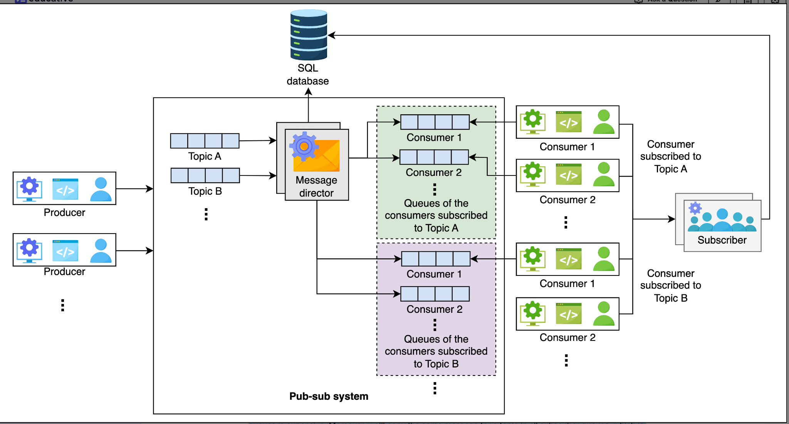
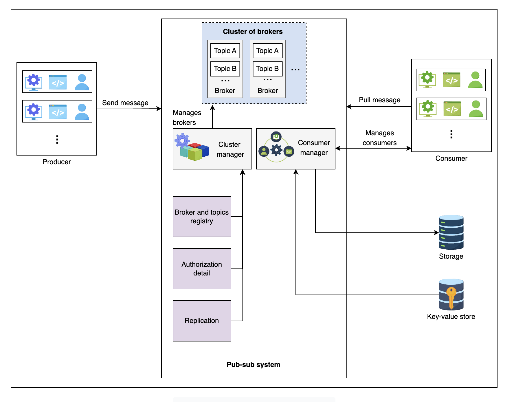
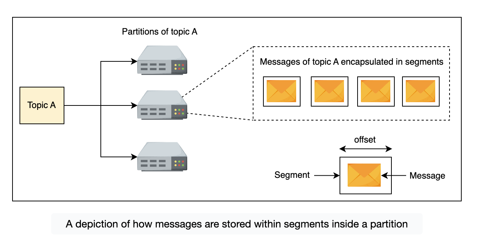

# Pub-Sub

Asynchronous service-to-service communication, most popular in serverless and microservice architectures. Messages can be sent asynchronously to different subsystems using pub-sub messages.

Using pub-sub increases scalability. Producers and consumers are decoupled and operate independently, so they can be scaled and developed separately. Adding or removing any component doesn't affect the others.

## Use cases

- **Improved performance:** consumers don't need to poll regularly and waste CPU cycles; it enables push-based messages.
- **Real-time monitoring:** raw or processed messages of an application can be provided to multiple applications to monitor a system in real time.
- **Replication:** e.g. in a leader-follower protocol, the leader can publish a message to its followers. Likewise, an app like WhatsApp with many clients (mobile, web browser, iOS) works elegantly with pub-sub.
- **Handling ingestion:** helps with log ingestion. User-interaction data can reveal behavior patterns. We can ingest a large amount of data into pub-sub and deliver it to any analytical system.

## Requirements

**Functional**

- Create a topic
- Produce a message to a topic
- Subscribe to a topic
- Read messages from a topic
- Delete a topic
- Specify retention time

**Non-functional**

- Availability
- Fault tolerance: operate in the event of failures
- Data durability
- Scalable: cater to a high number of increasing topics and messages
- Concurrent producers/consumers: handle concurrency where reading and writing happen simultaneously

## Design

### Approach 1: distributed queues

**Components**

- **Producer:** produces the message to a topic.
- **Topic queue:** producer messages are stored here.
- **Message director:** monitors messages coming to all topics. When a message comes, it checks all consumers of that topic and copies the message into their respective consumer queues.
- **Consumer queue:** the message from the topic queue is copied here so the consumer can read it.
- **Subscriber:** when a consumer requests a subscription to a topic, it adds an entry in the database for further message processing.
- **Database:** a relational database stores subscription details, e.g. which consumer subscribed to which topic, so consumers get their desired messages. Relational because consumer data is structured and we want data integrity.

Distributed queues keep the design simple. However, the huge number of queues is a significant concern. With millions of subscribers for thousands of topics, defining and maintaining millions of queues is expensive. Also, the same message for a topic is copied into every subscriber queue, which is unnecessary duplication and wastes space.

**Another problem with this approach**

Unread messages can become a bottleneck with a conventional queue API. For example, if 9 out of 10 readers have consumed the message at the start of the queue, it won't be deleted until the tenth consumer has consumed it, and the first nine can't move forward. So consumers need to consume the data independently.

### Final design

**Components**

- **Broker:** stores messages from the producer and allows consumers to read them.
- **Cluster manager:** manages topics, checks cluster health, and takes care of replication in case a broker goes down.
- **Consumer manager:** manages consumers. It decides whether a consumer is viable to read a message and from what offset a consumer can read in the topic. It also handles retention management in case a consumer's retention for messages expires.
- **Storage:** stores consumer details, subscription information and retention period.
- **Key-value store:** keeps offset information for each consumer. Allows fast fetching and increases availability of consumers.

### Detailed: broker

The broker server is the core component of the pub-sub system and handles write and read requests. A broker has multiple topics, and each topic can have multiple partitions. Partitions store messages in local storage for persistence, which improves availability. Partitions contain messages encapsulated in segments. Segments help identify the start and end of a message using an offset address. Using segments, consumers consume the message of their choice from a partition by reading from a specific offset address.

