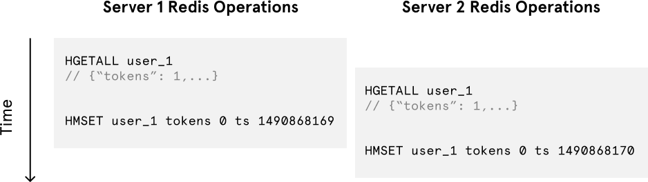
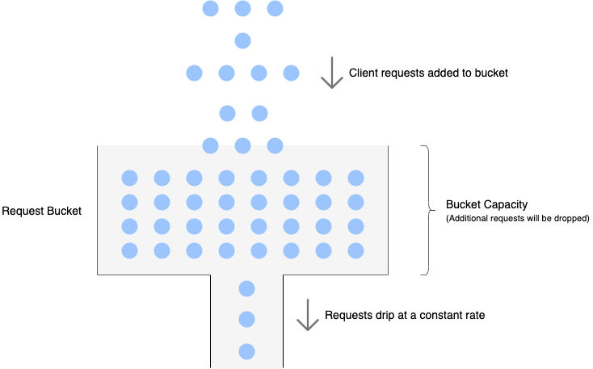
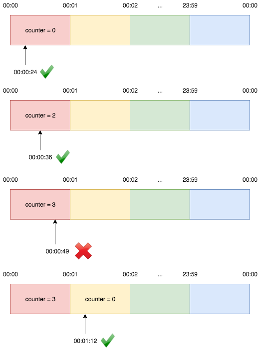
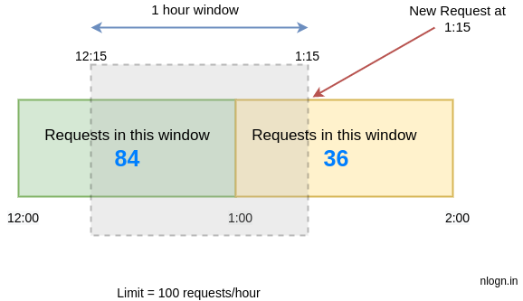
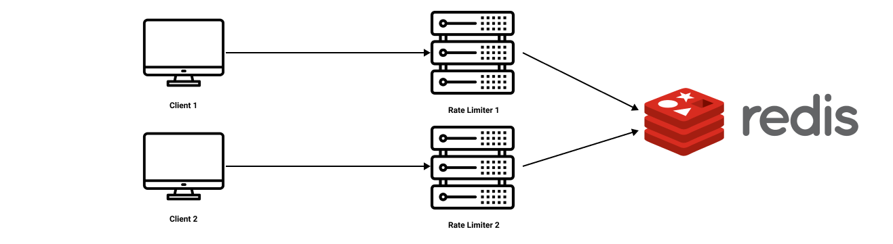
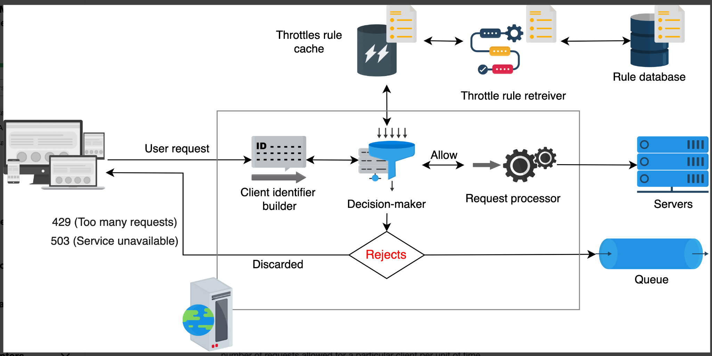

# Rate Limiter

## Token Bucket

- A container with a predefined capacity.
- New tokens are added into the bucket at a fixed frequency.
- If the bucket has a token when a request arrives, the request is served and a token is removed.
- If there is no token, the request overflows (is dropped).

```java
import redis.clients.jedis.Jedis;

public class RateLimitUsingTokenBucket {
    private final Jedis jedis;

    public RateLimitUsingTokenBucket(Jedis jedis) {
        this.jedis = jedis;
    }

    public boolean rateLimit(String userID, long intervalInSeconds, long maximumRequests) {
        String lastResetKey = userID + "_last_reset_time";
        String counterKey = userID + "_counter";

        // Check if this is the first request (key not present)
        String lastResetTimeStr = jedis.get(lastResetKey);
        long lastResetTime = lastResetTimeStr == null ? 0 : Long.parseLong(lastResetTimeStr);

        // Check if time window has elapsed
        if (System.currentTimeMillis() / 1000 - lastResetTime >= intervalInSeconds) {
            // Reset counter and update last reset time
            jedis.set(counterKey, String.valueOf(maximumRequests));
            jedis.set(lastResetKey, String.valueOf(System.currentTimeMillis() / 1000));
        } else {
            // Get remaining requests
            String requestLeftStr = jedis.get(counterKey);
            long requestLeft = requestLeftStr == null ? 0 : Long.parseLong(requestLeftStr);
            if (requestLeft <= 0) {
                // No requests left, drop request
                return false;
            }
        }

        // Decrement counter and allow request
        jedis.decr(counterKey);
        return true;
    }
}
```

### Distributed rate limiting, race conditions and concurrency

Despite its elegance and tiny memory footprint, the Redis operations above aren't atomic. In a distributed environment the read-then-write behavior creates a race condition, so the limiter can be too lenient.



If a user has one token left and issues multiple requests served by separate processes, each process can read the token count before either updates it. Each then thinks one token is left.

> [!tip] Solution
> Make it atomic: either take a Redis lock for the duration of the operations (slows concurrent requests from the same user, adds complexity), or use Lua scripting so the Redis operations are atomic.

**Pros**

- Simple and easy to implement.
- Very memory efficient.
- Allows bursts of traffic: a request goes through as long as tokens are left. Important since bursts are common (e.g. Amazon Prime Day).

**Cons**

- Race condition in distributed systems when concurrent requests come in for the same user.

## Leaky Bucket

- Also a finite-capacity container per client, but filled with client **requests** instead of tokens.
- Requests leave the bucket at a constant rate. If the bucket is full, new requests overflow.
- No burst of traffic.



- Implemented as a fixed-size queue, processed FIFO at a constant rate.

For each request a user makes:

1. Check if the queue limit is exceeded.
2. If exceeded, drop the request.
3. Otherwise, add the request to the end of the queue and handle it.

```java
import redis.clients.jedis.Jedis;

public class RateLimitUsingLeakyBucket {
    private final Jedis jedis;
    private final double requestsPerSecond;

    public RateLimitUsingLeakyBucket(Jedis jedis, double requestsPerSecond) {
        this.jedis = jedis;
        this.requestsPerSecond = requestsPerSecond;
    }

    public boolean rateLimit(String userID, String uniqueRequestID, long intervalInSeconds) {
        String requestQueueKey = userID;

        // Get the current request count
        long requestCount = jedis.llen(requestQueueKey);

        // Calculate the maximum allowed requests based on the interval and rate
        long maximumAllowedRequests = (long) (requestsPerSecond * intervalInSeconds);

        if (requestCount >= maximumAllowedRequests) {
            // Drop request if the maximum is reached
            return false;
        }

        // Add request ID to the queue
        jedis.rpush(requestQueueKey, uniqueRequestID);

        // Drain the queue according to the fixed rate
        long currentTime = System.currentTimeMillis() / 1000;
        long oldestRequestTime = jedis.lindex(requestQueueKey, 0);

        if (oldestRequestTime != null && currentTime - Long.parseLong(oldestRequestTime) >= intervalInSeconds) {
            // Calculate the maximum number of requests to process based on the elapsed time
            long requestsToProcess = (long) (requestsPerSecond * (currentTime - Long.parseLong(oldestRequestTime)));

            // Drain the queue up to the maximum allowed requests
            while (requestsToProcess > 0 && jedis.lpop(requestQueueKey) != null) {
                requestsToProcess--;
            }
        }
        return true;
    }
}
```

**Pros**

- Memory efficient given the limited queue size.
- Requests are processed at a fixed rate, so it suits use cases needing a stable outflow rate.

**Cons**

- A burst of traffic fills the queue with old requests, and if they aren't processed in time, recent requests are rate limited.

## Fixed Window Counter

The most basic rate limiting mechanism and probably the simplest to implement.

- Keep a counter for a given duration and increment it for every request. Once the limit is reached, drop further requests until the window resets.
- The timeline is divided into fixed-size windows, each with a counter. A request is mapped to a window by its arrival time; if that window's counter has reached the limit, the request is rejected.
- Example: window size 1 minute gives windows `[00:00, 00:01)`, `[00:01, 00:02)`, ... `[23:59, 00:00)`. With a limit of 2 requests per minute, a third request in the same window is rejected.



The advantage is that recent requests are served without being starved by old ones. The major problem is that it can let through **twice** the allowed requests: with a limit of 5 per minute, a user can make 5 requests at 11:00:59 and 5 more at 11:01:00, i.e. 10 requests in under a minute.

Unlike token bucket, the Redis operations here are atomic. Each request increments a Redis key that includes the window timestamp, so all requests for a user within a window share the same key. Compare the incremented value to the limit to decide whether to reject, and set the key to expire when the window passes so stale counters don't stay around.

```java
import redis.clients.jedis.Jedis;
import java.time.Instant;

public class RateLimiter {
    private Jedis redisClient;

    public RateLimiter(Jedis redisClient) {
        this.redisClient = redisClient;
    }

    public boolean rateLimitUsingFixedWindow(String userID, long intervalInSeconds, long maximumRequests) {
        long currentWindow = Instant.now().getEpochSecond() / intervalInSeconds;
        String key = userID + ":" + currentWindow;

        // Get current window count
        String value = redisClient.get(key);
        long requestCount = (value != null) ? Long.parseLong(value) : 0;

        if (requestCount >= maximumRequests) {
            // Drop request
            return false;
        }

        // Increment request count by 1
        redisClient.incr(key); // If the key is not available, it initializes to 0 and increments to 1

        // Handle request
        return true;
        // Optionally, you could add logic to delete expired keys at regular intervals
    }
}
```

**Pros**

- Memory efficient.
- Easy to understand.
- Best when the quota resets only at the end of the unit window. With 10 requests/min, 10 are allowed in 10:00:00-10:00:59 and the quota resets at 10:01:00. It doesn't matter that 20 requests were allowed between 10:00:30 and 10:01:29, since those fall in two different windows. That's why it's "fixed window" and not "sliding window".

**Cons**

- A traffic spike at the edge of a window makes it unsuitable when the time window must be tracked in real time.

## Sliding Window Logs

Fixes the window-edge problem of fixed window counter.

- Keep track of request timestamps, usually in a cache such as a Redis sorted set.
- On a new request, remove all timestamps older than the start of the current window (`currentTime - intervalInSec`).
- Add the new request's timestamp to the log.
- If the log size is within the allowed count, serve the request; otherwise reject it.

```java
import redis.clients.jedis.Jedis;
import redis.clients.jedis.Tuple;
import java.time.Instant;
import java.util.Set;

public class RateLimiter {
    private Jedis redisClient;

    public RateLimiter(Jedis redisClient) {
        this.redisClient = redisClient;
    }

    public boolean rateLimitUsingSlidingLogs(String userID, String uniqueRequestID, long intervalInSeconds, long maximumRequests) {
        long currentTime = Instant.now().getEpochSecond();
        long lastWindowTime = currentTime - intervalInSeconds;

        // Get current window count
        Set<Tuple> requestCount = redisClient.zrangeByScoreWithScores(userID, lastWindowTime, currentTime);

        if (requestCount.size() >= maximumRequests) {
            // Drop request
            return false;
        }

        // Add request ID to the last window
        redisClient.zadd(userID, currentTime, uniqueRequestID);

        // Optionally, remove expired request IDs
        redisClient.zremrangeByScore(userID, Double.NEGATIVE_INFINITY, lastWindowTime);

        // Handle request
        return true;
    }
}
```

**Pros**

- Very accurate: in a rolling window, requests never exceed the rate limit.

**Cons**

- Consumes a lot of memory, since every request ID/timestamp is stored.

## Sliding Window Counter

### Approach 1

Example: a limit of 100 requests/hour with a bucket size of 20 minutes gives 3 buckets per unit time. For the window 2AM-3AM:

```json
{
  "2AM-2:20AM": 10,
  "2:20AM-2:40AM": 20,
  "2:40AM-3:00AM": 30
}
```

A request arrives at 2:50AM. Sum the last 3 buckets including the current one: 60 (< 100), so the request is added to the 2:40AM-3:00AM bucket:

```json
{
  "2AM-2:20AM": 10,
  "2:20AM-2:40AM": 20,
  "2:40AM-3:00AM": 31
}
```

### Approach 2

Instead of a fixed window, use a rolling window of time to smooth bursts.

- Windows are typically defined by the floor of the current timestamp, so 12:03:15 with a 60-second window falls in the 12:03:00 window.
- It assumes a constant request rate in the previous window, which isn't always true (there can be spikes in one minute and nothing the next hour), so the result is only approximate.



```java
import redis.clients.jedis.Jedis;
import java.time.Instant;

public class RateLimiter {
    private Jedis redisClient;

    public RateLimiter(Jedis redisClient) {
        this.redisClient = redisClient;
    }

    public boolean rateLimitUsingSlidingWindow(String userID, String uniqueRequestID, long intervalInSeconds, long maximumRequests) {
        long now = Instant.now().getEpochSecond();

        String currentWindow = String.valueOf(now / intervalInSeconds);
        String key = userID + ":" + currentWindow;

        // Get current window count
        String value = redisClient.get(key);
        long requestCountCurrentWindow = (value != null) ? Long.parseLong(value) : 0;

        if (requestCountCurrentWindow >= maximumRequests) {
            // Drop request
            return false;
        }

        String lastWindow = String.valueOf((now - intervalInSeconds) / intervalInSeconds);
        key = userID + ":" + lastWindow;

        // Get last window count
        value = redisClient.get(key);
        long requestCountLastWindow = (value != null) ? Long.parseLong(value) : 0;

        double elapsedTimePercentage = (double) (now % intervalInSeconds) / intervalInSeconds;

        // Last window weighted count + current window count
        if ((requestCountLastWindow * (1 - elapsedTimePercentage)) + requestCountCurrentWindow >= maximumRequests) {
            // Drop request
            return false;
        }

        // Increment request count by 1 in current window
        redisClient.incr(userID + ":" + currentWindow);

        // Handle request
        return true;
    }
}
```

**Pros**

- Memory efficient.
- Smooths out traffic spikes because the rate is based on the average rate of the previous window.

**Cons**

- Only works for a not-so-strict look-back window. It approximates the real rate by assuming requests in the previous window were evenly distributed. This isn't as bad as it seems: Cloudflare's experiments found only 0.003% of requests wrongly allowed or limited among 400 million requests.

## Distributed Rate Limiter

To support millions of users, one rate limiter server may not be enough. With multiple servers, synchronizing data becomes an overhead: how does one server know how much quota is left for a customer just served by another? Two approaches:

1. **Sticky sessions:** route a client to the same rate limiter. Not advisable, since it's neither scalable nor flexible.
2. **Centralized data store** such as Redis (better).



## Rate limiter system design

### Why rate limit?

A rate limiter limits the number of requests a service fulfils and throttles requests that breach the limit. It's generally used as a defensive layer against attacks like DDoS or brute-force password cracking, and it makes services more reliable.

Use cases:

- Preventing resource starvation from attacks like DDoS.
- Managing policies and quotas.
- Avoiding excess cost.

### Requirements

**Functional**

- Limit the number of requests a client can send to a particular API.
- Make the limit per window configurable.
- The client gets a message/notification when the threshold is exceeded.

**Non-functional**

- **High availability:** the rate limiter protects the system, so it must be highly available.
- **Low latency:** every request passes through it.
- **Scalability:** it must handle an increasing number of clients.

### Types of throttling

- **Hard throttling:** a hard limit.
- **Soft throttling:** can go over by about 5-10%.
- **Elastic throttling:** can go beyond the limit based on available resources.

### Where to place the rate limiter

- **Client side:** error-prone (can be bypassed).
- **Server side.**
- **In the middle:** e.g. API gateway / middleware.

### Two models for a distributed rate limiter

One rate limiter node can't handle millions of requests, so use a cluster. Since each node has its own counter, they need to be synchronized:

1. **Nodes with a centralized database** (Cassandra, Redis)
    - Counters are in one place, so a node can't exceed the limit.
    - Downsides: higher latency if a large number of requests hit the central DB, plus concurrency and race conditions to handle (locks degrade performance).
2. **Nodes with a distributed database**
    - Rate-limiting state is in a distributed database, and each node tracks the limit.
    - Problem: the limiter can allow more requests while state is still being collected. A request can reach another node whose state hasn't been synced yet.
    - Fix: sticky sessions on the load balancer, but that reduces fault tolerance and causes scaling problems.

Another question is whether to use a **global counter** per rate-limit configuration or **individual counters** per node/user. The choice depends on the use case and the rules.

### Rule configuration example

```yaml
domain: messaging
descriptors:
  - key: message_type
    value: marketing
    rate_limit:
      unit: day
      request_per_unit: 5
```

### Architecture



Components:

- **Rule database:** rules defined by the service owner. Each rule specifies the number of requests allowed for a client per unit of time.
- **Rules retriever:** a background process that periodically checks for changes in the rule database and updates the rule cache.
- **Throttle rules cache:** holds the rules from the database. It serves rate-limiter requests faster than persistent storage. When a request arrives for an ID (key), it's checked against the rules in the cache.
- **Decision-maker:** decides against the rules in the cache, using one of the rate-limiting algorithms above.
- **Client identifier builder:** generates a unique ID for a request: remote IP, login ID, or a combination of attributes (so a sequencer can't be used). The ID is the key under which user data is stored in the key-value database, and it's passed to the decision-maker.

On **allow**, the request goes to the request processor and then the servers. On **reject**, it's discarded (client gets `429 Too Many Requests` or `503 Service Unavailable`) or pushed to a queue to be processed later.

### Race conditions

How to handle concurrent reads/updates of the same counter:

- **Set-then-get approach:** like a database constraint. Values are incremented in a performant way that doesn't need locking. Works if there's minimal contention.
- Divide the allowed quota across multiple places and use **sharded counters** to scale. See [Sharded Counters](sharded-counters.md).

### Optimization: keep the client's critical path short

Each request would otherwise retrieve, update and push back the count to the cache before being forwarded, which adds latency under high load. Split the work into online and offline parts:

- **Online:** read the count and decide allow/reject.
- **Offline:** update the count and cache.

### Checking the non-functional requirements

- **Availability:** if one rate limiter fails, others handle the requests, so there's no single point of failure.
- **Low latency:** data is read and updated from the cache instead of the database. Requests under the limit are forwarded first, then the cache and DB are updated.
- **Scalability:** the number of rate limiters can be raised or lowered with incoming traffic.

### Algorithm comparison

| Algorithm | Space efficient | Allows burst? |
|---|---|---|
| Token bucket | Yes | Yes, within the defined limit |
| Leaky bucket | Yes | No |
| Fixed window counter | Yes | Yes, at the window edge, and can exceed the defined limit |
| Sliding window log | No (the log needs extra storage) | No |
| Sliding window counter | Yes, but needs relatively more space than the other space-efficient ones | Smooths out bursts |

### Added: deep dives and interview points

> [!info] Added
> Everything below is supplementary and not from the original doc.

**Response headers.** Return `429 Too Many Requests` with `Retry-After`, and informational headers such as `X-RateLimit-Limit`, `X-RateLimit-Remaining`, `X-RateLimit-Reset`.

**Atomic check-and-update in Redis (Lua).** Doing GET then SET from the app races. A Lua script runs atomically in Redis:

```lua
-- KEYS[1] = counter key, ARGV[1] = limit, ARGV[2] = window seconds
local current = redis.call('INCR', KEYS[1])
if current == 1 then
  redis.call('EXPIRE', KEYS[1], ARGV[2])
end
if current > tonumber(ARGV[1]) then
  return 0
end
return 1
```

**Multi-data-center.** Per-region limiters with a per-region quota are cheapest. For a truly global limit, sync counters asynchronously (eventual consistency) and accept small overshoot.

**Failure policy.** Decide fail-open (allow traffic if the limiter is down, protects availability) or fail-closed (block, protects the backend). Most public APIs fail open, while security-sensitive endpoints (login, OTP) fail closed.

**What to limit by.** User ID, API key, IP, endpoint, or a combination. IP-only limiting breaks behind NATs and is bypassed by botnets.

**Estimation (example).** 10M DAU × 100 requests = 1B requests/day, ~12K/s average. A counter entry of ~50 bytes per active user is ~500 MB for 10M users, which fits in one Redis cluster.

**Monitoring.** Track the allowed vs rejected ratio per rule, limiter latency, and Redis memory/CPU. Alert on sudden spikes in rejections (attack or a bad rule).
