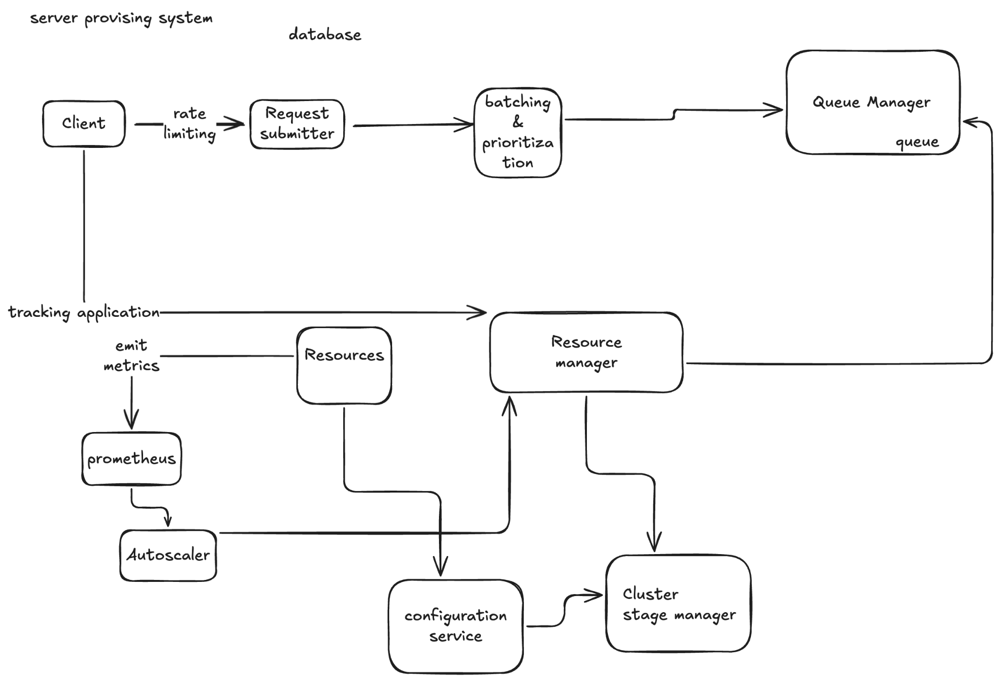
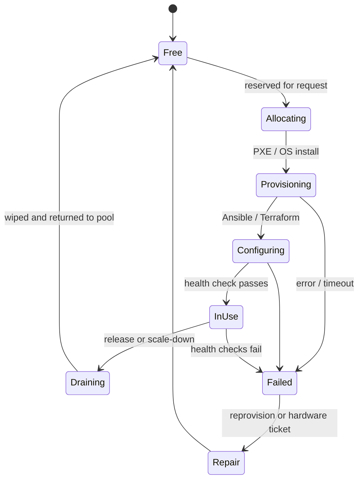

# Server Provisioning System

## Architecture



Flow in the diagram:

1. The **client** submits a request, subject to **rate limiting**, to the **request submitter**.
2. Requests go through **batching & prioritization** into the **queue manager** (queue).
3. The **resource manager** consumes from the queue, allocates resources, and hands state changes to the **cluster state manager**. The **configuration service** configures the allocated resources.
4. The client can **track the application** through the resource manager.
5. Resources **emit metrics** to **Prometheus**, which feeds the **autoscaler**; the autoscaler asks the resource manager to scale up/down.

## Components

### Provisioning manager

- **Responsibility:** orchestrates allocation, release and lifecycle management of physical machines.
- **Implementation:**
    - Interacts with a machine inventory database to identify available resources.
    - Executes OS provisioning using tools like PXE boot, Ansible or Terraform for configuration management.
    - Configures monitoring agents like Prometheus Node Exporter on newly provisioned machines.

### Cluster state management

- **Responsibility:** maintains real-time state of the machines and their workloads.
- **Tool:** etcd is ideal here.
    - It's a distributed key-value store with strong consistency, ideal for storing cluster metadata such as:
        - Machine availability
        - Active workloads
        - Resource utilization metrics

### Auto-scaling

- **Responsibility:** dynamically adjusts the number of allocated physical machines based on demand.
- **Implementation:**
    - Trigger conditions:
        - High CPU, memory or disk utilization.
        - Increased number of incoming requests or jobs.
    - Scaling actions:
        - Horizontal scaling: add/remove machines by provisioning or decommissioning.
        - Keep a predefined buffer of warm-spare machines for quicker scaling.
    - Leverage a metrics pipeline (Prometheus and Alertmanager) for real-time insight.

### Fault-tolerant mechanisms

- **Node failure detection**
    - Health checks with tools like Prometheus or Nagios.
    - Use the consensus protocol in etcd (Raft) to detect and manage node failures.
- **Replication**
    - Duplicate critical state data across etcd nodes to ensure high availability.
- **Reprovisioning**
    - On detecting a node failure:
        - Reallocate its workload to other nodes.
        - Automatically initiate reprovisioning of the failed machine.

## Workflow

1. **Initialization**
    - The provisioning manager queries the inventory database for free machines.
    - It allocates and configures them for the required workloads.
2. **Scaling**
    - Metrics are collected periodically and compared with predefined thresholds.
    - If usage exceeds limits, provision additional machines.
    - If under-utilized, decommission and release machines.
3. **Fault detection and recovery**
    - Health-check failures trigger workload migration.
    - Update etcd records to reflect the failed node.
    - The provisioning manager initiates recovery.

## Key tools and technologies

- **etcd:** distributed, consistent key-value store for cluster state. Integrates well with modern monitoring and orchestration tools.
- **Prometheus:** collects real-time metrics for auto-scaling and fault detection.
- **Ansible/Terraform:** automates machine provisioning and configuration.
- **Kubernetes (optional):** primarily for containers, but can manage physical machines with custom node provisioning logic.
- **Alertmanager:** handles alerts from Prometheus for failures and scaling triggers.

## Added: requirements, API, data model and deep dives

> [!info] Added
> The sections below are not in the original doc.

### Requirements

**Functional**

- Request N machines with a spec (CPU, RAM, disk, region/zone, OS image).
- Release machines; track the lifecycle of a request.
- Auto-scale a pool based on load.
- Detect failures and replace unhealthy machines.

**Non-functional**

- **Correctness:** a machine is never allocated to two requests (no double allocation).
- **Availability** of the control plane, even though provisioning itself may take minutes.
- **Scalable** to thousands of machines and bursts of requests.
- **Auditable:** every allocation and state change is recorded.

### Machine lifecycle



### API

```
POST /v1/requests            { count, spec, region, priority }  -> { requestId }
GET  /v1/requests/{id}       -> { status, machines[] }
DELETE /v1/requests/{id}     -> release machines
GET  /v1/machines?state=free&zone=<>
```

Make `POST` idempotent with a client-supplied idempotency key so retries don't double-allocate.

### Data model

| Table / key | Fields |
|---|---|
| `machines` | `id`, `spec`, `zone`, `rack`, `state`, `owner_request_id`, `version` |
| `requests` | `id`, `spec`, `count`, `priority`, `state`, `created_at` |
| etcd keys | `/machines/{id}/state`, `/leases/{id}`, `/health/{id}` |

### Preventing double allocation

- Use a **compare-and-set** on `machines.version` (or an etcd transaction) when moving `Free -> Allocating`. Only one request wins.
- Give allocations a **lease/TTL** in etcd. If the provisioning manager crashes mid-way, the lease expires and the machine returns to the pool or is reconciled.

### Queueing, batching and prioritization

- Rate limit per client/tenant at the entry (see [Rate Limiter](rate-limiter.md)).
- A priority queue (priority classes with aging so low priority doesn't starve) feeds the resource manager.
- **Batch** small requests for the same spec to amortize PXE/OS-image work and enable bin-packing across racks.

### Placement

- Spread across **racks/zones** for fault tolerance (anti-affinity), or pack for network locality, depending on the request.
- Prefer warm-spare machines (already imaged) to cut provisioning time from minutes to seconds.

### Reconciliation loop

Use a control-loop design (as in Kubernetes controllers): compare **desired state** (requests) with **actual state** (etcd and the inventory), and act to converge. This makes the system self-healing after crashes and missed events, because it never relies on a single event being delivered.

### Failure handling

- **Provisioning step fails:** retry with backoff, then mark the machine `Failed` and pick another.
- **Control-plane crash:** state is in etcd/DB, so a restarted or standby manager resumes via the reconciliation loop (leader election with etcd leases).
- **Flapping node:** require N consecutive failed health checks before declaring it dead, to avoid thrashing.
- **Autoscaler oscillation:** use cooldown periods and hysteresis (different scale-up and scale-down thresholds).

### Trade-offs

- **etcd vs a SQL DB for state:** etcd gives watches and strong consistency for small, hot metadata. Use SQL for inventory history and reporting.
- **Warm spares vs cost:** faster scaling means idle machines that still cost money, so size the buffer from the observed burst pattern.
- **Push vs pull configuration:** pull-based agents (machines fetch config) scale better than the manager pushing to thousands of hosts.
