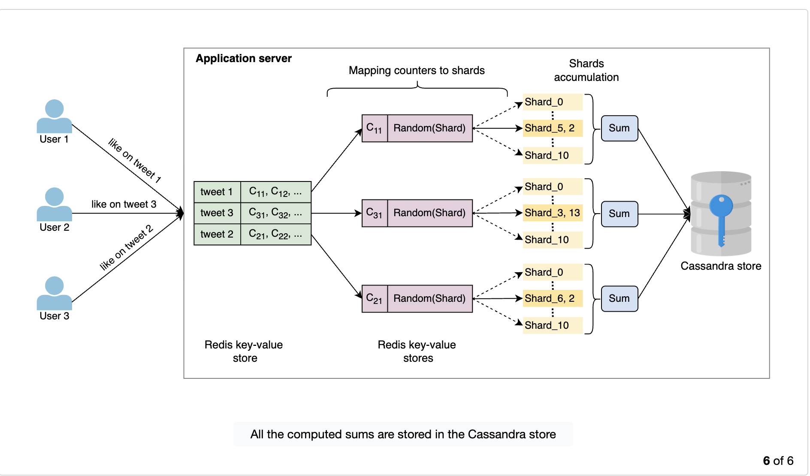

# Sharded Counters

## Problem

Real-time applications like Facebook, Twitter and LinkedIn have a lot of interactions in the form of reactions on posts. A post by a user with millions of followers gets a lot of reactions. Counting likes for a single post is easy, but how do you manage thousands of accounts with lots of followers and lots of posts each?

On average Twitter has 6000 tweets per second, which is 360k tweets per minute and 500 million tweets per day. These tweets account for billions of reactions. How do we handle millions of write requests against thousands of tweets?

Writing takes more time than reading, and there is a concurrency aspect too. As writes increase, lock contention increases linearly, and we may end up mostly taking locks.

**Sharded counters are the answer.**

Assume a single counter per tweet. If one tweet gets millions of likes, the requests must be serialized to avoid race conditions and keep data consistent. That avoids consistency issues at the expense of added delay, which isn't acceptable in real-time applications.

A single counter isn't enough for a large number of requests. We need multiple counters, called **sharded counters**. Each counter has a number of shards, and we reduce contention by balancing requests across the shards.

## Write flow

- A write request is forwarded to a specific tweet counter when a user likes the tweet.
- Based on the shards available for that counter, the write is sent to any one of the shards.

## Read flow

- On a read request, sum up the values of the counters from all shards and return it to the client.
- How to optimize this: see [How to optimize reads?](#how-to-optimize-reads).

## When shards are initialized

Whenever posts/videos are uploaded, their counters and shards are initialized based on parameters like number of followers, popularity, hashtags used, etc.

## API design

**`CreateCounter(counter_id, numberOfShards)`**

Initializes a distributed counter. We need to keep metadata about counter identifiers, their number of shards, the mapping of shards to physical machines, etc.

`counter_id` is the unique ID of the counter. The caller can use a sequencer to get a unique identifier (e.g. the tweet ID for tweets).

**`WriteCounter(counter_id, action_type)`**

`action_type` is increment/decrement. A specific shard of the counter is incremented or decremented.

**`ReadCounter(counter_id)`**

Gets the current value of the counter.

### How to choose the number of shards

This is critical for performance. Too many shards means high overhead on reads (collecting from different shards). Too few shards for an influencer profile causes write contention that slows writes. It's a trade-off between fast writes and fast reads.

- Based on follower count.
- Based on post type, public or protected.

Multiple counters can also be initialized for a single activity. When a post is created, you can initialize like, reply, comment and retweet counters separately, each with its own number of shards.

## Dynamically scaling shards up/down

- After a certain time the number of likes on a post starts to go down, since it's generally a short-span activity. Then we may need to scale down the shards.
- Conversely, a tweet from a not-so-popular user can blow up. Then we need to scale up the shards for that counter.

We need to monitor the write load on all shards to route requests appropriately, possibly using load balancers. This feedback mechanism also helps decide when to close shards for a counter and when to add more.

## Shard selection on the write path

- **Round robin:** usually either overloads or underutilizes resources because scheduling ignores current load. If each request is similar (roughly the same time to serve), it can be used and is attractive for its simplicity.
- **Random:** uniformly and randomly select a shard. The challenge with both round robin and random is variable load on the nodes hosting the shards.
- **Metrics-based:** a dedicated node manages shard selection based on shard health and similar metrics.

## How to optimize reads?

On a read, the system aggregates the values of all shards of the counter to return the total (likes, replies, etc.). Accumulating all shards on each read gives low read throughput and high read latency.

It's virtually impossible to give the exact count anyway, because the counter may change while the value is being returned. So periodically reading the counters of all shards and caching the result serves all use cases.

> [!question] Where might sharded counters with this consistency model not be suitable?
> Where strong consistency is needed, e.g. read-then-write scenarios where you first need the accurate value before deciding to modify it. Such a scenario needs transaction support.

## Sharded counters for top-K problems

Calculate the top K trending topics/hashtags on Twitter based on locality. It's a huge challenge to maintain counts of millions of hashtags and show them by user location. Sharded counters are the solution.

- Twitter creates a counter for each hashtag and decides the shard count according to the followers of the user who used the hashtag. When users use the same hashtag again, the counter created on first use is reused.
- Twitter maintains a separate counter per location, which sum up to the global counter. Metrics we can use:
    - **Region-wise hashtag count:** the number of tweets with the same hashtag within a geographical region. When a region's count crosses a threshold (10000 for Twitter), it becomes a trend. E.g. thousands of tweets with the same tag from New York City suggest users in the NYC area may see it in their trends.
    - **Time window:** the time during which tweets with specific tags are posted.

Top K tweets in a user's home timeline: includes accounts the user follows, tweets the user has liked, and retweets of accounts the user follows. Tweets get priority based on follower count and time. Twitter also shows promoted tweets and some tweets from accounts the user doesn't follow, depending on popularity and location.

## Placement of sharded counters

Where should we keep the counters?

- Same nodes as the application servers.
- Separate nodes.
- On CDN nodes near the end user.

For Twitter, we can compute counts by placing sharded counters near the user, which also helps with heavy hitter and top-K problems.

Reads can store counter values in appropriate data stores and rely on them for read scalability. A Cassandra store can maintain views, likes, comments and other counts per region. These counts are the last computed sum of all shards of a counter.

When users generate a timeline, read requests go to the nearest database servers, and the persisted values are used to respond. This storage also helps show region-wise top-K trends. The list of local top-K trends is sent to the application server, which sorts all the lists into the global top-K trends. Eventually the application server sends all counter details to the cache.

We also need storage for the sharded counters' metadata. Redis or Memcache servers can play a vital role here. For example, each tweet's unique ID is the key and the value is a counter ID or a list of counter IDs (like counter, reply counter, etc.). Each counter ID then has its own key-value store where the counter ID is the key and the value is the list of assigned shards.

## Non-functional requirements

- **Availability:** a single counter for any feature (like, view, reply) is a single point of failure. Sharded counters remove it by running many shards per counter.
- **Scalability:** sharded counters allow high horizontal scaling. Shards on additional nodes are easy to add, which also improves performance.
- **Reliability:** sharded counters reduce massive write load by mapping each write to a particular shard. Each write is handled as it comes, with no request waiting in a queue, so the hit ratio and reliability increase. The system also periodically saves computed counts in stable storage (Cassandra here).
