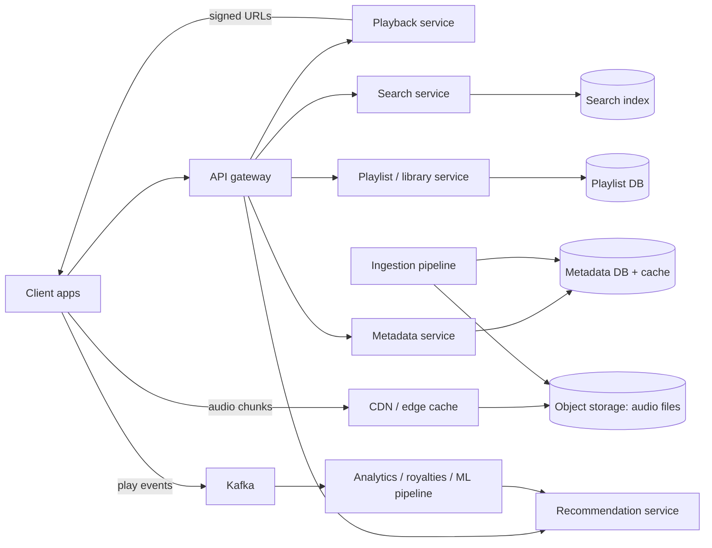
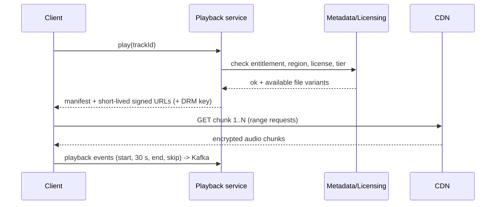
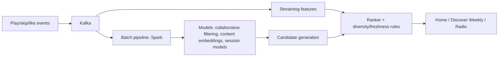

# Spotify

> [!info] Added
> The original doc had only the title for this problem. This note is written from general knowledge of music-streaming system design.

Design a music streaming service: users search for songs, play them with minimal start latency, build playlists, get recommendations and listen offline.

## Requirements

**Functional**

- Stream audio (play, pause, seek, next).
- Search songs, albums, artists, playlists.
- Create/edit playlists; like/follow.
- Personalized recommendations (home page, Discover Weekly, radio).
- Offline downloads (premium).
- Play history, and usage events for royalties and analytics.

**Non-functional**

- **Fast playback start** (< 200-300 ms perceived) and **no stalls**.
- High availability; streaming must survive backend partial failures.
- Scale to hundreds of millions of users, tens of millions of tracks.
- Content protection (DRM) and licensing/region restrictions.

## Estimates (example)

- 500M users, 100M DAU, ~2 hours/day listening => 200M hours/day.
- Bitrate ~160 kbps (~20 KB/s) => 200M x 3600 x 20 KB ~ **~14 PB/day** of egress, so a **CDN** is essential.
- Catalog: 100M tracks x ~5 encodings x ~5 MB avg ~ **2.5 PB** of audio.
- Metadata is tiny (~1 KB/track) => ~100 GB, easily cached.
- Play events: 100M DAU x ~50 plays => ~5B events/day (~60k/s) => stream via Kafka.

## High-level design



## Audio storage and delivery

- **Ingestion pipeline:** labels/artists upload masters -> validate -> transcode into multiple **bitrates/codecs** (e.g. Ogg Vorbis/AAC at 96/160/320 kbps) -> split into **chunks** (a few seconds each) -> store in **object storage** (S3/GCS) -> write metadata.
- **CDN:** audio is immutable and highly cacheable. Popular tracks (head of the long tail) are served from edge caches; cold tracks fall back to origin storage. Pre-warm caches for new releases and playlist-driven spikes.
- **Adaptive bitrate:** the client picks the bitrate based on network conditions and user settings, and can switch between chunks.
- **Prefetching and buffering:** the client buffers the next ~10-30 s and **prefetches the beginning of the next track** so skips and track changes are instant.
- **Peer-assisted delivery** (used by Spotify historically) can offload the CDN, but a CDN-first design is the standard interview answer.
- **Protocols:** progressive/chunked HTTP(S) streaming (HLS or DASH-style chunks, HTTP range requests) are simple and CDN-friendly. WebSockets or gRPC are for control/state, not audio bytes.

## Playback flow



- **Signed, expiring URLs** protect content from hot-linking. **DRM/encryption** protects offline files.
- A play is counted for royalties after ~30 s, so events must be reliable. Send via client SDK with retries and dedupe by an event ID.

## Metadata and data model

| Entity | Store | Notes |
|---|---|---|
| Track, album, artist | Relational/NoSQL + heavy caching | Read-heavy, rarely changes; cache aggressively (Redis/CDN/in-process). |
| Playlist | Wide-column/KV (e.g. Cassandra/DynamoDB) keyed by `playlist_id` | Ordered list of track IDs; supports collaborative editing via versioned operations. |
| User library (liked songs, follows) | KV keyed by `user_id` | Sharded by user. |
| Play history | Append-only (Kafka -> object store + serving store) | For "recently played" and ML. |

```text
track(track_id, title, artist_ids[], album_id, duration_ms, isrc, explicit, available_markets[], files[bitrate,codec,url])
playlist(playlist_id, owner_id, name, version, track_ids[] | playlist_track(playlist_id, position, track_id, added_by, added_at))
```

- Playlists can have millions of followers and collaborators: use **optimistic versioning** (`snapshot_id`) for concurrent edits.
- Availability is region-specific (licensing), so check `available_markets` at playback time.

## Search

- Inverted index over tracks/artists/albums/playlists (see [Distributed Search](distributed-search.md)), with prefix/typeahead support (see [TypeAhead](typeahead-service.md)).
- Ranking combines text relevance with **popularity**, user affinity and recency. Handle typos and multi-language/transliteration.
- Index is fed from the metadata DB via CDC; popularity is refreshed from the play-count pipeline.

## Recommendations



- **Collaborative filtering:** users who listen to similar songs get similar recommendations (matrix factorization / embeddings).
- **Content-based:** audio features (tempo, mood), track metadata, NLP over playlist titles/reviews, useful for **cold start** (new tracks/users).
- **Session-based/sequence models** for "what to play next."
- Pipeline: candidate generation (ANN over embeddings) -> ranking model -> business rules (diversity, freshness, explicit filter).
- Precompute weekly playlists such as Discover Weekly offline and store per user; compute "radio" online.

## Offline mode

- Premium users download tracks (encrypted, bound to the device/account) to local storage.
- The app stores a **license with an expiry** and must go online periodically (e.g. every 30 days) to renew it.
- Sync playlists and library changes when back online (conflict resolution by version/timestamp).
- Download prefers a lower-priority network (Wi-Fi) and resumes on failure (chunk-based).

## Scaling and reliability

- **Stateless services** behind a gateway; shard user-centric data by `user_id`.
- **Multi-region** deployment with the CDN absorbing most traffic. Metadata and playback control are small relative to audio bytes.
- Cache layers: client cache -> CDN -> service cache -> DB.
- **Graceful degradation:** if recommendations or search fail, playback of already-known tracks and the user's library still works. Clients can play from the local cache with the backend down.
- Backpressure and sampling on the events pipeline, but never drop royalty-relevant events (persist to a durable queue first).

## Trade-offs

| Decision | Pro | Con |
|---|---|---|
| Multiple bitrates per track | Adapts to network/plan | More storage and transcoding |
| CDN-first delivery | Low latency, scalable | CDN cost; cold-track cache misses |
| Prefetch next track | Instant skips | Wasted bandwidth when the user skips often |
| Precomputed recommendations | Fast home page | Staleness; storage per user |
| Immutable audio objects | Perfect caching | Updating a master needs a new version/URL |

## Interview tips

- Anchor on **bandwidth math** to justify the CDN, then separate the **control plane** (metadata, playlists, search) from the **data plane** (audio bytes).
- Cover the playback flow (entitlement -> signed URLs -> chunked streaming -> event reporting) and the royalty/analytics pipeline.
- Mention offline licensing/DRM and cold-start handling for recommendations.
