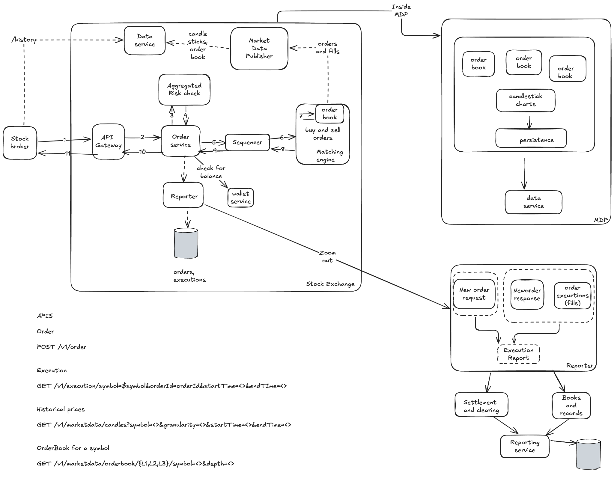
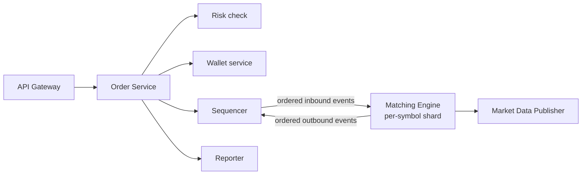

# Stock Exchange

The basic function of a stock exchange is to efficiently match buyers and sellers.

## Requirements

### Understanding the problem

- **Which securities?** Stocks, options or futures? Assume stocks only for now.
- **Which order operations?**
    - Placing a new order: market as well as limit orders.
    - Canceling an order.
- **Scale:** 100 symbols, billions of orders per day.
- **Risk checks?** Yes, simple ones, e.g. only 1000 shares of a certain stock are allowed per user.
- **Wallet management?** Yes, an order should only be placed if the user's wallet has sufficient money.

### Non-functional requirements

- **Availability:** 99.99%.
- **Low latency:** round-trip latency from order placement to a filled execution should be in milliseconds, otherwise the user experience is terrible.
- **Fault tolerance:** fault tolerance and fast recovery are needed to limit the impact of a production incident.
- **Security:**
    - The exchange needs an account management system. For legal and compliance reasons, KYC must verify a user before an account is opened.
    - Protection against DDoS attacks.

### Rough calculation

Assume the market is open 5 hours:

```
1 billion / (5 * 3600) ~= 50k QPS
```

Peak QPS is taken as 5x because there are more users at market open and close: **~250k QPS**.

## High-level design



### Life of an order

1. A client places an order via the broker's website, web or mobile app.
2. The broker sends the order to the exchange.
3. The order reaches the client API gateway, which does basic checks (input validation, rate limiting, authentication, normalization) and forwards it to the order service.
4. The order manager performs risk checks based on rules set by the risk manager.
5. The order service checks that the user's wallet has sufficient balance.
6. The order goes to the matching engine. When a match is found it emits two executions (fills), one for the buy side and one for the sell side. To guarantee **deterministic** matching, both orders and executions are sequenced by the sequencer.
7. The executions are returned to the client.

### Market data flow

1. The matching engine generates a stream of executions as matches are made. The stream goes to the market data publisher (MDP).
2. The MDP builds candlesticks and order books from the stream of orders and executions and sends the market data to the data service.
3. Market data is stored in specialized storage for real-time analytics. Brokers connect to the data service for timely market data and relay it to clients.

### Reporting flow

The reporter collects all the necessary fields (`client_id`, price, quantity, order type, filled_quantity, remaining_quantity, etc.) from orders and executions and stores them in a database.

### Trading flow (matching engine)

The matching engine is the main component here.

- Maps buy and sell orders.
- Maintains the order book for each symbol. An order book is the list of buy and sell orders for a symbol.
- Matches buy and sell orders. A match results in two executions (one per side). The matching function must be accurate.
- Distributes the execution data as a stream to the MDP.

A highly available engine must produce matches in a **deterministic order**: given a sequence of orders as input, replaying that sequence must produce the same sequence of executions.

### Sequencer

The sequencer is the key component that makes the matching engine deterministic. It stamps every order with a sequence id before the matching engine processes it, and stamps every pair of executions completed by the matching engine with sequence ids.

Reasons for using it:

- Timeliness and fairness
- Fast recovery/replay
- Exactly-once guarantee

### Client gateway

Auth, validation, rate limiting, normalization, FIX protocol support.

## APIs

```
# Place an order
POST /v1/order

# Executions
GET /v1/execution?symbol={symbol}&orderId={orderId}&startTime=<>&endTime=<>

# Historical prices
GET /v1/marketdata/candles?symbol=<>&granularity=<>&startTime=<>&endTime=<>

# Order book for a symbol
GET /v1/marketdata/orderbook/{L1,L2,L3}?symbol=<>&depth=<>
```

## Data models

- Order
- Symbol
- Execution
- OrderBook
- CandleStick

```java
class OrderBook {
    Book<Buy> buyBook;
    Book<Sell> sellBook;
    private PriceLevel bestBid;
    private PriceLevel bestOffer;
    private Map<OrderId, Order> orderMap; // for efficient cancellation
}

class Book<Side> {
    private Side side;
    private Map<Price, PriceLevel> limitMap;
}

class PriceLevel {
    private Price limitPrice;
    private long totalVolume;
    private List<Order> orders;
}
```

**CandleStick:** `openPrice`, `closePrice`, `highPrice`, `lowPrice`, `volume`, `timestamp`, `interval`.

## Performance optimizations for the matching engine

- Run everything in memory using an in-memory message bus such as `mmap`.
- Pin every process to one core for low latency.
- Use event sourcing (an immutable log of events) as the recovery mechanism.
- Use preallocated ring buffers to save space wherever possible.
- Run more than one instance of the event store (`mmap`) across geographically distributed replicas, coordinated by Raft for leader selection. All events go to the replicas too, not just the output executions.
- Use a multicast protocol.

## Added: deep dives

> [!info] Added
> The sections below are not in the original doc.

### Order book data structure

The goal is O(1) for the common operations and O(log n) at worst:

| Operation | How |
|---|---|
| Add limit order | Find the `PriceLevel` via `limitMap` (hash) or a sorted structure, append to its FIFO list |
| Cancel order | `orderMap` gives the order, and a doubly linked list per price level gives O(1) removal |
| Best bid/offer | Cached `bestBid`/`bestOffer` pointers, updated when a level empties |
| Match | Walk price levels from the best price, and within a level take orders FIFO (price-time priority) |

Use a doubly linked list per `PriceLevel` (not `List<Order>`) so cancels are O(1). Keep price levels in a sorted structure (e.g. a tree map or a sorted array of active levels) so the next best price is found fast after a level is exhausted.

### Matching rules

- **Price-time priority:** better price first; at the same price, earlier order first (FIFO).
- **Limit order:** matches against the opposite side while prices cross; any remainder rests in the book.
- **Market order:** matches at the best available prices until filled (or the book is exhausted).
- A match produces two fills with the same price and quantity (the resting order's price is used).

### Single-threaded matching per symbol

Matching for one symbol is **single-threaded** to avoid locks and keep determinism. Scale by sharding symbols across matching engine instances (100 symbols map easily to a few cores). The sequencer feeds each engine an ordered stream.



### High availability and recovery

- The primary matching engine and hot standbys all consume the **same sequenced event log**. State is rebuilt by replaying events from the last snapshot.
- Raft (or similar) elects the primary. On failure the standby already has identical state, so failover takes milliseconds.
- Take periodic snapshots of the order book so replay starts from the snapshot, not from the beginning of the day.

### Risk checks and wallet

- Risk and balance checks happen **before** the sequencer, so the hot path in the engine stays pure matching.
- Reserve (hold) funds or shares when an order is accepted, and release them on cancel or partial fill, to prevent overspending across concurrent orders.

### Market data distribution

- Use multicast/UDP for the lowest latency to co-located brokers, and a separate TCP/WebSocket feed for retail.
- Publish L1 (best bid/offer), L2 (aggregated depth) and L3 (order-level) books at different levels of detail.
- Candlesticks are built by the MDP by aggregating fills per interval (1m, 5m, 1d, ...).

### Settlement and clearing

The reporter feeds settlement and clearing and the books and records system. The exchange matches trades, while a clearing house handles the actual transfer of money and securities (typically T+1 or T+2).

### Trade-offs

- **Latency vs durability:** persisting to disk on the hot path adds latency, so use an in-memory event log replicated to peers, with async persistence.
- **Fairness vs throughput:** strict global ordering limits parallelism, so order only within a symbol.
- **Hot symbols:** one symbol can't be split across engines. Handle it with a faster core and a lean code path.
