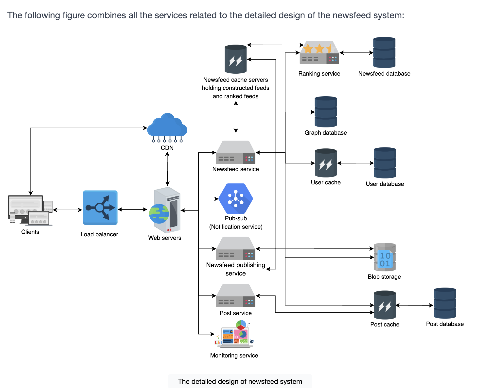
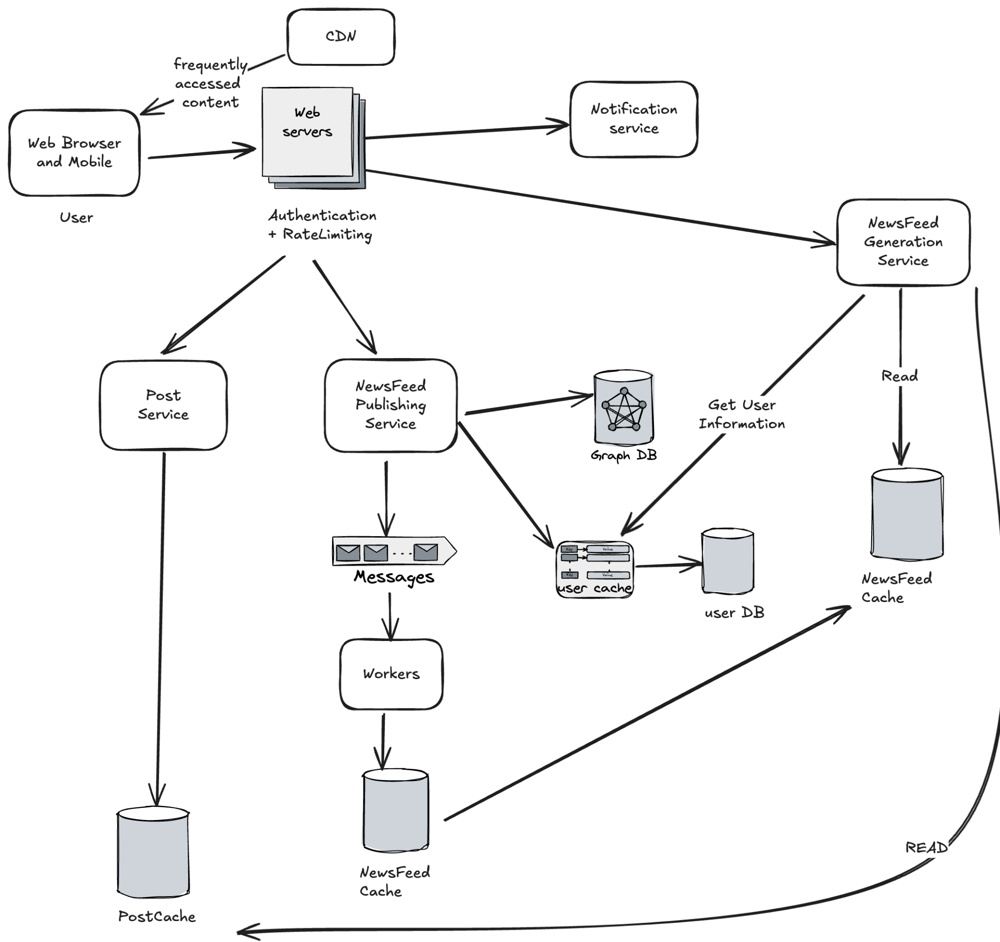
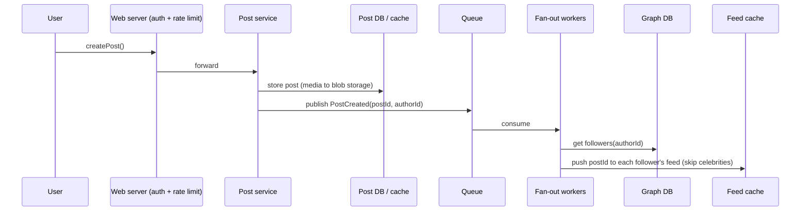
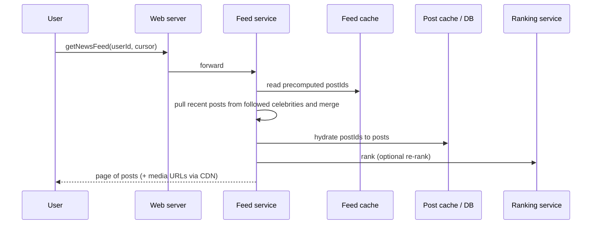

# Twitter / News Feed

> [!info] Added
> Sections marked **(Added)** are supplementary material not in the original notes: tweet posting flow, read path, ranking, cache/storage details, failure handling, and interview tips.

## Requirements

**Functional**

- **News feed generation:** generate a feed for a user from the pages, groups and people they follow. The challenge is the huge amount of content: the system must rank, pick, and decide what to show first.
- **News feed content:** posts may contain images, videos, etc.
- **Real-time feed:** incoming posts are appended to the feed and ranked accordingly.
- (Added) Post a tweet/post; follow/unfollow; like/retweet.

**Non-functional**

- Scalability
- High availability
- Low latency (feed fetch is the hot path)
- (Added) Eventual consistency is acceptable: a post showing up a few seconds late in a follower's feed is fine.

## Back-of-the-envelope calculation

- 500M DAU, each following 200 friends and 100 pages.
- Each user opens the app 10 times per day.
- **Requests:** 500M * 10 / 10^5 (seconds in a day) = **~50k requests per second**.

**Data estimation**

- Total users: 1B.
- User metadata: 1B * 50 KB = **50 TB**.
- Store the top 200 posts per user, each post 1 KB of text.
- Textual data: 200 * 1 KB * 500M = **100 TB**.
- Media store: do the same for images and videos.

> [!tip] (Added)
> Feeds hold post IDs, not full posts, in practice (200 IDs * 8 bytes = ~1.6 KB per user, ~800 GB for 500M users). The 100 TB figure assumes the post body is copied into each feed, which is the worst case. Storing IDs and hydrating from a post cache is the usual optimization.

## API design

- `generateNewsFeed(userId)`: generate the feed from friends and followers, and rank it.
- `getNewsFeed(userId, count)`: get a user's feed.
- (Added) `createPost(userId, content, mediaIds)`
- (Added) `getNewsFeed(userId, count, cursor)`: use a cursor (last seen post ID/score) instead of page numbers, so new posts arriving don't shift pages.

## Storage schema

**Users**

**Entity (Page or Group)**

**Post / FeedItem**

- Id
- userId
- Entity_id
- Creation_time
- Like_count
- Media_id

**Media**

- Media_id
- Description
- Path
- Views_count
- Creation_time

**Relationships:** use a graph database to store them.

- **User:** `User_id`, `Properties: json`
- **Relationship / Edge:** `Edge_id`, `Edge label`, `From_user_id`, `To_user_id`, `Properties: json`

> [!tip] (Added) Storage choices
> - **Posts:** sharded key-value / wide-column store (e.g. Cassandra), partitioned by `post_id` (time-sortable ID such as Snowflake). Writes are heavy; reads are by ID.
> - **Follow graph:** graph DB, or two tables in a sharded store: `following(user_id, followee_id)` and `followers(user_id, follower_id)`. Fan-out needs the followers list; feed pull needs the followees list.
> - **Media:** blob storage + CDN. Only the URL/ID lives in the post.
> - **Feeds:** Redis lists/sorted sets per user (post IDs, bounded to the last N).

## High-level design



- **Users:** make a post with some content, or request their news feed.
- **Load balancer:** redirects traffic to one of the web servers.
- **Web servers:** encapsulate the back-end services and sit between users and the services. Apart from enforcing authentication and rate limiting, they redirect traffic to other back-end services.
- **Notification service:** informs the news feed generation service whenever a new post is available from one's friends or followers, and sends a push notification.
- **News feed generation service:** generates news feeds from the posts of a user's followers/friends and keeps them in the news feed cache.
- **News feed publishing service:** publishes news feeds to a user's timeline from the news feed cache. It also appends a thumbnail of the media content from the blob storage, and its link, to the news feed intended for a user.
- **Post service:** when a user creates a post, the post service stores it in the post database and the corresponding cache. The media content in the post is stored in blob storage.
- **Ranking service:** ranks posts based on the user's likes, the time the user spent on topics, and the influencers they follow. A relevance score is assigned to each post and used to calculate the ranking.



### Post flow (Added)



### Read flow (Added)



## News feed publishing service

### Fan-out on write

The news feed is precomputed at write time. A new post is delivered to the friends' feed caches immediately after it's published.

**Pros**

- Feed generation is real time and can be pushed to friends immediately.
- Fetching the feed is fast, because the feed is precomputed.

**Cons**

- If a user has many friends, fetching the friends and pushing to their feed caches is slow and time-consuming. This is also called the **hotkey problem**.
- For users who rarely log in, precomputing feeds wastes compute.

### Fan-out on read

The news feed is generated at read time. This is an on-demand model: recent posts are pulled when a user loads their home page.

**Pros**

- For inactive users who rarely log in, no compute is wasted.
- Data isn't pushed to friends, so there's no hotkey problem.

**Cons**

- Fetching the feed is slow, as it isn't precomputed.

### Hybrid approach

We adopt a hybrid approach to get the benefits of both and avoid their pitfalls. Since fast feed fetching is crucial, we use a **push model for the majority of users**. For **celebrity users** with many friends/followers, we let followers **pull** the content on demand to avoid system load.

> [!tip] (Added) Making the hybrid concrete
> - **Threshold:** treat an account as a celebrity above ~10k-100k followers (tunable, not fixed).
> - **Write:** for non-celebrity authors, fan out to followers' feed caches. For celebrity authors, only write the post itself.
> - **Read:** take the user's precomputed feed, then fetch recent posts from the celebrities they follow (the `following` list filtered to celebrities), merge by time/score, rank, and return.
> - **Skip inactive users** on fan-out: only push to users active in the last N days. Rebuild their feed on next login (fan-out on read).

| | Fan-out on write | Fan-out on read | Hybrid |
|---|---|---|---|
| Read latency | Low | High | Low |
| Write cost | High for celebrities | Low | Bounded |
| Wasted work (inactive users) | High | None | Low |
| Complexity | Medium | Low | High |

## Ranking (Added)

Per the notes, the ranking service scores each post by relevance. Typical signals:

- **Affinity:** how often the user interacts with the author (likes, replies, profile visits).
- **Post weight:** media type, engagement so far (likes/comments/shares).
- **Time decay:** newer posts score higher.
- **Negative signals:** muted/hidden authors, previously seen posts.

```text
score = affinity * weight * decay(age)
```

Chronological ordering is the fallback and the simplest option. For ML ranking, a light first-pass ranker keeps latency low, with the heavier model applied only to the top few hundred candidates.

## Caching (Added)

- **Feed cache:** per user, a bounded list of post IDs (e.g. latest 200-800). Evict inactive users' feeds.
- **Post cache:** `post_id -> post`, hot posts are read by many followers.
- **User cache:** profile data for rendering.
- **CDN:** images and videos.

## Failure handling and scaling (Added)

- **Fan-out through a queue:** if a worker fails, the message is retried; fan-out must be idempotent (adding the same `post_id` twice to a feed is a no-op).
- **Feed cache loss:** rebuild lazily from the follow graph and recent posts (fan-out on read for that user).
- **Sharding:** feed cache by `user_id`; posts by `post_id`; follow graph by `user_id`.
- **Rate limit** posting and feed refresh at the web-server layer (see [Rate Limiter](rate-limiter.md)).
- **Real-time updates:** push via long polling/WebSocket/SSE, or push notifications through the notification service.

## Interview tips (Added)

- Start with the read/write ratio: feeds are extremely read-heavy, so optimize reads (precompute).
- Always bring up the celebrity problem when you propose fan-out on write.
- Mention eventual consistency and idempotent fan-out.
- Mention a cursor for pagination rather than offsets.
