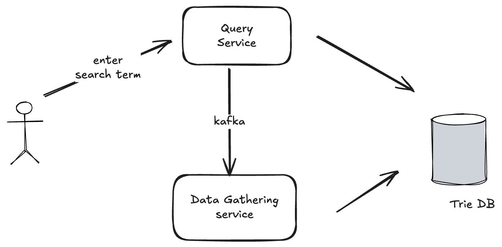
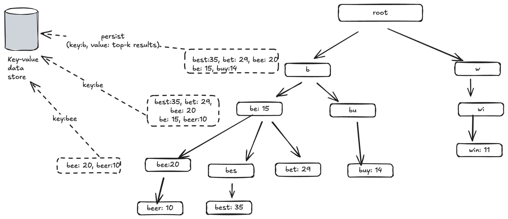
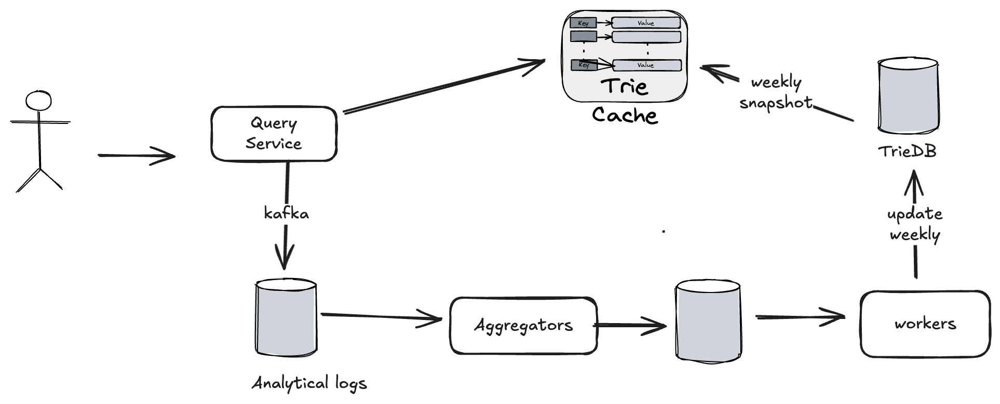

# TypeAhead Service

When searching on Google or shopping on Amazon, as you type in the search box, one or more matches for the search term are presented. This feature is called autocomplete, typeahead, search-as-you-type or incremental search.

The problem: design the **top-K most searched queries** for a typed prefix.

## Clarifying questions

| Question | Answer |
|---|---|
| How many results to return? | 5 |
| Prefix matching only, or substring too? | Prefix matching |
| How often to show results: every character or at a space? | Character level |
| Are queries in English? Need capitalization or other transformation? | Yes, English. No transformation. |
| DAU? | 10M |

## Back-of-the-envelope estimates

- 10M DAU, ~10 searches per user per day, so 100M searches/day.
- 100M / 10^5 seconds per day = **~1000 searches/s**.
- Suggestions are requested at character level and a query is ~20 characters, so ~1000 x 20 = **~20,000 requests/s**.
- Peak QPS = **~40k** (2x average).

> [!info] Added
> Rough storage: if ~10% of the 100M daily queries are new unique strings of ~20 bytes, that's ~200 MB/day of raw new query text. The trie and its cached top-K lists are much bigger than that, which is why we only store a bounded number of suggestions per node (see below).

## Requirements

**Functional**

- Return the top-K results for the string a user types.

**Non-functional**

- Fast response time. The system must respond quickly (a common target is under ~100 ms end to end).
- Availability
- Fault tolerance
- Scalability
- Relevant results for the typed query.
- Results sorted by popularity or another ranking model.

## High-level design

Two services:

- **Query service:** the user enters a search term, and it returns the top-K suggestions from the Trie DB. It also publishes the query to Kafka.
- **Data gathering service:** consumes the Kafka query stream and updates the Trie DB.



## Why not MySQL?

Data model:

| Query | Frequency |
|---|---|
| "Shubham" | 5 |

Query:

```sql
SELECT * FROM table WHERE query LIKE 'prefix%' ORDER BY frequency DESC LIMIT 5;
```

This is inefficient as data grows, because you would have to query each node (sharded data, no prefix locality) and sort on every keystroke.

## Trie data structure

- A tree-like data structure.
- The root represents an empty string.
- Each node stores a character and has up to 26 children, one for each possible character.
- Each node represents a single word or a prefix string.

**Where do we store the frequency?** To support sorting by frequency, frequency info is stored in the node. When a word ends, we store its frequency in that node.

### How autocomplete works on a plain trie

1. Start from the root, traverse the prefix and reach the prefix node: `O(p)`.
2. Traverse the subtree from the prefix node to get all valid children. A child is valid if a word ends there: `O(c)`, where `c` is the total number of children and sub-children of node `p`.
3. Sort the children by frequency and take the top K: `O(c log c)`.

Total complexity: `O(p) + O(c) + O(c log c)`.

This is slow because in the worst case we may traverse the entire trie to get the top results. Two optimizations:

1. **Limit the max prefix length.** With a bounded prefix length, finding the prefix node reduces to `O(1)`.
2. **Cache top queries at each node.**
    - Store the top-K most frequent queries at each node, so we don't traverse the subtree. 5-10 suggestions are enough.
    - This needs a lot of space to store top queries at every node, but trading space for time is worth it because fast response time is critical.



### Why not update the trie in real time?

Storing top-K at each node is not feasible with real-time updates:

1. Users may enter billions of queries per day. Updating the trie on every query would significantly slow down the query service.
2. Top suggestions don't change much, so updating this frequently is unnecessary.

So the trie is rebuilt **offline** (weekly in this design) from aggregated analytics logs.

## Data pipeline

Query service -> Kafka -> analytical logs -> **aggregators** -> aggregated store -> **workers** -> Trie DB (updated weekly) -> **weekly snapshot** loaded into the **trie cache** that the query service reads.



## Trie DB storage choice

1. **Document store**
    - A new trie is built weekly, so we can take a snapshot of it and serialize it into the database. MongoDB and Elasticsearch are good for serialized data.
2. **Key-value store**
    - A trie can be represented as a hash table:
        - every prefix in the trie maps to a key in the hash table,
        - the data on each trie node maps to the value (the top-K list).
    - Example from the diagram: key `b` -> `[best:35, bet:29, bee:20, be:15, buy:14]`, key `be` -> `[best:35, bet:29, bee:20, be:15, beer:10]`, key `bee` -> `[bee:20, beer:10]`.

---

> [!info] Added
> Everything below is supplemental to the original notes.

## API design

```http
GET /v1/suggestions?q=be&limit=5
```

```json
{ "prefix": "be", "suggestions": ["best", "bet", "bee", "be", "beer"] }
```

Keep the response small. Return only strings (and optionally a score) so it fits in a single packet.

## Data model for the key-value form

```text
key:   "be"                                   // prefix (normalized)
value: [("best",35),("bet",29),("bee",20),("be",15),("beer",10)]   // top-K, sorted
```

Lookup is a single `GET prefix`: `O(1)` network round trip, no trie traversal at query time. Memory is `prefixes x K x avg-term-size`, so limit prefix length (e.g. 50) and K (5-10).

## Deep dives

**Low latency on the read path**

- Serve from an in-memory trie cache (Redis or local memory) in front of the Trie DB.
- Browser-side: **debounce** keystrokes (~100-200 ms), cancel in-flight requests, and cache previous responses in the client (typing `be` then `bee` can reuse results).
- Use HTTP caching headers (`Cache-Control: max-age`) for popular prefixes, and a CDN/edge cache for the shortest, hottest prefixes (1-3 chars).
- Serve from the nearest region.

**Sharding the trie**

- Shard by prefix range (e.g. `a-m`, `n-z`) is simple but uneven (many more words start with `s` than `x`).
- Better: a **shard map** that splits by observed prefix traffic, so the load is balanced. Hot first-letter prefixes can be split by their second letter.
- Replicate each shard for availability and read throughput.

**Keeping suggestions fresh**

- Weekly rebuild is simple, but trending queries (breaking news) would lag.
- Combine: the weekly base trie + a small **real-time trending overlay** from a streaming job (e.g. Flink/Kafka Streams over a sliding window) that merges recent hot queries into the results at query time.

**Aggregation**

- The aggregators sum query frequencies per time window (e.g. daily partials, then rolled into weekly).
- Optionally apply **time decay** (recent searches weigh more than old ones), or sample the log if volume is huge.

**Ranking beyond raw frequency**

- Recency/trending, personalization (user history), locale/region, and business rules.
- Filtering: remove offensive, illegal or low-quality suggestions at build time (blocklist) and support quick removal from the cache.

**Trie update/rollout**

- Build the new trie/snapshot on workers, validate (size, sample queries), then **swap atomically** (blue-green: load new cache, flip pointer) so there is no mixed state.
- Keep the previous snapshot for quick rollback.

**Failure handling**

| Failure | Handling |
|---|---|
| Trie cache node down | Replicas; fall back to Trie DB (slower) or return empty suggestions. Search itself must keep working. |
| Trie DB down | Cache continues serving the last snapshot. |
| Kafka/aggregator lag | Only freshness suffers, not serving. |
| Bad snapshot | Roll back to the previous snapshot. |

> [!tip]
> Typeahead is best-effort: when anything is degraded, returning no suggestions is better than blocking the search box.

## Trade-offs

| Choice | Pro | Con |
|---|---|---|
| Top-K cached at each node | O(1) reads | Higher memory |
| Offline weekly rebuild | Cheap, simple, stable | Stale for trends (fix with an overlay) |
| Key-value form of the trie | Very simple, easy to shard/cache | Duplicated data across prefixes |
| Prefix-only matching | Fast, simple | No typo tolerance or substring match |

**Extensions (if asked):** fuzzy matching/typo correction (edit distance, n-gram index), multi-language and Unicode normalization, personalized suggestions, and substring/infix matching with a different index (n-gram or suffix tree, or [distributed search](distributed-search.md)).

## Interview tips

- Start with the clarifying questions and the 20k-QPS-at-character-level insight. It shows why caching and low latency matter.
- Explain **why** a plain trie is too slow and how storing top-K per node fixes it, then how it is updated offline.
- Mention sharding by prefix with a balanced shard map, client-side debounce, and the weekly snapshot swap.
