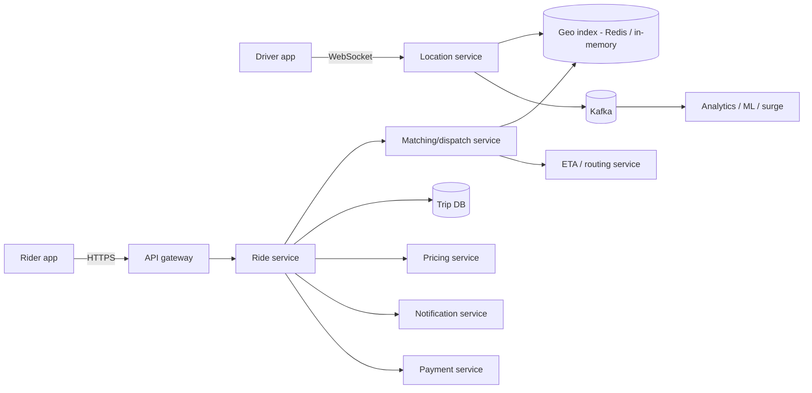
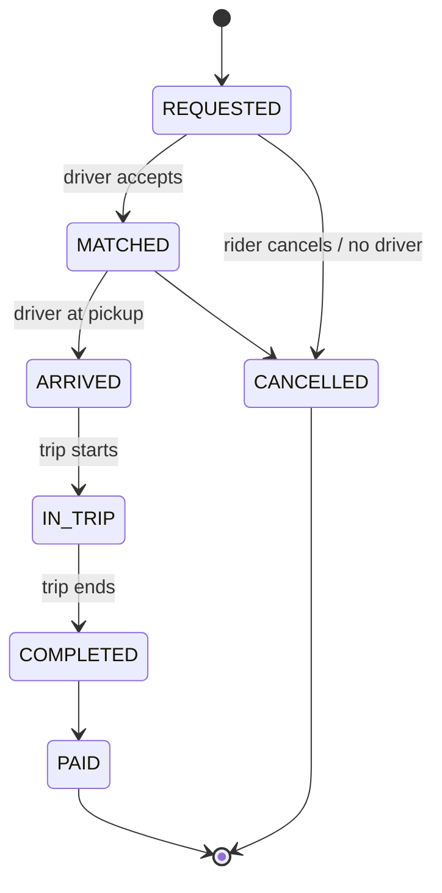

# Uber (Ride Hailing)

> [!info] Added
> The source doc only had the title "Design Uber". This note is written from scratch. Related: the Proximity Service problem for geo-indexing background.

## Requirements

**Functional**

- Rider requests a ride from a pickup to a destination and sees a fare estimate and ETA.
- System matches the rider with a nearby available driver.
- Driver accepts/declines; both see live location during the trip.
- Trip lifecycle: request, match, pickup, in-trip, complete, payment, rating.

**Non-functional**

- Low-latency matching (a few seconds).
- High availability; a ride request should rarely fail.
- Scalable location ingestion (write-heavy).
- Consistency where it matters: a driver must never be assigned two trips at once.

### Estimates (example)

- 100M riders, 5M drivers, 20M trips/day: about 230 trips/s average, about 1K/s at peak.
- 2M online drivers sending a location update every 4 s = **500K writes/s**. This dominates the design; location data is ephemeral and doesn't need durable storage per update.

## API design

```text
POST /v1/rides/estimate   {pickup, dropoff}                 -> {fare_range, eta}
POST /v1/rides            {pickup, dropoff, product}        -> {ride_id}
GET  /v1/rides/{ride_id}                                    -> {status, driver, location}
POST /v1/drivers/location {lat, lng, heading, status}       (every ~4 s, or over WebSocket)
POST /v1/rides/{ride_id}/accept | decline | start | end     (driver)
```

## High-level design



Services:

- **Location service:** ingests driver GPS updates, keeps latest position in the geo index, and publishes to Kafka for analytics.
- **Matching (dispatch) service:** finds and ranks candidate drivers.
- **Ride/trip service:** owns the trip state machine and the trip DB.
- **ETA/routing service:** map graph + live traffic.
- **Pricing service:** fare estimate and surge multiplier.
- **Payment service:** see [Payment System](payment-system.md).

## Location tracking and geo-indexing

Latest location per driver only; the history goes to a stream/data lake, not the hot path.

- **Geohash / S2 / H3 cells:** divide the map into cells; each cell holds the set of online drivers in it. Finding nearby drivers = look up the rider's cell plus its neighbors, then filter by exact distance.
- **Storage:** an in-memory store (Redis `GEOADD`/`GEOSEARCH`, or sharded in-memory index by cell). A driver moving across cells is removed from the old cell and added to the new one.
- **Sharding:** shard by cell/region so a city's load is spread out. Hot cities (dense downtown) need finer cells.
- **TTL:** drop drivers that haven't sent an update in N seconds (treated as offline).
- **Why not a quadtree in a DB?** Updates at 500K/s are too high for disk-based indexes; keep it in memory and rebuild from live traffic on restart.

## Matching / dispatch

1. Rider requests a ride; the ride service creates a trip in `REQUESTED`.
2. Matching queries nearby available drivers (expanding radius if none).
3. Rank candidates by **ETA to pickup** (road distance, not straight line), driver rating, vehicle type, and acceptance rate.
4. Offer the ride to the top driver with a timeout (e.g. 10-15 s). If declined/timeout, offer to the next one. Alternatively, batch requests over a short window and solve a global assignment to minimize total wait time.
5. Driver accepts, trip moves to `MATCHED`.

**Avoiding double assignment:** take a short-lived lock (or CAS on driver status `AVAILABLE → OFFERED`) when offering. Only one offer per driver at a time. The driver status transition is the single point of consistency.

## ETA and routing

- Road network as a graph with edge weights from live and historical traffic; use Dijkstra/A* with contraction hierarchies for speed.
- Precompute ETAs for common segments; use ML to correct for traffic, time of day and weather.
- ETA is used in matching, in the rider UI, and in pricing.

## Pricing and surge

- **Fare = base + per_km x distance + per_min x time**, then multiplied by a **surge multiplier**.
- **Surge:** per cell, compare demand (open requests) vs supply (available drivers) over a sliding window, and set the multiplier from that ratio. Smooth over time to avoid flapping.
- Show the upfront price to the rider and lock it for a short time.

## Trip state machine



Persist each transition in the trip DB (a relational or strongly consistent store, sharded by `trip_id` or city). Emit an event per transition for notifications, payments and analytics.

## Live tracking during the trip

- Driver app streams location over WebSocket; the rider app subscribes to updates for its trip (via a pub/sub channel keyed by `trip_id`).
- Map matching smooths noisy GPS points onto roads.
- Store the trip's route for the receipt and disputes.

## Failure handling

- **Location service down:** drivers keep sending; matching uses slightly stale positions. Stateless services scale out behind LBs.
- **Dispatch node crash mid-offer:** the offer has a TTL; the trip stays `REQUESTED`, and another node retries.
- **Driver app disconnects:** missed heartbeats set the driver offline; an in-flight trip continues and reconnects.
- **Region failover:** replicate trip DB across zones; the geo index is rebuilt from the next round of location updates.

## Trade-offs

- Straight-line vs road-distance ranking: cheaper to compute vs more accurate matching.
- Greedy per-request matching (fast) vs batched global matching (better overall wait times).
- Strong consistency for the trip/driver status vs eventual consistency for location.

> [!tip] Interview tips
> Start with the numbers (500K location writes/s) to justify an in-memory geo index. Then the matching race condition (double assignment), then ETA/surge. Keep payments as a brief hand-off to the [payment system](payment-system.md).
