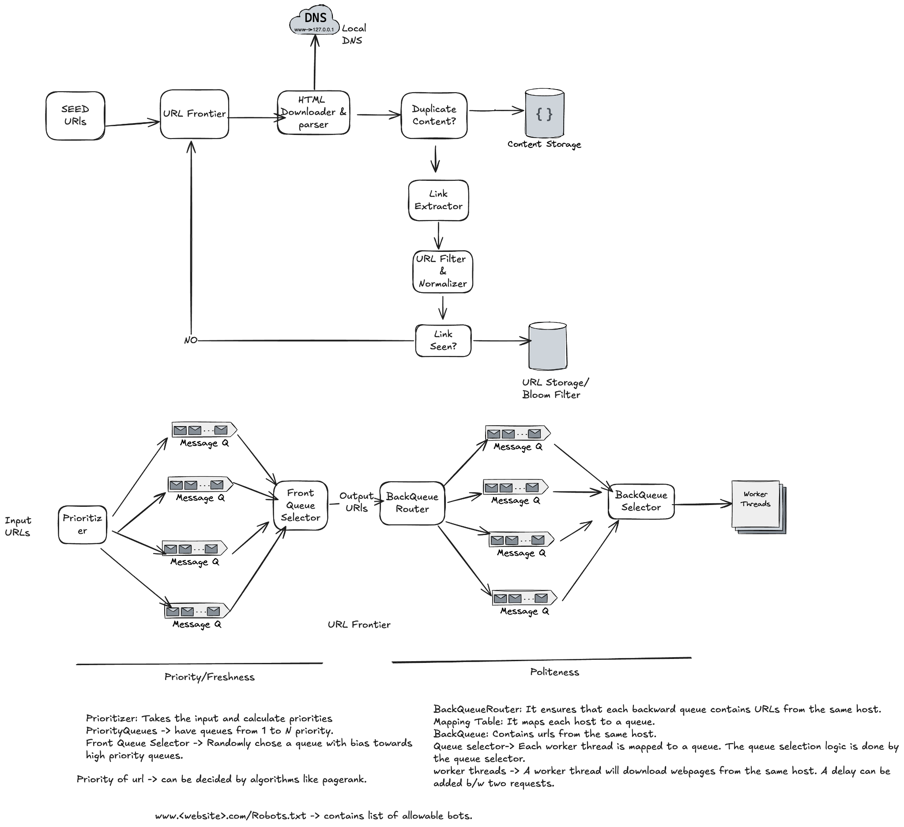

# Web Crawler

## Use cases

- Search engine indexing
- Web mining
- Web monitoring
- Web archiving

## What does it do?

- Given a set of URLs, download all the web pages addressed by the URLs.
- Extract all the URLs from these web pages.
- Add the new URLs to the list of URLs to be downloaded, and repeat.

## Questions to ask

- What's the main purpose of this crawler? Search indexing?
- How many pages does the crawler collect per month? (~1B)
- Do we need to store the crawled HTML pages, and for how long? (5 years)
- What content types are included? HTML only, or PDFs and images as well?
- Do we need to handle web pages with duplicate content?
- Should we consider newly added or edited pages and index them frequently?

## Characteristics of a good web crawler

- **Scalability:** crawling should be parallelized, as there are many pages out there. More than one server should be able to do it.
- **Robustness:** handle malicious content, bad HTML, unresponsive servers, crashes, etc.
- **Politeness:** don't send too many requests to a website in a short interval.
- **Freshness:** if a page is edited frequently or newly added, the crawler should identify it and index it frequently.
- **Easy extensibility:** easy to support content types other than HTML and other use cases.

## HLD components

- **Seed URLs:** the initial set of URLs.
- **URL Frontier**
    - Ensures politeness, URL prioritization and freshness.
    - Implemented using front queues and back queues. Front queues ensure prioritization, back queues ensure politeness. Freshness is guaranteed as part of URL prioritization.
- **Content downloader & DNS resolver**
- **Content parser**
- **Duplicate content identification**
    - ~30% of web pages are duplicate content.
    - Use an algorithm like SimHash.
- **Content storage**
- **Link extractor from web page**
- **URL filter**
    - For content types.
    - For malicious content.
- **URL deduplication**
    - If a URL has been seen already, discard it.
    - Use a Bloom filter.

## Common question: DFS vs BFS

DFS is not a good choice, since the depth can be very deep.

Problems with BFS:

- It's impolite: if all links on a page belong to the same host, it can flood that server with requests, breaking politeness.
- It doesn't take URL priority into consideration.

Hence we use a URL Frontier, which supports all of it.

## Performance optimizations

- Distributed crawl across servers.
- Local DNS resolver, since the DNS resolver thread is synchronous.
- Locality: crawl data near the servers for faster response times.
- Short timeout, in case a page isn't responding.
- Use consistent hashing to add/remove servers.

## Detect and avoid problematic content

- Redundant content.
- **Spider traps** (`www.ex.com/foo/bar/foo/bar/foo/bar...`)
    - Can cause an infinite loop.
    - Can be avoided by setting a maximum URL length, but one solution doesn't fit all. They're easy to identify due to the high number of pages on these sites, and can be excluded manually.
- Data noise
    - Some content has little value, so remove it: advertisements, code snippets, spam URLs, etc.

## Server-side rendering

Many websites use scripts such as JavaScript or AJAX to generate links on the fly. If we download and parse pages directly, we can't retrieve dynamically generated links. To solve this, perform server-side rendering first, before parsing a page.
