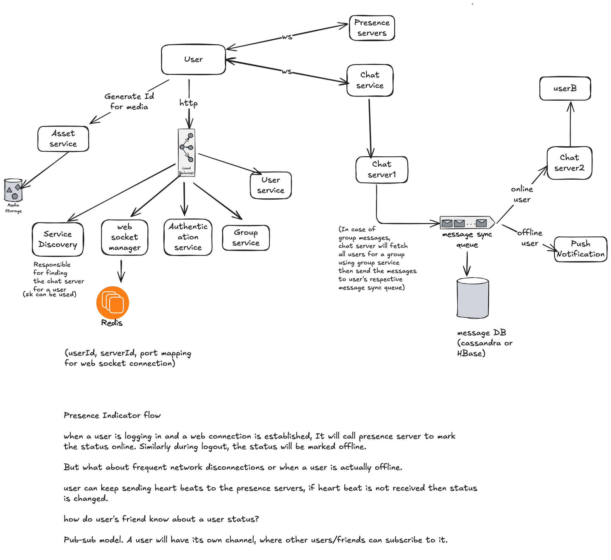
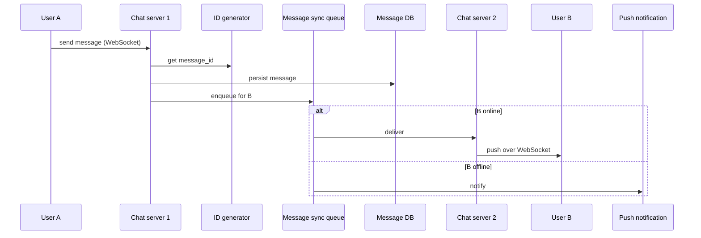

# WhatsApp (Chat System)

## Requirements

Scope questions and answers:

| Question | Answer |
|---|---|
| 1-1 or group chat? | Both |
| Mobile or web? | Both |
| Max users in a group? | 500 |
| DAU? | 50M |
| Important features? | 1-1 chat, group chat, online presence indicator |
| Media support? | Yes |

**Functional**

- 1-1 chat with low delivery latency
- Small group chat, max 500 people
- Online presence
- Multi-device support
- Push notifications

> [!info] Added
> **Non-functional:** low latency delivery, no message loss (durability), ordering within a conversation, high availability, horizontal scalability. Messages are delivered at-least-once, and the client dedupes by `message_id`.

### Back-of-envelope estimates

> [!info] Added
> Assumptions: 50M DAU, 40 messages/user/day.
>
> - Messages/day = 50M x 40 = 2B, so about 23K msg/s average and about 50-70K msg/s at peak.
> - Storage at ~100 bytes/message = 200 GB/day, or about 73 TB/year (text only; media is stored separately in object storage).
> - Concurrent connections: if ~10-20% of DAU is online at once, that's 5-10M WebSocket connections. At ~50K connections per chat server that's about 100-200 servers.

## Communication protocol

Flow: sender client → chat server → receiver client.

When a client starts a chat it connects to the chat server using a communication protocol. HTTP is popular and fine for client → server, but it isn't a good fit for server → client pushes. The options:

- **Polling:** the client periodically asks the server for new messages. Costly, and wastes a lot of server resources.
- **Long polling:** the client holds a connection until there is a new message or a timeout expires. Problems:
    - Sender and receiver may not connect to the same chat server, since HTTP servers are usually stateless and sit behind a load balancer.
    - The server has no way to know the client has disconnected.
    - Still efficient if a user doesn't chat much.
- **WebSockets:** initiated by the client. Bi-directional and persistent. It starts life as an HTTP connection and is upgraded to a WebSocket connection. **This is the choice for chat.**

## High-level design

**Stateless HTTP services** (behind a load balancer): User service, Authentication service, Group service, Service discovery, WebSocket manager, Asset service.

**Stateful WebSocket services:** Chat service (chat servers) and Presence servers.

- **Service discovery:** finds the chat server for a user (ZooKeeper can be used).
- **WebSocket manager:** keeps the `(userId, serverId, port)` mapping for each WebSocket connection, in Redis.
- **Asset service:** generates IDs/URLs for media, which is stored in media storage (object store).
- **Message sync queue:** each chat server puts the message on the receiver's sync queue. If the user is online, the message is forwarded via the user's chat server (chat server 2 → userB). If the user is offline, a push notification is sent.
- **Message DB:** Cassandra or HBase.
- **Group messages:** the chat server fetches all users of the group through the group service, then sends the message to each user's message sync queue.

### Message flow (1-1)

> [!info] Added
> **Delivery receipts:** the client acks each message (sent → delivered → read). The server keeps per-message status and relays it back to the sender. If B comes online later, B's client pulls all messages with `message_id > last_seen_id` from its sync queue/DB.

### Presence indicator flow

- When a user logs in and a WebSocket connection is established, the client calls the presence server to mark the user **online**. On logout the status is marked **offline**.
- Frequent network disconnections, or a user who is actually offline: the client keeps sending **heartbeats** to the presence servers. If a heartbeat isn't received within a timeout, the status changes to offline.
- How do a user's friends learn the status? **Pub-sub model.** Each user has their own channel and friends subscribe to it.

> [!info] Added
> For large friend lists or groups, fan-out of presence changes is expensive. Only push presence for the currently open chat/visible contacts, and fetch the rest lazily.

## Data model

**Message**

| Field | Notes |
|---|---|
| `message_id` | |
| `message_from` | |
| `message_to` | |
| `content` | |
| `created_at` | |

**GroupMessage**

| Field | Notes |
|---|---|
| `channel_id` | |
| `message_id` | |
| `from_user` | |
| `content` | |
| `created_at` | |

### Message ID generation

- IDs must be unique.
- IDs should be sortable by time: new rows have higher IDs than old ones.

SQL gives this with auto-increment, but NoSQL doesn't have it. Options: the Twitter **Snowflake** method, or, looking deeper, we need a **local** sequence number generator, not a global one. Local sequence numbers mean IDs are unique **within a group (or a 1-1 conversation)**, which is sufficient.

## Storage choice

- **User profile, settings, friend list:** MySQL is preferred, with geographically distributed replicas and a cache.
- **Messages:** data is enormous and needs low latency. Look at the read patterns:
    - Recent chats are accessed frequently.
    - Random access is also used for search, viewing mentions, etc.

A **key-value store** fits, for these reasons:

- Easy horizontal scaling.
- Low latency.
- Relational databases don't handle a long tail of data well: when indexes grow, random access is expensive.
- Adopted by other proven chat apps: Facebook uses HBase, Discord uses Cassandra.

> [!info] Added
> **Key design:** partition key = `conversation_id` (or `channel_id`), clustering key = `message_id` descending. This keeps a conversation on one partition and makes "latest N messages" a cheap range read.

## Deep dives

> [!info] Added
> - **Multi-device:** each device has its own WebSocket connection and a `cur_max_message_id`. The server tracks the last synced ID per device and syncs each device independently, so all devices converge.
> - **Media:** the client uploads the file to object storage via the asset service (pre-signed URL), and the message carries only the media URL and metadata. Use a CDN for delivery and generate thumbnails async.
> - **End-to-end encryption:** keys live on devices (Signal protocol); servers only relay ciphertext. This means server-side search and spam checks on content aren't possible.
> - **Large groups:** the fan-out is bounded (max 500). Write-fan-out per member's sync queue is acceptable; for much larger groups switch to read-fan-out.
> - **Chat server failure:** the client reconnects via the load balancer, service discovery assigns a new server, and the client pulls missed messages by last-seen ID. Messages are already durable in the DB/queue.
> - **Ordering:** order by `message_id` within a conversation; the client shows its own optimistic messages and reconciles on ack.

## Trade-offs

- WebSockets give low latency but make chat servers **stateful**; this needs service discovery + connection registry and careful rolling deploys (drain connections).
- Key-value store gives scale but no joins/secondary indexes; build search separately (e.g. per-user index).
- At-least-once delivery + client dedupe is simpler and more robust than trying for exactly-once.
