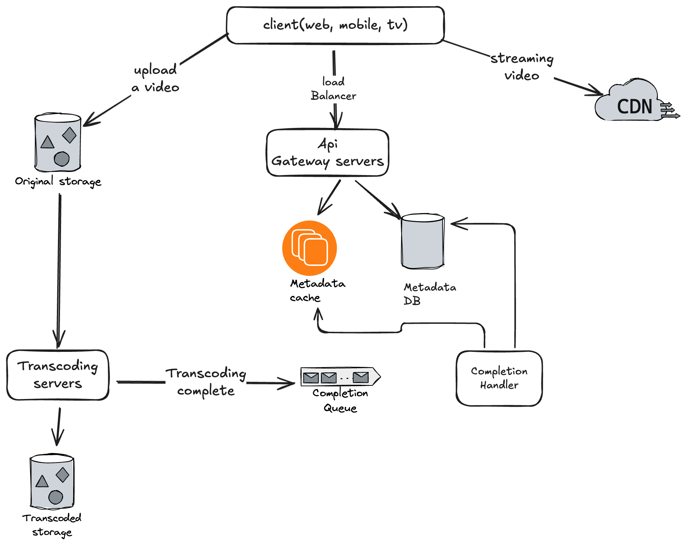
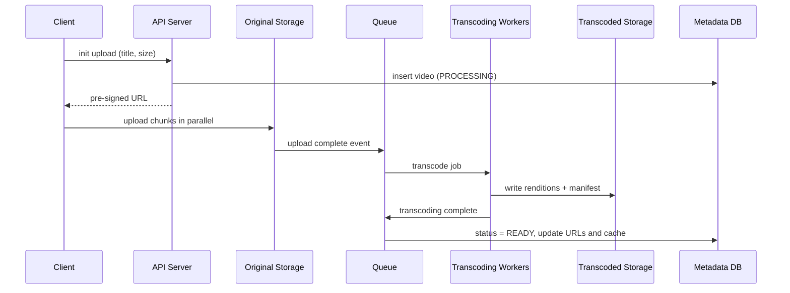

# YouTube

## Understanding the problem

- **Important features:** watch a video, upload a video, search videos.
- **Clients:** mobile apps, web browsers and smart TVs.
- **Scale:** 5M DAU, 30 minutes average daily time spent.
- **International users:** yes, a large percentage.

## Requirements

**Functional**

- Stream videos
- Upload videos
- Search videos by title
- Like and dislike videos
- Add comments to videos
- Add thumbnails

**Non-functional**

- High availability
- Scalability
- Good performance
- Reliability and durability of the content

## Back-of-the-envelope calculation

- 5M DAU. Assume 10% of users upload 1 video per day. Average video size is 300 MB. A user watches 5 videos per day.
- Daily storage: `5M * 0.1 * 300 MB` = **150 TB per day** (uncompressed).
- **CDN cost:** the cloud CDN charges for data transferred out. Assume 100% of traffic is served from the CDN:
    - `5M * 5 videos * 0.3 GB * $0.02/GB` = **$150,000 per day**. That's huge.

## High-level design

- **Client:** you can watch YouTube on a computer, mobile phone or smart TV.
- **CDN:** videos are stored in and cached by the CDN. When you press play, the video streams from the CDN.
- **API servers:** everything except video streaming goes through API servers: feed recommendation, generating the video upload signed URL, updating the metadata database and cache, user signup, etc.
- **Metadata DB:** video metadata is stored here. It's sharded and replicated to meet performance and high-availability requirements.
- **Original store:** stores the original videos.
- **Transcoding servers:** video transcoding (also called video encoding) converts a video into other formats (MPEG, HLS, etc.) that provide the best stream for different devices and bandwidth.
- **Transcoded storage:** blob storage that holds the transcoded video files.

### Video upload flow

Divided into two parts:

1. Upload the actual video.
2. Update the video metadata (video URL, size, resolution, format, user info, etc.).

### Video streaming flow

When you watch a video it usually starts streaming immediately; you don't wait for the whole video to download. *Downloading* copies the whole video to your device, while *streaming* means your device continuously receives video streams from a remote source. The client loads a little data at a time.

Streaming protocols are a standardized way to control data transfer for video streaming. Popular ones:

- **MPEG-DASH:** "Dynamic Adaptive Streaming over HTTP" (MPEG is the Moving Picture Experts Group).
- **Apple HLS:** HTTP Live Streaming.
- **Microsoft Smooth Streaming**
- **Adobe HTTP Dynamic Streaming (HDS)**

Different streaming protocols support different video encodings and playback players, so when designing a video streaming service, choose the protocol according to your requirements.

## System optimizations

- **Speed:** parallelize video uploading.
- **Speed:** place upload centers close to users.
- **Speed:** parallelism everywhere.
- **Safety:** pre-signed upload URL.
- **Safety:** protect your videos.

### Cost-saving optimizations

- Serve only the most popular videos from the CDN; serve other videos from high-capacity storage video servers.
- For less popular content, encode videos on demand.
- Some videos are popular only in a region, so there's no need to distribute them geographically.
- Build your own CDN.

## Added: deep dives

> [!info] Added
> The sections below are not in the original doc.

### Upload in detail

1. The client asks the API server for an **upload session** and receives a pre-signed URL (so the video bytes go straight to object storage, not through API servers).
2. The client uploads in **chunks** (e.g. 5-10 MB) in parallel and can resume after a failure. Chunks are assembled into the original file.
3. A "video uploaded" event goes onto a queue and kicks off the transcoding pipeline.
4. The metadata row is created with status `PROCESSING` and flips to `READY` when the completion handler is notified.

### Transcoding pipeline (DAG)

Transcoding is a DAG of tasks run by a scheduler and resource manager, not one monolithic job:

- Split the video into GOP-aligned segments, then encode segments **in parallel** on workers.
- Per segment: video encode (multiple resolutions/bitrates such as 240p to 4K), audio encode, thumbnail extraction, watermarking.
- Merge into a manifest (`.mpd` for DASH or `.m3u8` for HLS) that points to the segments.
- Use a task queue with priorities (e.g. premium creators first) and retries. Failed segments are re-run independently.

### Adaptive bitrate streaming

The client downloads small segments (2-10 s) and picks the next segment's bitrate from its measured bandwidth and buffer, switching quality seamlessly. This is why transcoding produces multiple renditions.

### Metadata and search

- **Metadata DB:** shard by `video_id`. Keep a cache (Redis) for hot videos. Counters (views, likes) should use [sharded counters](sharded-counters.md) or async aggregation.
- **Search by title:** index titles/descriptions/tags in Elasticsearch/OpenSearch. See [Ecommerce search](ecommerce-search.md) for the generic indexing and ranking approach.
- **Comments:** a separate service and store (e.g. Cassandra keyed by `video_id`, ordered by time).

### CDN strategy

- Long-tail content is requested rarely, so cache popular videos at edge nodes and fall back to regional/origin storage for the rest (see cost-saving optimizations above).
- Pre-warm the CDN for videos expected to go viral (new uploads from big channels).

### Failure handling

- Upload is resumable at chunk level.
- Transcoding workers are idempotent, so retrying a segment is safe.
- Metadata DB: replicated, with a failover replica. The video stays playable from the CDN even if the metadata DB is briefly down, since the manifest is already cached.
- Dead-letter queue for jobs that keep failing, plus alerts.

### Trade-offs

| Decision | Trade-off |
|---|---|
| Transcode everything upfront | Fast playback and consistent quality, but high compute/storage cost |
| Transcode on demand for the long tail | Cheaper, but the first viewer waits |
| Everything on CDN | Lowest latency, highest egress cost |
| Own CDN / ISP caches | Lower cost at scale, high operational investment |

### Interview tips

- Separate the **control plane** (API servers, metadata) from the **data plane** (blob storage, CDN) early.
- Mention pre-signed URLs, chunked resumable upload, DAG-based transcoding, ABR streaming and the CDN cost estimate. These are the usual discussion points.

## Interview questions

